# Page: Overview

# Overview

<details>
<summary>Relevant source files</summary>

The following files were used as context for generating this wiki page:

- [.dockerignore](.dockerignore)
- [.gitignore](.gitignore)
- [CHANGELOG.md](CHANGELOG.md)
- [Dockerfile](Dockerfile)
- [README.md](README.md)
- [docker-compose.yml](docker-compose.yml)
- [docker/README.md](docker/README.md)
- [instance/config.js](instance/config.js)
- [instance/package.json](instance/package.json)
- [package-lock.json](package-lock.json)
- [package.json](package.json)
- [plugins/README.md](plugins/README.md)
- [plugins/atak/.gitignore](plugins/atak/.gitignore)
- [plugins/atak/README.md](plugins/atak/README.md)
- [service/npm-shrinkwrap.json](service/npm-shrinkwrap.json)
- [service/package.json](service/package.json)
- [web-app/package-lock.json](web-app/package-lock.json)
- [web-app/package.json](web-app/package.json)
- [web-app/projects/core-lib/angular-cli/README.md](web-app/projects/core-lib/angular-cli/README.md)
- [web-app/projects/core-lib/angular-cli/builders/schema.json](web-app/projects/core-lib/angular-cli/builders/schema.json)
- [web-app/projects/core-lib/angular-cli/collection.json](web-app/projects/core-lib/angular-cli/collection.json)
- [web-app/projects/core-lib/package.json](web-app/projects/core-lib/package.json)

</details>


The [Mage](https://ngageoint.github.io/MAGE) platform provides mobile situational awareness and data collection capabilities [README.md:3-4](). This wiki page serves as a parent overview of the `mage-server` monorepo, detailing its architecture, technology stack, and high-level component layout. 

For setup and development workflows, see [Getting Started and Local Development](#1.1). For details on package dependencies and release versioning, see [Monorepo Structure and Versioning](#1.2).

## Purpose and Architecture

MAGE is structured as a modular monorepo containing a Node.js/Express backend REST service, an Angular client web application, a shared UI library, and extensible server/web plugins. The system enables users to submit and view geospatial observations, manage events and teams, and run administrative tasks [README.md:4-7]().

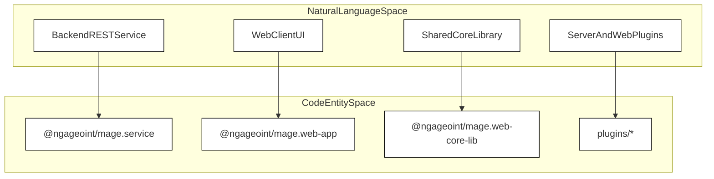
*Diagram 1: Mapping Natural Language components to monorepo code packages.*

Sources: [README.md:3-58](), [service/package.json:2-4]()

## Technology Stack

MAGE is built on the standard **MEAN stack**, leveraging TypeScript for robust backend typing and modern Angular features for the frontend interface [README.md:16-25]().

| Stack Layer | Technology | Code / Package Reference | Role |
| :--- | :--- | :--- | :--- |
| **Database** | MongoDB / Mongoose | `mongoose: "8.24.1"` [service/package.json:64]() | NoSQL JSON document persistence |
| **Backend** | Node.js / Express.js | `express: "4.22.3"` [service/package.json:51]() | REST API routing and middleware |
| **Frontend** | Angular / TypeScript | `@angular/core: "20.3.33"` [web-app/package.json:60]() | Web client SPA and Admin console |
| **Binary Runner** | Commander | `commander: "12.0.0"` [service/package.json:50]() | CLI option parsing (`mage.service`) |

Sources: [README.md:14-25](), [service/package.json:50-64](), [web-app/package.json:60]()

## Monorepo Layout and Component Integration

The project organizes its codebase into distinct top-level packages that assemble together via a deployment instance [README.md:27-58]().

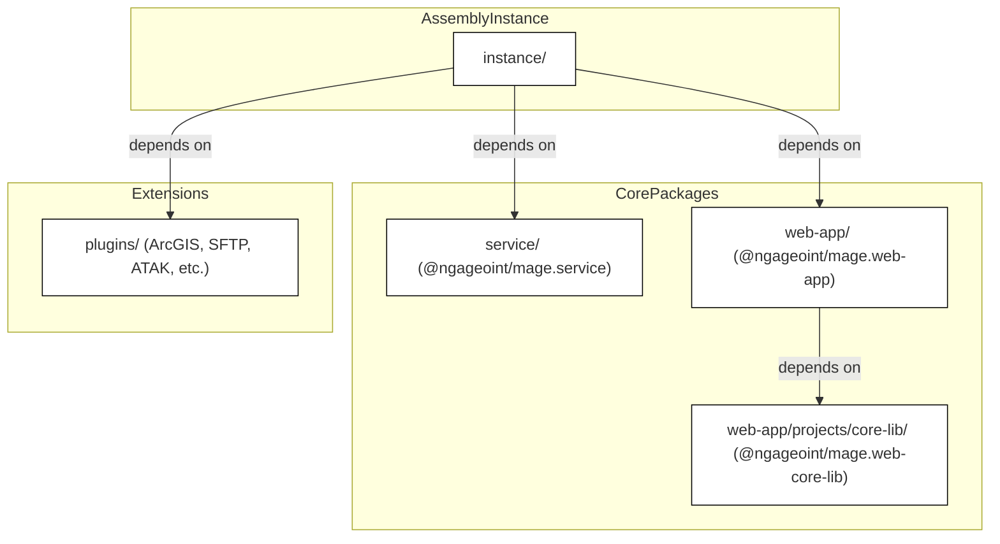
*Diagram 2: Component assembly relationships in the MAGE monorepo.*

- **`service/`**: Contains the `@ngageoint/mage.service` backend REST API package, database models, and migration handlers [README.md:32-35](), [service/package.json:2-4]().
- **`web-app/`**: Contains the `@ngageoint/mage.web-app` client single-page application and administration shell [README.md:37-40](), [web-app/package.json:3-5]().
- **`core-lib/`**: Contains `@ngageoint/mage.web-core-lib`, an Angular library providing shared components for both the web app and web plugins [README.md:42-46](), [web-app/projects/core-lib/package.json:2-3]().
- **`instance/`**: Provides a runnable reference configuration (`config.js`) and environment assembly script (`bin/mage.service.js`) [README.md:48-52](), [instance/package.json:6-7]().
- **`plugins/`**: Houses optional capability packages such as ArcGIS integration, SFTP ingestion, ClamAV scanning, and maritime safety feeds [README.md:54-58](), [docker-compose.yml:35-49]().

Sources: [README.md:27-58](), [instance/package.json:1-36](), [docker-compose.yml:35-49]()

## Child Pages

For further details, refer to the following child sections:
- [Getting Started and Local Development](#1.1)
- [Monorepo Structure and Versioning](#1.2)

Sources: [README.md:1-135]()

---

# Page: Getting Started and Local Development

# Getting Started and Local Development

<details>
<summary>Relevant source files</summary>

The following files were used as context for generating this wiki page:

- [.dockerignore](.dockerignore)
- [.gitignore](.gitignore)
- [CHANGELOG.md](CHANGELOG.md)
- [Dockerfile](Dockerfile)
- [README.md](README.md)
- [docker-compose.yml](docker-compose.yml)
- [docker/README.md](docker/README.md)
- [instance/config.js](instance/config.js)
- [instance/init.js](instance/init.js)
- [instance/package.json](instance/package.json)
- [package-lock.json](package-lock.json)
- [package.json](package.json)
- [plugins/README.md](plugins/README.md)
- [plugins/atak/.gitignore](plugins/atak/.gitignore)
- [plugins/atak/README.md](plugins/atak/README.md)
- [service/bin/mage.service.js](service/bin/mage.service.js)
- [service/npm-shrinkwrap.json](service/npm-shrinkwrap.json)
- [service/package.json](service/package.json)
- [web-app/package-lock.json](web-app/package-lock.json)
- [web-app/package.json](web-app/package.json)
- [web-app/projects/core-lib/angular-cli/README.md](web-app/projects/core-lib/angular-cli/README.md)
- [web-app/projects/core-lib/angular-cli/builders/schema.json](web-app/projects/core-lib/angular-cli/builders/schema.json)
- [web-app/projects/core-lib/angular-cli/collection.json](web-app/projects/core-lib/angular-cli/collection.json)
- [web-app/projects/core-lib/package.json](web-app/projects/core-lib/package.json)

</details>


## Purpose and Scope

This page details the procedures, scripts, configuration options, and environment variables required to clone, build, and run a local development instance of the `mage-server` monorepo. It covers root workspace workflows, individual package compilation steps (`@ngageoint/mage.service`, `@ngageoint/mage.web-app`, `@ngageoint/mage.web-core-lib`), and runtime configuration merging managed by `mage.service`.

Sources: [README.md:1-135](), [package.json:1-50]()

---

## Cloning and Workspace Layout Setup

MAGE is structured as an npm monorepo containing a core backend service, an Angular web client, a shared core library, an instance runner, and several optional or core plugins. 

To initialize the repository locally:

```bash
git clone https://github.com/ngageoint/mage-server.git
cd mage-server
npm install
```

The root `package.json` delegates package installations and build processes to individual component directories (`service`, `web-app`, `instance`, and `plugins/*`).

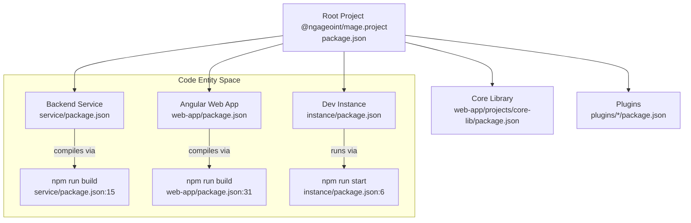

Sources: [README.md:27-59](), [package.json:7-50](), [instance/package.json:1-36]()

---

## NPM Workspace Install and Build Scripts

The monorepo uses root scripts to orchestrate dependencies and builds across packages via `npm-run-all`. The table below outlines key scripts defined in the root `package.json` and package-level `package.json` files.

| Script Name | Target Package | Description |
| :--- | :--- | :--- |
| `npm run build` | Root [package.json:10]() | Builds `service`, `web-app`, and `instance` sequentially. |
| `npm run build-all` | Root [package.json:11]() | Builds the core stack plus all plugin packages. |
| `service:build` | `service` [service/package.json:149]() | Compiles TypeScript (`tsc -b src`) and copies views, assets, and types to `lib/`. |
| `web-app:build` | `web-app` [web-app/package.json:31]() | Cleans `dist`, builds `core-lib`, compiles the Angular app, and runs `post_build.js`. |
| `instance:start` | `instance` [instance/package.json:6]() | Executes the development server using root module redirection. |

Sources: [package.json:7-50](), [service/package.json:141-175](), [web-app/package.json:29-53]()

---

## Running the Development Instance

The `instance/` directory acts as a fully assembled local deployment of MAGE. It references relative package paths in its `dependencies` object, allowing developers to test changes across the service, web app, and plugins without re-publishing to an external registry [instance/package.json:26-35]().

To start the development instance with live configuration from `instance/config.js`:

```bash
cd instance
npm start
```

Under the hood, `instance/package.json` invokes `node -r ./root_modules_first.js ./node_modules/.bin/mage.service -C config.js` [instance/package.json:7](). The `root_modules_first.js` hook ensures Node prioritizes local workspace packages over hoisted dependencies.

Sources: [README.md:48-59](), [instance/package.json:1-36]()

---

## `instance/config.js` Options, CLI Switches, and Env Vars

The MAGE backend service entry point (`mage.service`) is built using the Commander library [README.md:119-122](). Configuration is resolved via a three-tier merging hierarchy:

1. **Command Line Switches** (Highest precedence)
2. **Environment Variables**
3. **Configuration File / JSON Object** (`-C` or `MAGE_CONFIG`) (Lowest precedence)

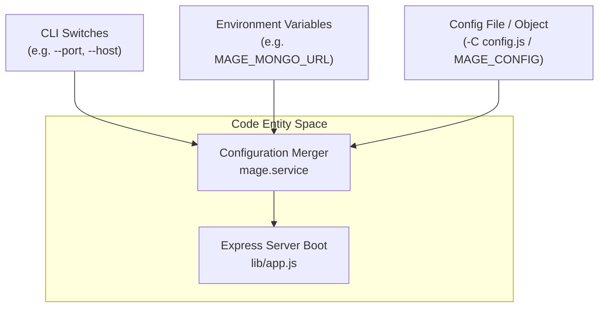

### Key Configuration Options and Environment Variables

* **Configuration File (`-C` / `--config` / `MAGE_CONFIG`)**: Specifies a path to a JSON file or Node module (such as `instance/config.js`) returning a configuration object [README.md:120-135]().
* **MongoDB Connection**: Controlled via environment variable `MAGE_MONGO_URL` or configuration property `mage.mongo.url` [docker-compose.yml:63]().
* **Server Binding**: Configured via `--address` / `mage.address` and `--port` / `mage.port` [README.md:128-130]().
* **Token Expiration**: Set via `MAGE_TOKEN_EXPIRATION` or configuration settings [docker-compose.yml:64]().
* **Plugins**: Registered using repeated `--plugin` and `--web-plugin` switches or defined within the `plugins` array in `config.js` [docker-compose.yml:34-49]().

Sources: [README.md:110-135](), [docker-compose.yml:25-70](), [service/package.json:171-172]()

---

# Page: Monorepo Structure and Versioning

# Monorepo Structure and Versioning

<details>
<summary>Relevant source files</summary>

The following files were used as context for generating this wiki page:

- [CHANGELOG.md](CHANGELOG.md)
- [instance/package.json](instance/package.json)
- [package-lock.json](package-lock.json)
- [package.json](package.json)
- [plugins/image/web-app/.gitignore](plugins/image/web-app/.gitignore)
- [plugins/image/web-app/angular.json](plugins/image/web-app/angular.json)
- [plugins/image/web-app/package-lock.json](plugins/image/web-app/package-lock.json)
- [plugins/image/web-app/package.json](plugins/image/web-app/package.json)
- [plugins/image/web-app/projects/mage-image/package.json](plugins/image/web-app/projects/mage-image/package.json)
- [plugins/image/web-app/projects/mage-image/src/test.ts](plugins/image/web-app/projects/mage-image/src/test.ts)
- [plugins/image/web-app/projects/mage-image/tsconfig.lib.json](plugins/image/web-app/projects/mage-image/tsconfig.lib.json)
- [plugins/image/web-app/projects/mage-image/tsconfig.lib.prod.json](plugins/image/web-app/projects/mage-image/tsconfig.lib.prod.json)
- [service/npm-shrinkwrap.json](service/npm-shrinkwrap.json)
- [service/package.json](service/package.json)
- [web-app/.gitignore](web-app/.gitignore)
- [web-app/angular.json](web-app/angular.json)
- [web-app/package-lock.json](web-app/package-lock.json)
- [web-app/package.json](web-app/package.json)
- [web-app/projects/core-lib/package.json](web-app/projects/core-lib/package.json)
- [web-app/projects/core-lib/tsconfig.lib.prod.json](web-app/projects/core-lib/tsconfig.lib.prod.json)

</details>


## Purpose and Scope
This page details the structural layout, package organization, inter-package dependencies, versioning strategies (`apiVersion` versus release version), changelog conventions, and lockfile/shrinkwrap mechanics of the MAGE monorepo (`https://github.com/COG-GTM/NGA-mage-server`).

Sources: [package.json:1-66](), [CHANGELOG.md:1-12]()

---

## Package Layout & Inter-Package Dependencies
The MAGE monorepo contains a core Node.js backend service, an Angular web application, a core Angular library, a development instance assembler, and modular extensions (plugins). The root package acts as an npm workspace coordinator defining aggregate build and test tasks [package.json:7-50]().

The primary packages within the monorepo include:
* **Root Package (`@ngageoint/mage.project`)**: Coordinates workspace-level tasks, CI setup, and dependency declarations across core and plugin directories [package.json:1-66]().
* **Backend Service (`@ngageoint/mage.service`)**: Located in `service/`, providing the REST API, Mongoose models, authentication strategies, and data adapters [service/package.json:1-6]().
* **Web Application (`@ngageoint/mage.web-app`)**: Located in `web-app/`, containing the Angular frontend application [web-app/package.json:1-25]().
* **Core Library (`@ngageoint/mage.web-core-lib`)**: Located in `web-app/projects/core-lib`, exporting shareable Angular components, schematics, and UI utilities [web-app/projects/core-lib/package.json:1-39]().
* **Development Instance (`@ngageoint/mage.dev-instance`)**: Located in `instance/`, assembling a running deployment from relative workspace paths [instance/package.json:1-36]().
* **Plugins (`plugins/`)**: Domain-specific service and web extensions (e.g., ArcGIS, SFTP, Image processing, NGA MSI, ATAK) linked dynamically into the runtime [instance/package.json:27-35]().

### Package Dependency Architecture

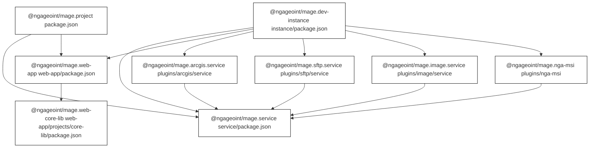
Sources: [package.json:1-66](), [service/package.json:1-35](), [web-app/package.json:1-30](), [web-app/projects/core-lib/package.json:1-15](), [instance/package.json:1-36]()

---

## Release Version vs. `apiVersion`
MAGE decouples its overall project release version from its REST API compatibility version to prevent client breaking changes on minor patch deployments.

* **Release Version**: Governed by Semantic Versioning in individual `package.json` files (e.g., `"version": "6.7.1"` in root, service, web-app, and core-lib) [package.json:5](), [service/package.json:3](), [web-app/package.json:3](), [web-app/projects/core-lib/package.json:3]().
* **API Compatibility Version (`apiVersion`)**: Declared explicitly within `@ngageoint/mage.service` configuration metadata (`"apiVersion": "6.8.0"` in `service/package.json`) [service/package.json:4](). This value increments when public contract additions occur (e.g., exposing optional `buttonText` fields in authentication strategies), allowing client apps to verify API contract compatibility independently of service bugfix increments [CHANGELOG.md:8-11]().

Sources: [CHANGELOG.md:8-11](), [service/package.json:1-5]()

---

## CHANGELOG Conventions
Changes are documented in a centralized `CHANGELOG.md` following Semantic Versioning guidelines [CHANGELOG.md:1-4](). 

The changelog structure separates developments across three core technical domains:
1. **Service**: Changes to REST endpoints, Mongoose schema models, audit logging, security policies, and migration scripts.
2. **Web App**: Updates to Angular components, routing, authentication flows, UI banners, and dialog dimensions.
3. **Plugins**: Sub-entries for distinct modular extensions (e.g., ArcGIS, Image processor, NGA-MSI, SFTP).

Within each domain, modifications are partitioned into category headings:
* `#### Features`
* `#### Bug Fixes`
* `#### Security`

Releases are tagged with version headers pointing to GitHub release endpoints (e.g., `## [6.7.1](https://github.com/ngageoint/mage-server/releases/tag/6.7.1)`) while unreleased changes accumulate under `## Pending on develop` [CHANGELOG.md:8-80]().

Sources: [CHANGELOG.md:1-97]()

---

## Lockfiles, Shrinkwraps, and Instance Assembly
Dependency integrity across the monorepo is managed through dedicated lockfiles and shrinkwrap configurations per sub-package:

* Root Lockfile: `package-lock.json` tracks workspace-level dependencies [package-lock.json:1-10]().
* Service Shrinkwrap: `service/npm-shrinkwrap.json` pins exact dependency trees for `@ngageoint/mage.service` to ensure reproducible backend builds and container deployments [service/npm-shrinkwrap.json:1-12]().
* Web App Lockfile: `web-app/package-lock.json` manages Angular dependency resolutions [web-app/package-lock.json:1-15]().

### Monorepo Build and Assembly Flow
The development instance (`instance/`) acts as an assembly layer that links compiled workspace packages and plugins into an executable server instance using `bin/mage.service.js` [instance/package.json:1-36](), [service/package.json:176-184]().

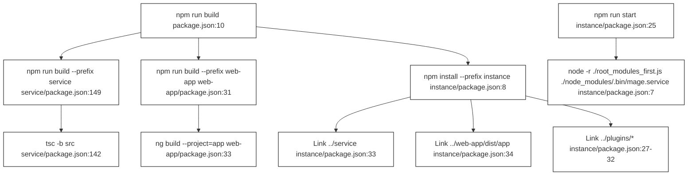
Sources: [package.json:7-36](), [service/package.json:141-184](), [web-app/package.json:29-53](), [instance/package.json:1-36]()

---

# Page: Backend Service Architecture

# Backend Service Architecture

<details>
<summary>Relevant source files</summary>

The following files were used as context for generating this wiki page:

- [instance/init.js](instance/init.js)
- [service/.gitignore](service/.gitignore)
- [service/bin/mage.service.js](service/bin/mage.service.js)
- [service/src/adapters/adapters.controllers.web.ts](service/src/adapters/adapters.controllers.web.ts)
- [service/src/adapters/events/adapters.events.db.mongoose.ts](service/src/adapters/events/adapters.events.db.mongoose.ts)
- [service/src/adapters/users/adapters.users.controllers.web.ts](service/src/adapters/users/adapters.users.controllers.web.ts)
- [service/src/adapters/users/adapters.users.db.mongoose.ts](service/src/adapters/users/adapters.users.db.mongoose.ts)
- [service/src/app.api/users/app.api.users.ts](service/src/app.api/users/app.api.users.ts)
- [service/src/app.impl/users/app.impl.users.ts](service/src/app.impl/users/app.impl.users.ts)
- [service/src/entities/entities.global.ts](service/src/entities/entities.global.ts)
- [service/src/entities/events/entities.events.ts](service/src/entities/events/entities.events.ts)
- [service/src/express.ts](service/src/express.ts)
- [service/src/models/event.d.ts](service/src/models/event.d.ts)
- [service/src/models/event.js](service/src/models/event.js)
- [service/src/permissions/permissions.events.ts](service/src/permissions/permissions.events.ts)
- [service/src/permissions/permissions.observations.ts](service/src/permissions/permissions.observations.ts)
- [service/src/routes/events.ts](service/src/routes/events.ts)
- [service/src/routes/layers.js](service/src/routes/layers.js)
- [service/src/routes/observations.js](service/src/routes/observations.js)
- [service/test/adapters/events/adapters.events.db.mongoose.test.ts](service/test/adapters/events/adapters.events.db.mongoose.test.ts)
- [service/test/event/eventReadTest.js](service/test/event/eventReadTest.js)
- [service/test/permissions/permissions.events.test.ts](service/test/permissions/permissions.events.test.ts)
- [service/test/permissions/permissions.observations.test.ts](service/test/permissions/permissions.observations.test.ts)
- [web-app/post_build.js](web-app/post_build.js)

</details>


This document provides a high-level overview of the backend service architecture for `@ngageoint/mage.service`. It outlines the layered architectural pattern (`entities`, `app.api`, `app.impl`, `adapters`, `routes`, and legacy `models`), the system boot sequence, configuration management, and links to child pages for detailed subsystem documentation.

---

## Layered Architecture Overview

The MAGE backend service follows a clean, layered architecture designed to decouple business logic and domain entities from external web frameworks (Express) and persistence stores (MongoDB/Mongoose). 

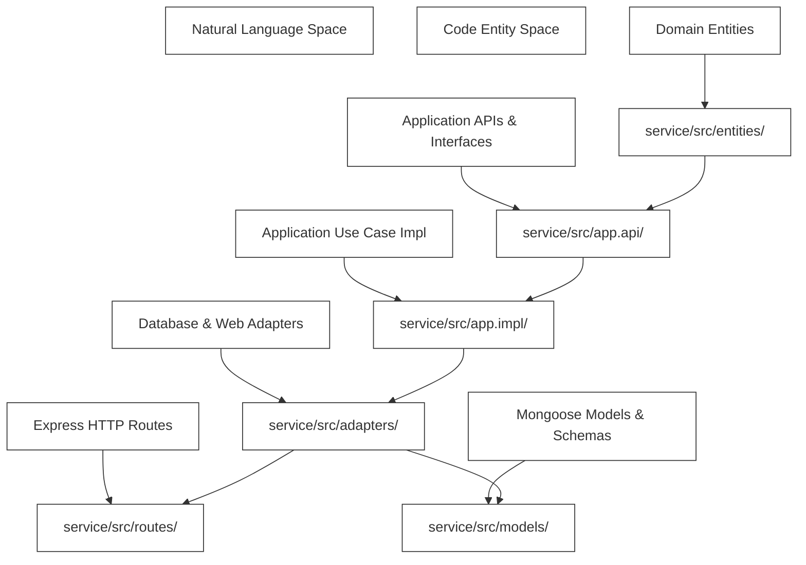
*Figure 1: Bridging Natural Language Architectural Layers to Code Entity Space (`service/src/`) [service/src/entities/events/entities.events.ts:1]().*

Each layer serves a distinct responsibility within the service monorepo:
* **`entities/`**: Pure TypeScript domain models and business rules independent of storage or framework mechanisms (e.g., `MageEvent`, `Observation`) [service/src/entities/events/entities.events.ts:74]().
* **`app.api/`**: Abstract application service interfaces and request context boundaries.
* **`app.impl/`**: Concrete implementations of application use cases and business workflows.
* **`adapters/`**: Infrastructure integrations, including database repositories (e.g., `MongooseMageEventRepository`) and web controller request factories [service/src/adapters/events/adapters.events.db.mongoose.ts:13](), [service/src/adapters/adapters.controllers.web.ts:6]().
* **`routes/`**: Express HTTP routing definitions, input validation middleware, and route-level authorization (e.g., `EventRoutes`, observation handlers) [service/src/routes/events.ts:178](), [service/src/routes/observations.js:1]().
* **`models/`**: Mongoose database schemas, model definitions, and persistence-level pre/post hooks (e.g., `EventSchema`, `FieldSchema`) [service/src/models/event.js:34]().

Sources: [service/src/entities/events/entities.events.ts:1](), [service/src/adapters/events/adapters.events.db.mongoose.ts:13](), [service/src/routes/events.ts:178](), [service/src/models/event.js:34]()

---

## Service Boot Sequence and Configuration

The MAGE backend service starts via a command-line interface (CLI) script (`service/bin/mage.service.js`), which parses configuration options from environment variables, command-line arguments, or configuration JSON files, merges them, and boots the Express application server.

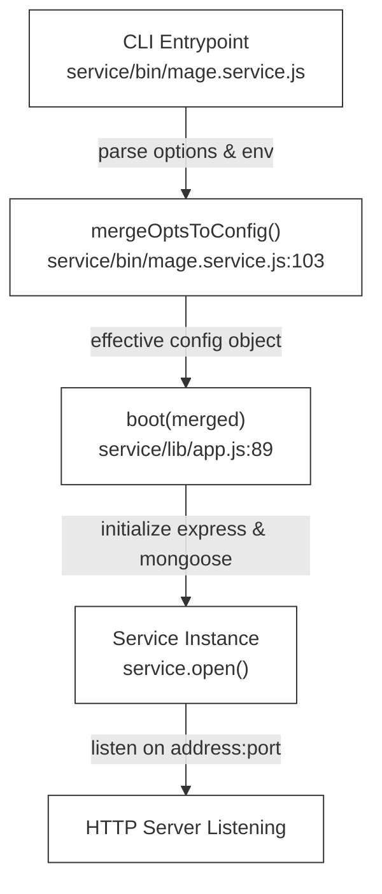
*Figure 2: Service Boot and Configuration Sequence [service/bin/mage.service.js:80]().*

Configuration properties such as database connection parameters (`mongo.url`), attachment directories (`attachmentDir`), and token expiration are managed centrally during startup. Routes and error handlers (such as `mageAppErrorHandler` and compatibility error handlers) are bound during application bootstrapping [service/src/adapters/adapters.controllers.web.ts:41]().

Sources: [service/bin/mage.service.js:80](), [service/src/adapters/adapters.controllers.web.ts:41]()

---

## Subsystem Overviews and Child Pages

The MAGE backend service is divided into several major functional subsystems. Detailed technical documentation for each subsystem is maintained in the following child pages:

### [Observations Subsystem](#2.1)
Covers the core observation entity, form validation rules, save/read use cases, Mongoose repositories, attachment processing pipelines, filesystem storage, ClamAV security scanning integration, and search indexing. For details, see [Observations Subsystem](#2.1).

### [Events, Forms, Teams and Layers](#2.2)
Covers the `MageEvent` model, dynamic form subdocuments (`FormSchema`, `FieldSchema`), team association rules, access control lists (ACLs), map layer management, and GeoPackage validation and optimization (`GeoPackageUtility`). For details, see [Events, Forms, Teams and Layers](#2.2).

### [Users, Authentication and Authorization](#2.3)
Covers user lifecycle management, signup workflows with captcha, authentication strategies (local, LDAP, SAML, OAuth, OIDC), roles, permission services (`EventPermissionServiceImpl`), and event access control types (`EventAccessType`) [service/src/permissions/permissions.events.ts:26](). For details, see [Users, Authentication and Authorization](#2.3).

### [Feeds, Locations, Exports and System Info](#2.4)
Covers feed service types and topics, client location tracking, export engines (CSV, GeoJSON, KML, GeoPackage), system info endpoints, and icon management. For details, see [Feeds, Locations, Exports and System Info](#2.4).

### [Persistence, Migrations and Service Testing](#2.5)
Covers base Mongoose adapters (`BaseMongooseRepository`), models index, migration runner scripts, unit and functional test suites, and OpenAPI documentation generators. For details, see [Persistence, Migrations and Service Testing](#2.5).

Sources: [service/src/models/event.js:34](), [service/src/permissions/permissions.events.ts:26]()

---

# Page: Observations Subsystem

# Observations Subsystem

<details>
<summary>Relevant source files</summary>

The following files were used as context for generating this wiki page:

- [service/src/adapters/observations/adapters.observations.controllers.web.ts](service/src/adapters/observations/adapters.observations.controllers.web.ts)
- [service/src/adapters/observations/adapters.observations.db.mongoose.ts](service/src/adapters/observations/adapters.observations.db.mongoose.ts)
- [service/src/adapters/observations/adapters.observations.dto.ecma404-json.ts](service/src/adapters/observations/adapters.observations.dto.ecma404-json.ts)
- [service/src/adapters/observations/adapters.observations.search.controllers.web.ts](service/src/adapters/observations/adapters.observations.search.controllers.web.ts)
- [service/src/adapters/observations/adapters.observations.search.db.mongoose.ts](service/src/adapters/observations/adapters.observations.search.db.mongoose.ts)
- [service/src/app.api/observations/app.api.observations.search.ts](service/src/app.api/observations/app.api.observations.search.ts)
- [service/src/app.api/observations/app.api.observations.ts](service/src/app.api/observations/app.api.observations.ts)
- [service/src/app.impl/observations/app.impl.observations.search.ts](service/src/app.impl/observations/app.impl.observations.search.ts)
- [service/src/app.impl/observations/app.impl.observations.ts](service/src/app.impl/observations/app.impl.observations.ts)
- [service/src/app.ts](service/src/app.ts)
- [service/src/entities/events/entities.events.forms.ts](service/src/entities/events/entities.events.forms.ts)
- [service/src/entities/observations/entities.observations.ts](service/src/entities/observations/entities.observations.ts)
- [service/src/models/observation.d.ts](service/src/models/observation.d.ts)
- [service/src/models/observation.js](service/src/models/observation.js)
- [service/src/permissions/permissions.observations.search.ts](service/src/permissions/permissions.observations.search.ts)
- [service/test/adapters/observations/adapters.observations.controllers.web.test.ts](service/test/adapters/observations/adapters.observations.controllers.web.test.ts)
- [service/test/adapters/observations/adapters.observations.db.mongoose.test.ts](service/test/adapters/observations/adapters.observations.db.mongoose.test.ts)
- [service/test/adapters/observations/adapters.observations.dto.ecma404-json.test.ts](service/test/adapters/observations/adapters.observations.dto.ecma404-json.test.ts)
- [service/test/app/observations/app.observations.search.test.ts](service/test/app/observations/app.observations.search.test.ts)
- [service/test/app/observations/app.observations.test.ts](service/test/app/observations/app.observations.test.ts)
- [service/test/entities/observations/entities.observations.test.ts](service/test/entities/observations/entities.observations.test.ts)
- [service/test/permissions/permissions.observations.search.test.ts](service/test/permissions/permissions.observations.search.test.ts)

</details>


The Observations Subsystem is a core pillar of the MAGE backend architecture, responsible for the complete lifecycle of geo-located observation entities. It handles domain modeling, strict validation against dynamic event forms, state management, secure database persistence via Mongoose, attachment processing pipelines, and advanced spatial/attribute searching.

---

## 1. Observation Entity and Event Form Validation

An observation in MAGE represents a GeoJSON `Feature` submitted within the context of a specific `MageEvent` [service/src/entities/observations/entities.observations.ts:1-42](). The core domain logic is encapsulated in the `Observation` class (`service/src/entities/observations/entities.observations.ts`), which evaluates incoming attributes against the dynamic form definitions, field constraints, and geometry types configured for the parent event [service/src/entities/observations/entities.observations.ts:104-176]().

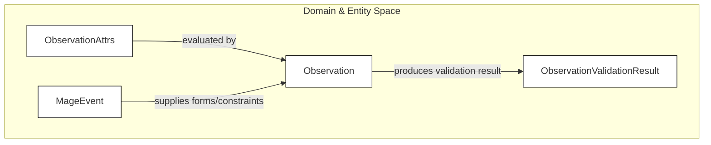
*Figure 1: Observation entity evaluation and validation flow bridging domain attributes with event form schemas.*

> **Sources:** `service/src/entities/observations/entities.observations.ts:1-176`

---

## 2. Use Cases and Web Controllers

The application layer implements core observation use cases including reading observations (`ReadObservations`), allocating pre-IDs (`AllocateObservationId`), and saving/updating observations (`SaveObservation`) [service/src/app.impl/observations/app.impl.observations.ts:18-138](). These use cases enforce permission checks using an `ObservationPermissionService` before interacting with event-scoped repositories.

HTTP endpoints are exposed via `ObservationRoutes` in the web adapter layer [service/src/adapters/observations/adapters.observations.controllers.web.ts:24-32](). The routes accept client-facing DTOs (`ExoObservation`), parsing search parameters and streaming multipart attachment uploads using `busboy` [service/src/adapters/observations/adapters.observations.controllers.web.ts:36-155]().

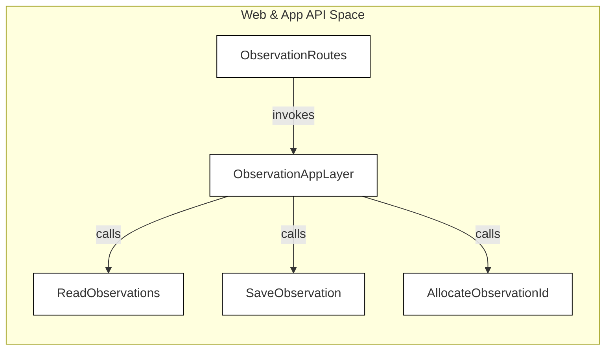
*Figure 2: Routing and application layer bridge for observation operations.*

> **Sources:** `service/src/adapters/observations/adapters.observations.controllers.web.ts:24-155`, `service/src/app.impl/observations/app.impl.observations.ts:18-138`

---

## 3. Mongoose Persistence Repository

Observations are persisted using `MongooseObservationRepository`, which extends `BaseMongooseRepository` to provide event-scoped data access (`EventScopedObservationRepository`) [service/src/adapters/observations/adapters.observations.db.mongoose.ts:15-25](). Because MAGE supports dynamic per-event schemas, observation collections are dynamically compiled using Mongoose schemas defined in `service/src/models/observation.js` [service/src/models/observation.js:56-77]().

The repository manages document mapping, unique ID allocation via an `ObservationId` collection model, geospatial indices (`2dsphere`), and domain event emission upon successful saves [service/src/adapters/observations/adapters.observations.db.mongoose.ts:27-74, service/src/models/observation.js:79-90]().

> **Sources:** `service/src/adapters/observations/adapters.observations.db.mongoose.ts:15-74`, `service/src/models/observation.js:56-90`

---

## 4. Attachments and Staged Content

Observations support rich multimedia attachments tied to specific form fields (such as images, videos, or files). The subsystem handles multipart streaming uploads, tracks processing statuses (`pending`, `success`, `rejected`, `error`), and generates multi-resolution thumbnails.

For detailed information on the upload pipeline, filesystem storage, background processing hooks, and security scanning, see the child page:
- **[Attachments and Attachment Store](#2.1.1)**

> **Sources:** `service/src/adapters/observations/adapters.observations.controllers.web.ts:69-154`, `service/src/models/observation.js:33-53`

---

## 5. Observation Search and Filtering

To query observations efficiently across large datasets, MAGE provides dedicated search infrastructure (`ObservationSearchRepository` and `SearchIndexAppLayer`) [service/src/app.impl/observations/app.impl.observations.search.ts, service/src/adapters/observations/adapters.observations.search.db.mongoose.ts](). Searches combine geospatial bounding boxes, temporal ranges (timestamps and last-modified dates), observation states, user/team filters, and complex nested form field matching rules [service/src/app.api/observations/app.api.observations.ts:24-40]().

> **Sources:** `service/src/app.api/observations/app.api.observations.ts:24-40`, `service/src/app.impl/observations/app.impl.observations.ts:32-55`

---

# Page: Attachments and Attachment Store

# Attachments and Attachment Store

<details>
<summary>Relevant source files</summary>

The following files were used as context for generating this wiki page:

- [plugins/clamav/service/src/clamHook.ts](plugins/clamav/service/src/clamHook.ts)
- [plugins/clamav/service/src/index.ts](plugins/clamav/service/src/index.ts)
- [plugins/clamav/service/src/scan.ts](plugins/clamav/service/src/scan.ts)
- [plugins/clamav/service/tsconfig.json](plugins/clamav/service/tsconfig.json)
- [service/src/adapters/observations/adapters.observations.attachment_store.file_system.ts](service/src/adapters/observations/adapters.observations.attachment_store.file_system.ts)
- [service/src/adapters/observations/adapters.observations.controllers.web.ts](service/src/adapters/observations/adapters.observations.controllers.web.ts)
- [service/src/adapters/observations/adapters.observations.db.mongoose.ts](service/src/adapters/observations/adapters.observations.db.mongoose.ts)
- [service/src/adapters/observations/adapters.observations.dto.ecma404-json.ts](service/src/adapters/observations/adapters.observations.dto.ecma404-json.ts)
- [service/src/app.api/observations/app.api.observations.ts](service/src/app.api/observations/app.api.observations.ts)
- [service/src/app.impl/observations/app.impl.observations.ts](service/src/app.impl/observations/app.impl.observations.ts)
- [service/src/app.ts](service/src/app.ts)
- [service/src/entities/events/entities.events.forms.ts](service/src/entities/events/entities.events.forms.ts)
- [service/src/entities/observations/entities.observations.ts](service/src/entities/observations/entities.observations.ts)
- [service/src/models/observation.d.ts](service/src/models/observation.d.ts)
- [service/src/models/observation.js](service/src/models/observation.js)
- [service/test/adapters/observations/adapters.observations.attachment_store.file_system.test.ts](service/test/adapters/observations/adapters.observations.attachment_store.file_system.test.ts)
- [service/test/adapters/observations/adapters.observations.controllers.web.test.ts](service/test/adapters/observations/adapters.observations.controllers.web.test.ts)
- [service/test/adapters/observations/adapters.observations.db.mongoose.test.ts](service/test/adapters/observations/adapters.observations.db.mongoose.test.ts)
- [service/test/adapters/observations/adapters.observations.dto.ecma404-json.test.ts](service/test/adapters/observations/adapters.observations.dto.ecma404-json.test.ts)
- [service/test/app/observations/app.observations.test.ts](service/test/app/observations/app.observations.test.ts)
- [service/test/entities/observations/entities.observations.test.ts](service/test/entities/observations/entities.observations.test.ts)

</details>


## Purpose and Scope
This document details the attachment subsystem within the MAGE server. It covers the attachment upload pipeline using multipart streaming, the filesystem-backed attachment storage architecture, entity models, thumbnail generation, asynchronous processing hooks, and ClamAV virus scan integration.

---

## 1. Attachment Upload Pipeline

The attachment upload pipeline manages incoming binary files associated with observations. Clients upload attachments via a dedicated HTTP `PUT` endpoint on the observation routes (`service/src/adapters/observations/adapters.observations.controllers.web.ts:69`). 

To handle large file streams efficiently without buffering the entire payload into memory, MAGE integrates `busboy` middleware directly within the Express route handler (`service/src/adapters/observations/adapters.observations.controllers.web.ts:77`).

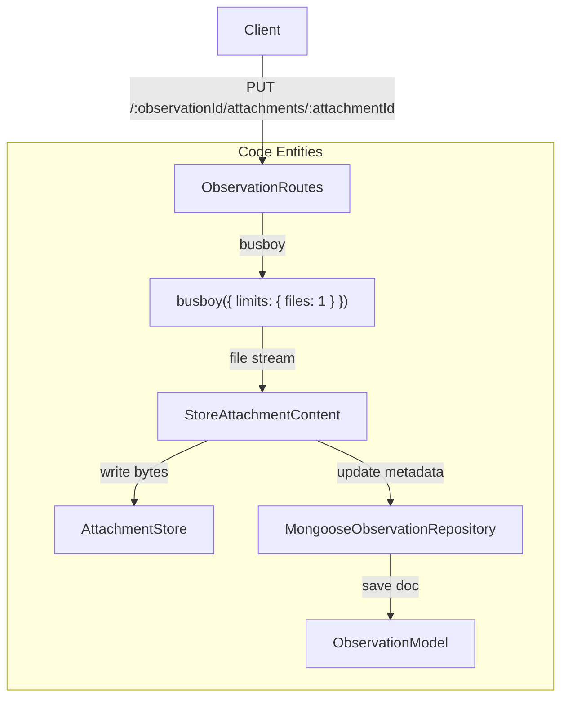
*Diagram 1: Attachment Upload Data Flow and Code Entity Mapping*

### Key Upload Pipeline Components
* **`ObservationRoutes`**: Declares the `PUT` route for attachment uploads and initializes `busboy` with strict limits (`files: 1`, `fields: 0`) (`service/src/adapters/observations/adapters.observations.controllers.web.ts:69-80`).
* **`ExoIncomingAttachmentContent`**: Struct containing the readable stream (`bytes`), file name (`name`), and media type (`mediaType`) passed down from the adapter layer to the application layer (`service/src/app.api/observations/app.api.observations.ts:136-140`).
* **`StoreAttachmentContent`**: Application service interface handling business validation, permission checks, and delegation to the persistence and storage adapters (`service/src/app.api/observations/app.api.observations.ts:63-70`).

Sources:
- `service/src/adapters/observations/adapters.observations.controllers.web.ts:1-155`
- `service/src/app.api/observations/app.api.observations.ts:63-140`

---

## 2. Filesystem Attachment Store

Binary attachment content is separated from document metadata. While metadata resides in MongoDB, actual files are managed by the `AttachmentStore` interface on the filesystem.

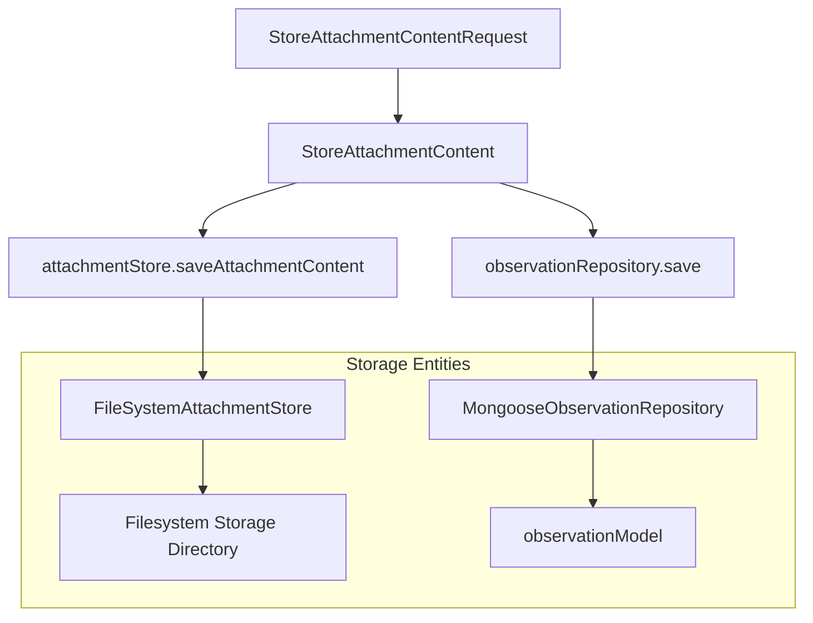
*Diagram 2: Storage Architecture for Binary Content vs. Metadata*

### Attachment Attributes and Schemas
An attachment record tracks processing status, dimensions, content type, size, and location locators:

| Attribute / Field | Type | Description |
| :--- | :--- | :--- |
| `id` / `_id` | `AttachmentId` / `ObjectId` | Unique identifier for the attachment. |
| `observationFormId` | `ObjectId` | Associated form entry identifier. |
| `fieldName` | `String` | Form field name defining the attachment slot. |
| `contentType` | `String` | MIME type of the uploaded file. |
| `size` | `Number` | File size in bytes. |
| `relativePath` | `String` | Filesystem relative path used by `FileSystemAttachmentStore`. |
| `processingStatus` | `String` | Status enum: `pending`, `success`, `rejected`, `error` (`service/src/models/observation.js:45`). |
| `thumbnails` | `Thumbnail[]` | Array of generated thumbnail subdocuments. |

Sources:
- `service/src/entities/observations/entities.observations.ts:44-64`
- `service/src/models/observation.js:33-53`
- `service/src/adapters/observations/adapters.observations.db.mongoose.ts:32-74`

---

## 3. Processing Hooks and Thumbnails

Attachments often require asynchronous post-processing, such as EXIF orientation correction, metadata extraction, or downscaling into thumbnails.

### Processing Lifecycle
* **`AttachmentProcessingStatus`**: Tracks the progression of asynchronous hooks (`pending`, `success`, `rejected`, `error`) (`service/src/entities/observations/entities.observations.ts:58`).
* **`processingHook`**: Identifies which plugin hook is responsible for processing the attachment content (`service/src/entities/observations/entities.observations.ts:60`).
* **`processingRetryCount`**: Tracks failure retries during asynchronous hook execution (`service/src/entities/observations/entities.observations.ts:62`).

### Thumbnails
Thumbnails are stored as subdocuments within the `AttachmentSchema` (`service/src/models/observation.js:21`). Each thumbnail specifies a target dimension constraint:
* **`minDimension`**: The minimum pixel constraint used to generate the resized thumbnail (`service/src/entities/observations/entities.observations.ts:68`).
* **`ThumbnailSchema`**: Defines dimensions (`width`, `height`), `contentType`, `size`, and `relativePath` (`service/src/models/observation.js:21-31`).

Sources:
- `service/src/entities/observations/entities.observations.ts:44-76`
- `service/src/models/observation.js:21-53`

---

## 4. ClamAV Scan Integration

To protect the server instance from malicious file uploads, MAGE supports optional ClamAV virus scanning integration via plugins.

### Scanning Pipeline
1. When an attachment stream is received through the upload pipeline, hook handlers intercept the stream.
2. The ClamAV scan client (`plugins/clamav/service/src/scan.ts`) pipes the incoming attachment stream through a TCP socket to a running ClamAV daemon (`clamd`).
3. If the scan returns clean, the file proceeds to the `FileSystemAttachmentStore`.
4. If a virus or threat is detected, the `processingStatus` is marked as `rejected` or `error`, the stream is terminated, and an `InvalidInputError` or security exception is returned to the caller.

Sources:
- `plugins/clamav/service/src/clamHook.ts`
- `plugins/clamav/service/src/scan.ts`
- `service/src/adapters/observations/adapters.observations.controllers.web.ts:101-136`

---

# Page: Events, Forms, Teams and Layers

# Events, Forms, Teams and Layers

<details>
<summary>Relevant source files</summary>

The following files were used as context for generating this wiki page:

- [service/src/adapters/adapters.controllers.web.ts](service/src/adapters/adapters.controllers.web.ts)
- [service/src/adapters/events/adapters.events.acl.controllers.web.ts](service/src/adapters/events/adapters.events.acl.controllers.web.ts)
- [service/src/adapters/events/adapters.events.controllers.web.ts](service/src/adapters/events/adapters.events.controllers.web.ts)
- [service/src/adapters/events/adapters.events.db.mongoose.ts](service/src/adapters/events/adapters.events.db.mongoose.ts)
- [service/src/adapters/feeds/adapters.feeds.controllers.web.ts](service/src/adapters/feeds/adapters.feeds.controllers.web.ts)
- [service/src/adapters/feeds/adapters.feeds.db.mongoose.ts](service/src/adapters/feeds/adapters.feeds.db.mongoose.ts)
- [service/src/adapters/roles/adapters.roles.controllers.web.ts](service/src/adapters/roles/adapters.roles.controllers.web.ts)
- [service/src/api/form.js](service/src/api/form.js)
- [service/src/app.api/app.api.global.ts](service/src/app.api/app.api.global.ts)
- [service/src/app.api/events/app.api.events.acl.ts](service/src/app.api/events/app.api.events.acl.ts)
- [service/src/app.api/events/app.api.events.ts](service/src/app.api/events/app.api.events.ts)
- [service/src/app.api/feeds/app.api.feeds.ts](service/src/app.api/feeds/app.api.feeds.ts)
- [service/src/app.impl/events/app.impl.events.acl.ts](service/src/app.impl/events/app.impl.events.acl.ts)
- [service/src/app.impl/events/app.impl.events.ts](service/src/app.impl/events/app.impl.events.ts)
- [service/src/app.impl/feeds/app.impl.feeds.ts](service/src/app.impl/feeds/app.impl.feeds.ts)
- [service/src/entities/entities.i18n.ts](service/src/entities/entities.i18n.ts)
- [service/src/entities/entities.json_types.ts](service/src/entities/entities.json_types.ts)
- [service/src/entities/events/entities.events.ts](service/src/entities/events/entities.events.ts)
- [service/src/entities/feeds/entities.feeds.ts](service/src/entities/feeds/entities.feeds.ts)
- [service/src/migrations/006-event-teams.js](service/src/migrations/006-event-teams.js)
- [service/src/models/event.d.ts](service/src/models/event.d.ts)
- [service/src/models/event.js](service/src/models/event.js)
- [service/src/models/team.js](service/src/models/team.js)
- [service/src/permissions/permissions.events.ts](service/src/permissions/permissions.events.ts)
- [service/src/permissions/permissions.observations.ts](service/src/permissions/permissions.observations.ts)
- [service/src/routes/events.ts](service/src/routes/events.ts)
- [service/src/routes/index.js](service/src/routes/index.js)
- [service/src/routes/layers.js](service/src/routes/layers.js)
- [service/src/routes/observations.js](service/src/routes/observations.js)
- [service/src/routes/teams.js](service/src/routes/teams.js)
- [service/test/adapters/events/adapters.events.acl.controllers.web.test.ts](service/test/adapters/events/adapters.events.acl.controllers.web.test.ts)
- [service/test/adapters/events/adapters.events.controllers.web.test.ts](service/test/adapters/events/adapters.events.controllers.web.test.ts)
- [service/test/adapters/events/adapters.events.db.mongoose.test.ts](service/test/adapters/events/adapters.events.db.mongoose.test.ts)
- [service/test/adapters/feeds/adapters.feeds.controllers.web.test.ts](service/test/adapters/feeds/adapters.feeds.controllers.web.test.ts)
- [service/test/adapters/feeds/adapters.feeds.db.mongoose.test.ts](service/test/adapters/feeds/adapters.feeds.db.mongoose.test.ts)
- [service/test/adapters/icons/adapters.icons.controllers.web.test.ts](service/test/adapters/icons/adapters.icons.controllers.web.test.ts)
- [service/test/adapters/roles/adapters.roles.controllers.web.test.ts](service/test/adapters/roles/adapters.roles.controllers.web.test.ts)
- [service/test/app/events/app.events.acl.test.ts](service/test/app/events/app.events.acl.test.ts)
- [service/test/app/events/app.events.test.ts](service/test/app/events/app.events.test.ts)
- [service/test/app/feeds/app.feeds.test.ts](service/test/app/feeds/app.feeds.test.ts)
- [service/test/app/icons/app.icons.test.ts](service/test/app/icons/app.icons.test.ts)
- [service/test/entities/entities.i18n.test.ts](service/test/entities/entities.i18n.test.ts)
- [service/test/entities/feeds/entities.feeds.test.ts](service/test/entities/feeds/entities.feeds.test.ts)
- [service/test/event/eventReadTest.js](service/test/event/eventReadTest.js)
- [service/test/observation/observationImportantTest.js](service/test/observation/observationImportantTest.js)
- [service/test/permissions/permissions.events.test.ts](service/test/permissions/permissions.events.test.ts)
- [service/test/permissions/permissions.icons.test.ts](service/test/permissions/permissions.icons.test.ts)
- [service/test/permissions/permissions.observations.test.ts](service/test/permissions/permissions.observations.test.ts)
- [service/test/team/teamReadTest.js](service/test/team/teamReadTest.js)

</details>


This page documents the core architectural subsystems responsible for managing **Events**, dynamic **Forms**, **Teams**, and map **Layers** (including GeoPackage processing) in the MAGE server backend [service/src/models/event.js:86-117](). These components form the structural boundary for operational data collections, access permissions, and spatial rendering.

---

## 1. Event Model and API Routes

MAGE events represent operational missions or exercises. An event aggregates collections of observations, map layers, external feeds, and user teams. 

### Event Schema Definition

Events are backed by a Mongoose schema defined in `service/src/models/event.js`. The `EventSchema` enforces unique names, links to authorized teams and map layers, and maintains an Access Control List (`acl`) [service/src/models/event.js:86-112]().

```javascript
const EventSchema = new Schema({
  _id: { type: Number, required: true },
  name: { type: String, required: true, unique: true },
  description: { type: String, required: false },
  complete: { type: Boolean },
  collectionName: { type: String, required: true },
  teamIds: [{ type: Schema.Types.ObjectId, ref: 'Team' }],
  layerIds: [{ type: Number, ref: 'Layer' }],
  feedIds: [{ type: String, ref: 'Feed' }],
  forms: [FormSchema],
  acl: {}
}, { ... });
```
*(Source: [service/src/models/event.js:86-117]())*

### Event Routes and Query Parsing

HTTP requests targeting `/api/events` are handled by Express routers in `service/src/routes/events.ts`. Middleware functions handle request parameter parsing (`parseEventQueryParams`), style sanitization (`reduceStyle`), and access authorization (`middlewareAuthorizeAccess`) [service/src/routes/events.ts:34-159]().

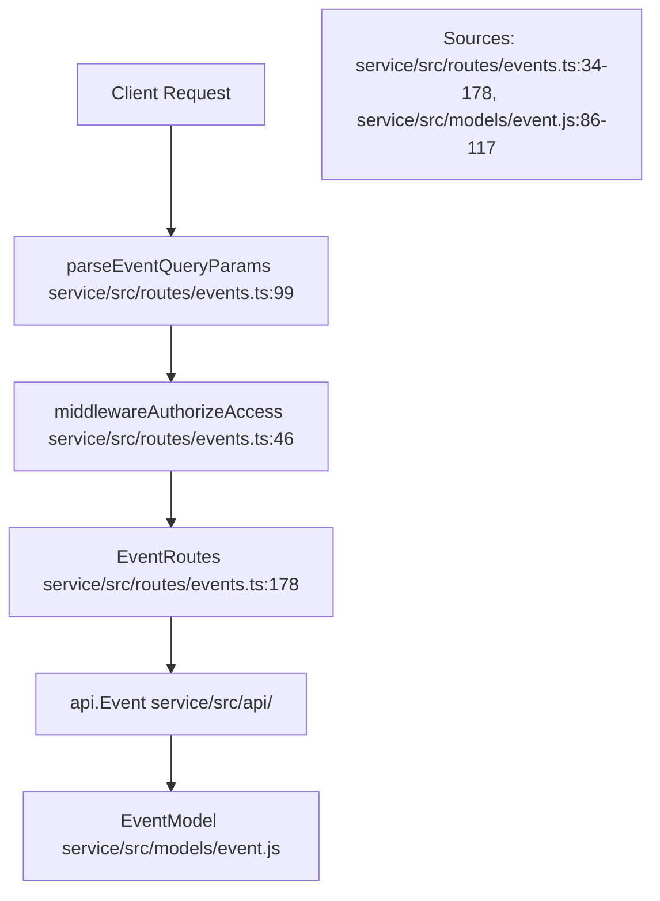
*Sources: [service/src/routes/events.ts:34-178](), [service/src/models/event.js:86-117]()*

---

## 2. Dynamic Form Subdocuments and Field Validation

Events contain an array of `FormSchema` subdocuments that dictate the schema of observations submitted by users [service/src/models/event.js:68-84](). 

### Form and Field Hierarchy

Each form contains a set of field definitions (`FieldSchema`) supporting types such as text, numeric values, dropdowns, attachments, and geometries [service/src/models/event.js:34-50]().

| Schema Component | File Location | Description |
| :--- | :--- | :--- |
| `EventSchema` | `service/src/models/event.js:86` | Root document container for teams, layers, and forms |
| `FormSchema` | `service/src/models/event.js:68` | Defines form metadata, primary/variant fields, and validation rules |
| `FieldSchema` | `service/src/models/event.js:34` | Defines individual form inputs, types, requirements, and restrictions |
| `OptionSchema` | `service/src/models/event.js:16` | Dropdown or radio choice option configuration |

*(Sources: [service/src/models/event.js:16-84]())*

### User Field Population

Forms can include designated "user fields" (`userFields`), which dynamically populate their choice lists with the display names of users assigned to the event's associated teams [service/src/api/form.js:34-104]().

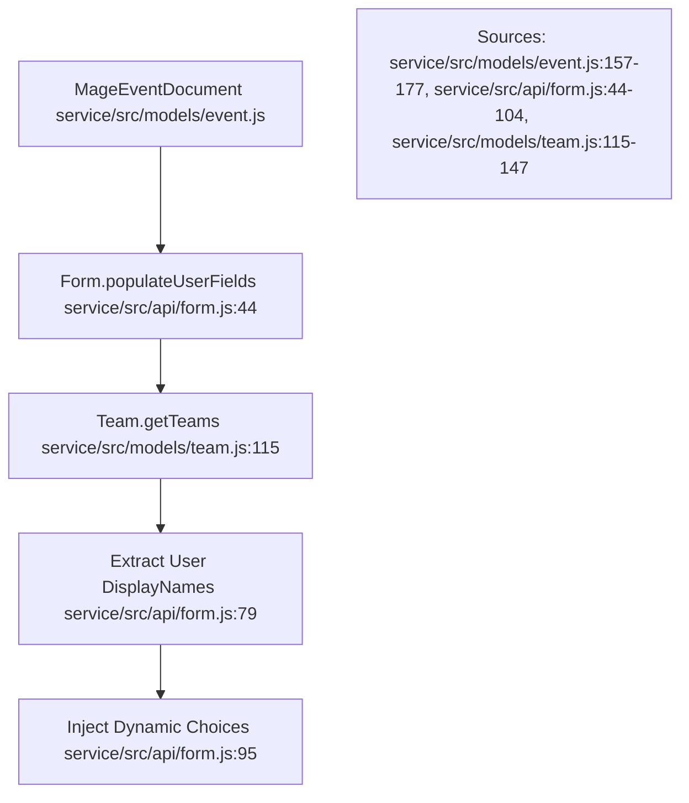
*Sources: [service/src/models/event.js:157-177](), [service/src/api/form.js:44-104](), [service/src/models/team.js:115-147]()*

---

## 3. Teams and Access Control

Teams control group membership and scoping for MAGE events [service/src/models/team.js:13-21](). 

### Team Roles and Permissions

Teams maintain an access control list (`acl`) mapping user IDs to roles (`OWNER`, `MANAGER`, `GUEST`) [service/src/models/team.js:18-29](). 
* **OWNER**: Full control (`read`, `update`, `delete`) [service/src/models/team.js:26]()
* **MANAGER**: Administrative control (`read`, `update`) [service/src/models/team.js:27]()
* **GUEST**: Read-only access (`read`) [service/src/models/team.js:28]()

The `EventPermissionServiceImpl` validates user access across both global roles and event-specific ACLs [service/src/permissions/permissions.events.ts:26-57]().

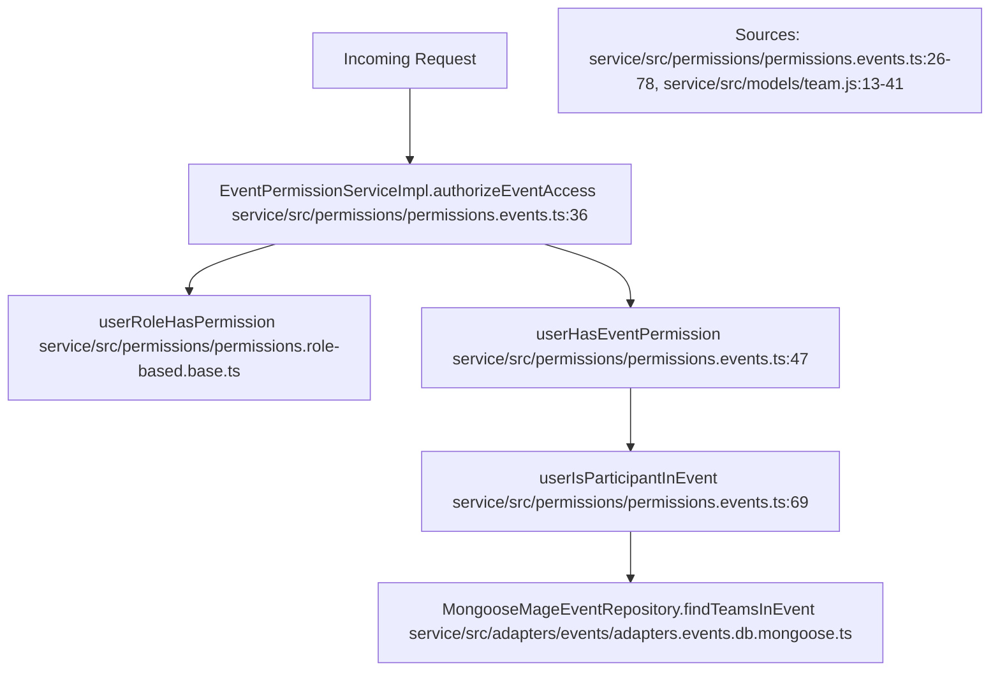
*Sources: [service/src/permissions/permissions.events.ts:26-78](), [service/src/models/team.js:13-41]()*

---

## 4. Map Layers and GeoPackage Processing Pipeline

Map layers provide contextual spatial data (such as WMS, WFS, or GeoPackage files) to events [service/src/routes/layers.js:1-60]().

### GeoPackage Ingestion Workflow

When a GeoPackage layer is uploaded, the service validates the file, extracts spatial tables, sets the initial state to `unavailable` or `processing`, and invokes an asynchronous optimization and indexing routine [service/src/routes/layers.js:35-160]().

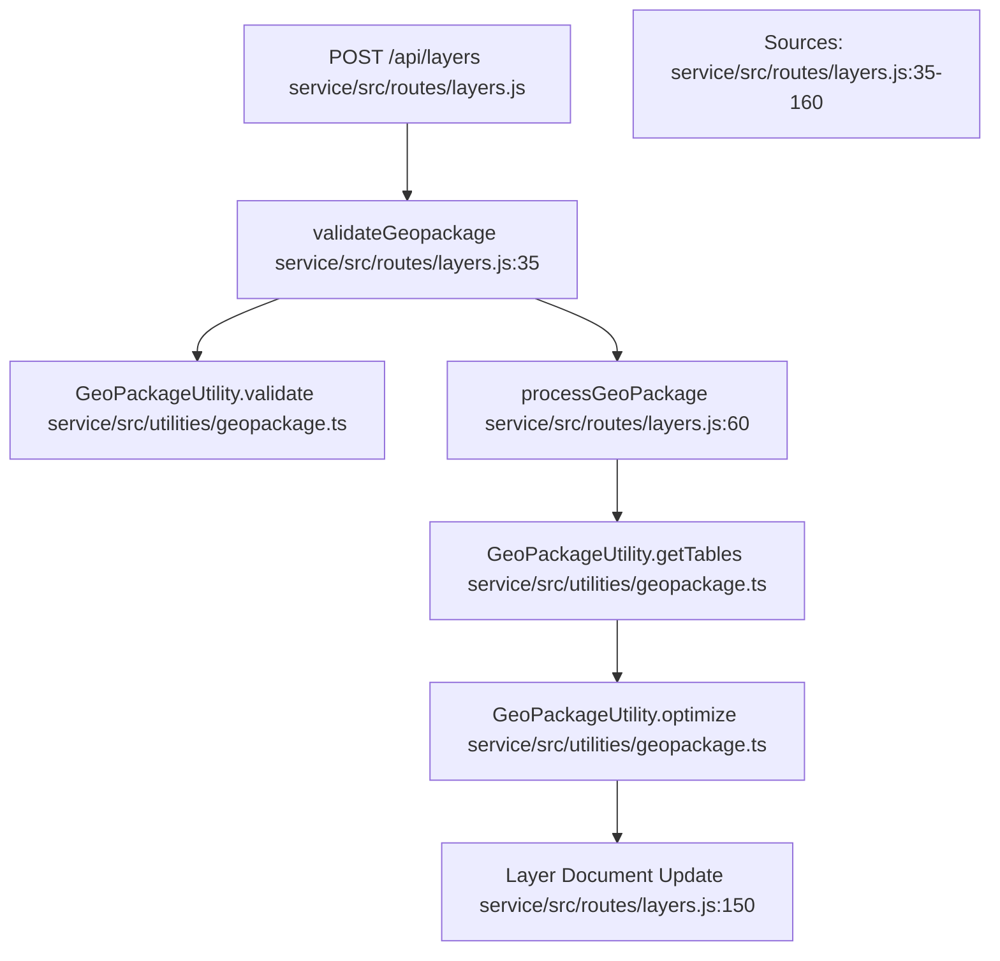
*Sources: [service/src/routes/layers.js:35-160]()*

---

# Page: Users, Authentication and Authorization

# Users, Authentication and Authorization

<details>
<summary>Relevant source files</summary>

The following files were used as context for generating this wiki page:

- [service/src/adapters/roles/adapters.roles.db.mongoose.ts](service/src/adapters/roles/adapters.roles.db.mongoose.ts)
- [service/src/api/icon.js](service/src/api/icon.js)
- [service/src/api/user.js](service/src/api/user.js)
- [service/src/app.api/roles/app.api.roles.ts](service/src/app.api/roles/app.api.roles.ts)
- [service/src/app.impl/roles/app.impl.roles.ts](service/src/app.impl/roles/app.impl.roles.ts)
- [service/src/assets/fonts/Roboto-Regular.ttf](service/src/assets/fonts/Roboto-Regular.ttf)
- [service/src/authentication/ldap.js](service/src/authentication/ldap.js)
- [service/src/authentication/oauth.js](service/src/authentication/oauth.js)
- [service/src/authentication/openidconnect.js](service/src/authentication/openidconnect.js)
- [service/src/authentication/saml.js](service/src/authentication/saml.js)
- [service/src/entities/authorization/entities.authorization.ts](service/src/entities/authorization/entities.authorization.ts)
- [service/src/entities/authorization/entities.permissions.ts](service/src/entities/authorization/entities.permissions.ts)
- [service/src/environment/env.js](service/src/environment/env.js)
- [service/src/migrations/007-user-icon.js](service/src/migrations/007-user-icon.js)
- [service/src/migrations/030-add-read-system-info-permissions.js](service/src/migrations/030-add-read-system-info-permissions.js)
- [service/src/models/authentication.js](service/src/models/authentication.js)
- [service/src/models/role.js](service/src/models/role.js)
- [service/src/models/user.d.ts](service/src/models/user.d.ts)
- [service/src/models/user.js](service/src/models/user.js)
- [service/src/permissions/permissions.systemInfo.ts](service/src/permissions/permissions.systemInfo.ts)
- [service/src/plugins.api/plugins.api.attachments.ts](service/src/plugins.api/plugins.api.attachments.ts)
- [service/src/routes/users.js](service/src/routes/users.js)
- [service/src/transformers/user.js](service/src/transformers/user.js)
- [service/test/mockToken.js](service/test/mockToken.js)
- [service/test/models/authenticationTest.js](service/test/models/authenticationTest.js)
- [service/test/pagingTest.js](service/test/pagingTest.js)
- [service/test/permissions/permissions.feeds.test.ts](service/test/permissions/permissions.feeds.test.ts)
- [service/test/permissions/permissions.systemInfo.test.ts](service/test/permissions/permissions.systemInfo.test.ts)
- [service/test/user/userAvatarIconScanTest.js](service/test/user/userAvatarIconScanTest.js)
- [service/test/user/userCreatePostAvatarIconScanTest.js](service/test/user/userCreatePostAvatarIconScanTest.js)
- [service/test/user/userReadTest.js](service/test/user/userReadTest.js)
- [web-app/src/app/ingress/account-status/account-status.component.ts](web-app/src/app/ingress/account-status/account-status.component.ts)
- [web-app/src/app/ingress/authentication/authentication.component.html](web-app/src/app/ingress/authentication/authentication.component.html)
- [web-app/src/app/ingress/authentication/ldap/ldap-authentication.component.html](web-app/src/app/ingress/authentication/ldap/ldap-authentication.component.html)
- [web-app/src/app/ingress/authentication/ldap/ldap-authentication.component.scss](web-app/src/app/ingress/authentication/ldap/ldap-authentication.component.scss)
- [web-app/src/app/ingress/authentication/ldap/ldap-authentication.component.ts](web-app/src/app/ingress/authentication/ldap/ldap-authentication.component.ts)
- [web-app/src/app/ingress/intialize/initialize.component.html](web-app/src/app/ingress/intialize/initialize.component.html)
- [web-app/src/app/ingress/intialize/initialize.component.scss](web-app/src/app/ingress/intialize/initialize.component.scss)
- [web-app/src/app/ingress/intialize/initialize.component.ts](web-app/src/app/ingress/intialize/initialize.component.ts)

</details>


## Purpose and Scope
This section details the MAGE user management, authentication, and authorization subsystem. It covers the Mongoose `User` and `Authentication` models, multi-provider authentication strategies (Local, LDAP, SAML, OAuth, OIDC), user signup workflows with integrated CAPTCHA verification, avatar/icon upload and attachment-scanning pipelines, role-based access control (RBAC), permission services, and event access control lists (ACLs).

Sources: `service/src/models/user.js:1-205` [], `service/src/models/authentication.js:1-214` []

---

## User Model and Mongoose Schema
The `User` model manages user identity, contact details, status, roles, and profile imagery. 

### Schema Definition
The `UserSchema` defines the core database properties for a MAGE user:
* `username`: String, required, unique, and normalized to lowercase [service/src/models/user.js:28]().
* `displayName`: String, required [service/src/models/user.js:29]().
* `email`: String, optional [service/src/models/user.js:30]().
* `phones`: Array of subdocuments containing `type` and `number` [service/src/models/user.js:18-24,31]().
* `avatar` & `icon`: Subdocuments tracking content type, size, storage paths, and icon creation configurations (`none`, `upload`, `create`) [service/src/models/user.js:32-44]().
* `active` & `enabled`: Boolean flags controlling user access state [service/src/models/user.js:45-46]().
* `roleId`: Reference to the `Role` model [service/src/models/user.js:47]().
* `authenticationId`: Reference to the polymorphic `Authentication` model [service/src/models/user.js:50]().

### Middleware and Hooks
* **Duplicate Prevention (`pre('save')`)**: Automatically lowercases `username` and queries the database for existing duplicates, throwing a `409` error if a collision is detected [service/src/models/user.js:70-86]().
* **Token Invalidation (`pre('save')`)**: Automatically removes all active authentication tokens for a user if `active` or `enabled` is set to `false` [service/src/models/user.js:88-97]().
* **Cascade Deletion (`pre('deleteOne')`)**: Cleans up associated user locations, tokens, logins, observations, event ACLs, team ACLs, and the linked `Authentication` document [service/src/models/user.js:114-154]().
* **Object Transformation (`DbUserToObject`)**: Strips internal storage paths (`avatar.relativePath`), transforms `_id` to `id`, and embeds populated `role` and `authentication` objects during serialization [service/src/models/user.js:157-197]().

Sources: `service/src/models/user.js:1-205` [], `service/src/models/user.d.ts:1-64` []

```mermaid
title "User Model Lifecycle and Hook Architecture"

graph TD
    UserDoc["UserDocument"] --> PreSave["UserSchema.pre('save')"]
    PreSave --> CheckDup["Verify Unique Lowercase Username"]
    PreSave --> CheckActive["Check active/enabled Flags"]
    CheckActive -->|Inactive| ClearTokens["Token.removeTokensForUser()"]
    
    UserDoc --> PreDelete["UserSchema.pre('deleteOne')"]
    PreDelete --> DelLoc["userLocationRepo.deleteLocationsForUser()"]
    PreDelete --> DelToken["Token.removeTokensForUser()"]
    PreDelete --> DelLogin["Login.removeLoginsForUser()"]
    PreDelete --> DelObs["Observation.removeUser()"]
    PreDelete --> DelEvent["Event.removeUserFromAllAcls()"]
    PreDelete --> DelAuth["Authentication.removeAuthenticationById()"]
```
Sources: `service/src/models/user.js:26-154` []

---

## Authentication Subsystem and Strategies
MAGE uses a polymorphic Mongoose schema (`AuthenticationSchema`) with a discriminator key `type` to support multiple authentication providers [service/src/models/authentication.js:13-28]().

### Discriminator Strategies
* **Local (`local`)**: Stores salted/hashed passwords using `pbkdf2` [service/src/models/authentication.js:5-10,40-50](). Tracks security metadata such as `locked`, `lockedUntil`, `invalidLoginAttempts`, and `numberOfTimesLocked` [service/src/models/authentication.js:44-49]().
* **SAML (`saml`)**: Integrates with external SAML IdPs [service/src/models/authentication.js:65,155]().
* **LDAP (`ldap`)**: Authenticates users against directory services [service/src/models/authentication.js:66,158]().
* **OAuth (`oauth`)**: OAuth2 credential integration [service/src/models/authentication.js:67,161]().
* **OpenID Connect (`openidconnect`)**: OIDC token-based authentication [service/src/models/authentication.js:68,164]().

### Password Policies and Pre-Save Operations
When saving local authentication credentials, the `LocalSchema` executes validation checks via `PasswordValidator` against the system's `passwordPolicy` configuration [service/src/models/authentication.js:75-99](). Passwords are hashed using PBKDF2, added to `previousPasswords` history (bounded by `passwordHistoryCount`), and trigger token removal upon modification [service/src/models/authentication.js:101-143]().

Sources: `service/src/models/authentication.js:1-214` []

---

## User Routes, Signup, CAPTCHA, and Upload Pipelines

### User API & Routes
User management endpoints (`/api/users`) handle creation, reads, updates, and deletions [service/src/routes/users.js:186-203](). Account creation through `User.prototype.create` resolves the target authentication configuration, reads default team/event assignments, and runs attachment pipelines for profile images [service/src/api/user.js:91-186]().

### CAPTCHA Integration
Signup and authentication verification flows utilize `captcha-canvas` along with bundled fonts registered via `skia-canvas` (`FontLibrary.use`) to render CAPTCHA challenges [service/src/routes/users.js:47-57](). These are verified using a passport bearer strategy bound to the `TokenAssertion.Captcha` payload [service/src/routes/users.js:59-71]().

### Avatar/Icon Upload & Scanning Pipeline
Multipart uploads for user avatars and icons are processed using a dedicated `Upload` multer middleware configured with `environment.userContentMaxSize` [service/src/routes/users.js:25-26](). Upload errors are intercepted by `handleUserContentUploadError` to return clean `400 Bad Request` responses for file size limit violations [service/src/routes/users.js:31-37](). Staged files are run through content-scanning hooks via `runPipeline(getAttachmentHooks(), ...)` before being moved to permanent storage [service/src/api/user.js:119-138]().

Sources: `service/src/routes/users.js:1-203` [], `service/src/api/user.js:91-186` [], `service/src/plugins.api/plugins.api.attachments.ts:1-49` []

```mermaid
title "User Creation and Authentication Configuration Data Flow"

graph TD
    PostUser["POST /api/users"] --> ValUser["validateUsername()"]
    ValUser --> ValAcct["validateAccount()"]
    ValAcct --> ParseIcon["parseIconUpload()"]
    ParseIcon --> UserCreate["User.prototype.create()"]
    
    UserCreate --> GetConfig["AuthenticationConfiguration.getConfiguration()"]
    GetConfig --> CreateAuth["UserModel.createUser()"]
    
    CreateAuth --> CheckAvatar{Options.avatar present?}
    CheckAvatar -->|Yes| RunPipeline["runPipeline(getAttachmentHooks())"]
    RunPipeline -->|Pass| MoveAvatar["fs.move() to avatarPath"]
    RunPipeline -->|Reject/Error| WarnLog["Log Warning & Remove Temp File"]
    
    MoveAvatar --> SaveUser["newUser.save()"]
    SaveUser --> AssignTeams["TeamModel.addUser() (Default Teams/Events)"]
```
Sources: `service/src/routes/users.js:186-203` [], `service/src/api/user.js:91-186` []

---

## Roles, Permissions Services, and Event ACLs

### Permission Enums
System permissions are centralized in `entities.permissions.ts`, enumerating capabilities across devices, users, roles, events, layers, observations, locations, teams, settings, feeds, static icons, system info, and exports [service/src/entities/authorization/entities.permissions.ts:1-102](). 

Examples include:
* `UsersPermission`: `CREATE_USER`, `READ_USER`, `UPDATE_USER`, `DELETE_USER`, `UPDATE_USER_ROLE`, `UPDATE_USER_PASSWORD` [service/src/entities/authorization/entities.permissions.ts:8-15]().
* `SystemInfoPermission`: `READ_SYSTEM_INFO` [service/src/entities/authorization/entities.permissions.ts:81-83]().

### Role-Based Permission Services
Permissions are enforced through service classes such as `RoleBasedSystemInfoPermissionService`, which evaluates context requests against user roles via `ensureContextUserHasPermission` [service/src/permissions/permissions.systemInfo.ts:13-19]() and returns structured `PermissionDeniedError` objects when checks fail [service/test/permissions/permissions.systemInfo.test.ts:34-42]().

### Event and Team ACLs
When a user is deleted, the `UserSchema.pre('deleteOne')` middleware automatically invokes `Event.removeUserFromAllAcls()` and `Team.removeUserFromAllAcls()` to purge the user from all event and team access control lists [service/src/models/user.js:139-146]().

Sources: `service/src/entities/authorization/entities.permissions.ts:1-140` [], `service/src/permissions/permissions.systemInfo.ts:1-21` [], `service/src/models/user.js:114-154` []

---

# Page: Feeds, Locations, Exports and System Info

# Feeds, Locations, Exports and System Info

<details>
<summary>Relevant source files</summary>

The following files were used as context for generating this wiki page:

- [service/src/access/index.ts](service/src/access/index.ts)
- [service/src/adapters/exports/adapters.exports.controllers.web.ts](service/src/adapters/exports/adapters.exports.controllers.web.ts)
- [service/src/adapters/feeds/adapters.feeds.controllers.web.ts](service/src/adapters/feeds/adapters.feeds.controllers.web.ts)
- [service/src/adapters/feeds/adapters.feeds.db.mongoose.ts](service/src/adapters/feeds/adapters.feeds.db.mongoose.ts)
- [service/src/adapters/icons/adapters.icons.db.mongoose.ts](service/src/adapters/icons/adapters.icons.db.mongoose.ts)
- [service/src/adapters/locations/adapters.locations.controllers.web.ts](service/src/adapters/locations/adapters.locations.controllers.web.ts)
- [service/src/adapters/locations/adapters.locations.recent.db.mongoose.ts](service/src/adapters/locations/adapters.locations.recent.db.mongoose.ts)
- [service/src/adapters/systemInfo/adapters.systemInfo.controllers.web.ts](service/src/adapters/systemInfo/adapters.systemInfo.controllers.web.ts)
- [service/src/adapters/systemInfo/adapters.systemInfo.service.ts](service/src/adapters/systemInfo/adapters.systemInfo.service.ts)
- [service/src/app.api/app.api.global.ts](service/src/app.api/app.api.global.ts)
- [service/src/app.api/events/app.api.events.ts](service/src/app.api/events/app.api.events.ts)
- [service/src/app.api/exports/app.api.exports.ts](service/src/app.api/exports/app.api.exports.ts)
- [service/src/app.api/feeds/app.api.feeds.ts](service/src/app.api/feeds/app.api.feeds.ts)
- [service/src/app.api/locations/app.api.locations.ts](service/src/app.api/locations/app.api.locations.ts)
- [service/src/app.api/systemInfo/app.api.systemInfo.ts](service/src/app.api/systemInfo/app.api.systemInfo.ts)
- [service/src/app.impl/events/app.impl.events.ts](service/src/app.impl/events/app.impl.events.ts)
- [service/src/app.impl/exports/app.impl.exports.csv.ts](service/src/app.impl/exports/app.impl.exports.csv.ts)
- [service/src/app.impl/exports/app.impl.exports.geojson.ts](service/src/app.impl/exports/app.impl.exports.geojson.ts)
- [service/src/app.impl/exports/app.impl.exports.geopackage.ts](service/src/app.impl/exports/app.impl.exports.geopackage.ts)
- [service/src/app.impl/exports/app.impl.exports.kml.ts](service/src/app.impl/exports/app.impl.exports.kml.ts)
- [service/src/app.impl/exports/app.impl.exports.ts](service/src/app.impl/exports/app.impl.exports.ts)
- [service/src/app.impl/feeds/app.impl.feeds.ts](service/src/app.impl/feeds/app.impl.feeds.ts)
- [service/src/app.impl/systemInfo/app.impl.systemInfo.ts](service/src/app.impl/systemInfo/app.impl.systemInfo.ts)
- [service/src/entities/entities.i18n.ts](service/src/entities/entities.i18n.ts)
- [service/src/entities/entities.json_types.ts](service/src/entities/entities.json_types.ts)
- [service/src/entities/feeds/entities.feeds.ts](service/src/entities/feeds/entities.feeds.ts)
- [service/src/entities/icons/entities.icons.ts](service/src/entities/icons/entities.icons.ts)
- [service/src/entities/locations/entities.locations.ts](service/src/entities/locations/entities.locations.ts)
- [service/src/entities/systemInfo/entities.systemInfo.ts](service/src/entities/systemInfo/entities.systemInfo.ts)
- [service/src/models/role.d.ts](service/src/models/role.d.ts)
- [service/src/permissions/permissions.exports.ts](service/src/permissions/permissions.exports.ts)
- [service/src/permissions/permissions.locations.ts](service/src/permissions/permissions.locations.ts)
- [service/src/permissions/permissions.role-based.base.ts](service/src/permissions/permissions.role-based.base.ts)
- [service/test/adapters/events/adapters.events.controllers.web.test.ts](service/test/adapters/events/adapters.events.controllers.web.test.ts)
- [service/test/adapters/exports/adapters.exports.controllers.web.test.ts](service/test/adapters/exports/adapters.exports.controllers.web.test.ts)
- [service/test/adapters/feeds/adapters.feeds.controllers.web.test.ts](service/test/adapters/feeds/adapters.feeds.controllers.web.test.ts)
- [service/test/adapters/feeds/adapters.feeds.db.mongoose.test.ts](service/test/adapters/feeds/adapters.feeds.db.mongoose.test.ts)
- [service/test/adapters/icons/adapters.icons.controllers.web.test.ts](service/test/adapters/icons/adapters.icons.controllers.web.test.ts)
- [service/test/adapters/icons/adapters.icons.db.mongoose.test.ts](service/test/adapters/icons/adapters.icons.db.mongoose.test.ts)
- [service/test/adapters/locations/adapters.locations.controllers.web.test.ts](service/test/adapters/locations/adapters.locations.controllers.web.test.ts)
- [service/test/adapters/locations/adapters.locations.recents.db.mongoose.test.ts](service/test/adapters/locations/adapters.locations.recents.db.mongoose.test.ts)
- [service/test/adapters/plugins/adapters.plugins.db.mongoose.test.ts](service/test/adapters/plugins/adapters.plugins.db.mongoose.test.ts)
- [service/test/adapters/systemInfo/adapters.systemInfo.controllers.web.test.ts](service/test/adapters/systemInfo/adapters.systemInfo.controllers.web.test.ts)
- [service/test/app/events/app.events.test.ts](service/test/app/events/app.events.test.ts)
- [service/test/app/exports/app.exports.test.ts](service/test/app/exports/app.exports.test.ts)
- [service/test/app/feeds/app.feeds.test.ts](service/test/app/feeds/app.feeds.test.ts)
- [service/test/app/icons/app.icons.test.ts](service/test/app/icons/app.icons.test.ts)
- [service/test/app/locations/app.locations.test.ts](service/test/app/locations/app.locations.test.ts)
- [service/test/app/systemInfo/app.systemInfo.test.ts](service/test/app/systemInfo/app.systemInfo.test.ts)
- [service/test/entities/entities.i18n.test.ts](service/test/entities/entities.i18n.test.ts)
- [service/test/entities/feeds/entities.feeds.test.ts](service/test/entities/feeds/entities.feeds.test.ts)
- [service/test/init.test.ts](service/test/init.test.ts)
- [service/test/permissions/permissions.exports.test.ts](service/test/permissions/permissions.exports.test.ts)
- [service/test/permissions/permissions.icons.test.ts](service/test/permissions/permissions.icons.test.ts)
- [service/test/permissions/permissions.locations.test.ts](service/test/permissions/permissions.locations.test.ts)
- [service/test/utilities/authenticationApiAppenderTest.js](service/test/utilities/authenticationApiAppenderTest.js)
- [web-app/src/app/entities/user/entities.user-location.ts](web-app/src/app/entities/user/entities.user-location.ts)
- [web-app/src/app/map/marker/LocationMarker.ts](web-app/src/app/map/marker/LocationMarker.ts)

</details>


## Purpose and Scope
This section details the implementation of peripheral yet critical subsystems within the `@ngageoint/mage.service` backend architecture. Specifically, this covers:
- **Feeds**: Federated data sources, service types, topic discovery, and connection abstractions (`[service/src/entities/feeds/entities.feeds.ts]()`, `[service/src/app.impl/feeds/app.impl.feeds.ts]`).
- **Locations**: Real-time and historical user tracking repositories and controllers (`[service/src/entities/locations/entities.locations.ts]()`).
- **Exports**: Streaming archive generation across multiple geospatial and tabular formats (CSV, GeoJSON, KML, GeoPackage) (`[service/src/app.impl/exports/app.impl.exports.csv.ts]()`).
- **System Info**: Node/MongoDB environment metrics, version metadata, dynamic disclaimers, contact info, and authentication strategy inspection (`[service/src/app.impl/systemInfo/app.impl.systemInfo.ts]()`, `[service/src/entities/systemInfo/entities.systemInfo.ts]`).
- **Icons**: Static icon asset repositories, URL scheme resolution, and content-hash tracking (`[service/test/adapters/icons/adapters.icons.db.mongoose.test.ts]()`).

---

## 1. Feeds Subsystem

The Feeds subsystem enables MAGE to integrate external geospatial and tabular data feeds (such as OGC WFS, OGC API - Features, ATAK CoT via Marti API, and NGA Maritime Safety Information) into MAGE events and maps.

### Entities and Domain Model
- **`FeedServiceType`**: Defines a registered plugin service category (e.g., `urn:ogc:wfs`), its configuration JSON schema (`configSchema`), and validation rules (`[service/src/entities/feeds/entities.feeds.ts:33-50]()`).
- **`FeedService`**: Represents a configured instance of a feed service pointing to a specific endpoint with specific credentials or options (`[service/src/entities/feeds/entities.feeds.ts:77-83]()`).
- **`FeedServiceConnection`**: An active connection handle generated by a service type, exposing `fetchServiceInfo()`, `fetchAvailableTopics()`, and `fetchTopicContent()` (`[service/src/entities/feeds/entities.feeds.ts:85-94]()`).
- **`FeedTopic`**: A specific topic or layer within a feed service, including spatial/identity flags and property schemas (`[service/src/entities/feeds/entities.feeds.ts:121-174]()`).

### Use Cases and Application Logic
Application use cases are implemented in `[service/src/app.impl/feeds/app.impl.feeds.ts]()`:
- `ListFeedServiceTypes`: Lists all registered service types after checking `ensureListServiceTypesPermissionFor()` (`[service/src/app.impl/feeds/app.impl.feeds.ts:14-24]`).
- `PreviewTopics`: Validates service configuration against the service type schema and queries the remote connection for available topics (`[service/src/app.impl/feeds/app.impl.feeds.ts:26-50]`).
- `CreateFeedService`, `ListFeedServices`, `GetFeedService`, `DeleteFeedService`: Manages persistent storage and redaction of sensitive configuration parameters (`[service/src/app.impl/feeds/app.impl.feeds.ts:52-120]`).

```mermaid
graph TD
  Client["Client Request"] -->|HTTP GET/POST| WebRoutes["FeedsRoutes"]
  WebRoutes -->|Invokes| AppLayer["ListFeedServiceTypes / PreviewTopics / CreateFeedService"]
  AppLayer -->|Validates Config| ServiceType["FeedServiceType"]
  ServiceType -->|Creates Connection| Conn["FeedServiceConnection"]
  Conn -->|Fetches Topics| RemoteAPI["External Geospatial Service"]
  AppLayer -->|Persists| ServiceRepo["FeedServiceRepository"]

  sub5["Sources: [service/src/app.impl/feeds/app.impl.feeds.ts](), [service/src/entities/feeds/entities.feeds.ts]()"]
  click sub5 href ""
```

Sources: `[service/src/app.impl/feeds/app.impl.feeds.ts]()`, `[service/src/entities/feeds/entities.feeds.ts]()`, `[service/test/adapters/feeds/adapters.feeds.controllers.web.test.ts]()`

---

## 2. Location Tracking Subsystem

The Location Tracking subsystem records and queries real-time and historical positional updates for users and their connected devices.

### Entities and Repositories
- **`UserLocation`**: Represents a point location associated with a user, device, timestamp, and optional accuracy/altitude metadata (`[service/src/entities/locations/entities.locations.ts]()`).
- **`UserLocationRepository`**: Interface governing location storage, bounding-box queries, and recents aggregation (`[service/src/adapters/locations/adapters.locations.recent.db.mongoose.ts]()`).

Data flowing from mobile clients is ingested through location controllers, authenticated against event scopes, and persisted to MongoDB collections optimized for spatial indexes.

Sources: `[service/src/entities/locations/entities.locations.ts]()`, `[service/src/adapters/locations/adapters.locations.recent.db.mongoose.ts]()`

---

## 3. Export Subsystem

MAGE supports exporting event observations and user locations into structured archive bundles containing CSV, GeoJSON, KML, or GeoPackage files.

### Streaming Architecture
The `CsvExportTransform` class (`[service/src/app.impl/exports/app.impl.exports.csv.ts]()`) demonstrates the streaming export pattern:
1. **Archive Initialization**: Uses `archiver` to stream zip archives directly to HTTP response streams.
2. **Observation Streaming**: Iterates over observations matching filter specifications (`IterateObservations`), calculating centroids, formatting MGRS coordinates via `mgrs.forward()`, parsing WKT via `wkx`, and generating dynamic CSV columns based on event form definitions (`[service/src/app.impl/exports/app.impl.exports.csv.ts:44-95]()`).
3. **Async JSON-to-CSV Parsing**: Pipes observation attribute objects through `json2csv.AsyncParser` (`[service/src/app.impl/exports/app.impl.exports.csv.ts:92-95]()`).

```mermaid
graph LR
  ExportReq["Export Request"] -->|Triggers| CsvExport["CsvExportTransform.export"]
  CsvExport -->|Stream Observations| Iter["IterateObservations"]
  Iter -->|Fetch User & Device| Cache["User & Device Cache"]
  Cache -->|Compute MGRS / WKT| Transformer["json2csv.AsyncParser"]
  Transformer -->|Pipe Output| Archiver["archiver.Archiver (ZIP)"]
  Archiver -->|HTTP Stream| ClientRes["Client Response"]

  sub5["Sources: [service/src/app.impl/exports/app.impl.exports.csv.ts]()"]
  click sub5 href ""
```

Sources: `[service/src/app.impl/exports/app.impl.exports.csv.ts]()`, `[service/src/app.impl/exports/app.impl.exports.geojson.ts]()`, `[service/src/app.impl/exports/app.impl.exports.kml.ts]()`, `[service/src/app.impl/exports/app.impl.exports.geopackage.ts]()`

---

## 4. System Info API

The System Info API provides clients (web and mobile applications) with server runtime characteristics, compatibility version checks, and enabled authentication strategies.

### Implementation Details
The factory function `CreateReadSystemInfo` (`[service/src/app.impl/systemInfo/app.impl.systemInfo.ts:14-83]()`) orchestrates the system info payload:
- **User Count & Initial Setup**: Checks if any users exist in the database (`legacyUsers.count`) to determine if the server is in initial setup mode (`initial: userCount == 0`) (`[service/src/app.impl/systemInfo/app.impl.systemInfo.ts:50-61]()`).
- **Settings & Metadata**: Retrieves dynamic server settings such as `disclaimer` and `contactinfo` from the settings model (`[service/src/app.impl/systemInfo/app.impl.systemInfo.ts:62-63]()`).
- **Environment Inspection**: If the requesting principal holds the `READ_SYSTEM_INFO` permission (`[service/src/permissions/permissions.systemInfo.ts]()`), environment details (Node version, MongoDB version) are appended via `EnvironmentService` (`[service/src/app.impl/systemInfo/app.impl.systemInfo.ts:67-74]()`).
- **Authentication Strategies**: Appends all enabled authentication configurations transformed via `AuthenticationConfigurationTransformer` with whitelist filtering (`[service/src/app.impl/systemInfo/app.impl.systemInfo.ts:32-44, 77-79]()`).

```mermaid
graph TD
  Req["GET /api (ReadSystemInfoRequest)"] -->|Calls| Impl["CreateReadSystemInfo"]
  Impl -->|Query User Count| UsersModel["Users Model"]
  Impl -->|Fetch Settings| SettingsModel["Settings Model (Disclaimer/Contact)"]
  Impl -->|Check Permissions| Perms["SystemInfoPermissionService"]
  Perms -->|Authorized?| Env["EnvironmentService (Node/Mongo Versions)"]
  Impl -->|Fetch Auth Configs| AuthConfig["AuthenticationConfiguration Model"]
  AuthConfig -->|Transform & Whitelist| Transformer["AuthenticationConfigurationTransformer"]
  Impl -->|Returns Combined Response| ExoSys["ExoSystemInfo / ExoPrivilegedSystemInfo"]

  sub5["Sources: [service/src/app.impl/systemInfo/app.impl.systemInfo.ts](), [service/src/entities/systemInfo/entities.systemInfo.ts]()"]
  click sub5 href ""
```

Sources: `[service/src/app.impl/systemInfo/app.impl.systemInfo.ts]()`, `[service/src/entities/systemInfo/entities.systemInfo.ts]()`, `[service/test/app/systemInfo/app.systemInfo.test.ts]()`

---

## 5. Icons Subsystem

The Icons subsystem manages static and dynamic icon assets used for mapping symbology across observations, feeds, and layers.

### Repository and URL Resolution
- **`StaticIcon` / `StaticIconStub`**: Entities describing static icon metadata, dimensions, media type, content hashes, and source URLs (`[service/test/adapters/icons/adapters.icons.db.mongoose.test.ts:73-85]()`).
- **`MongooseStaticIconRepository`**: Handles registration and deduplication via source URLs and content hashes (`[service/test/adapters/icons/adapters.icons.db.mongoose.test.ts:88-96]()`). When an icon's content hash changes, properties are automatically updated (`[service/test/adapters/icons/adapters.icons.db.mongoose.test.ts:132-177]()`).
- **URL Schemes**: Resolves custom icon schemes (`UrlScheme`, `UrlResolutionError`) to fetch binary graphic content safely (`[service/test/adapters/icons/adapters.icons.db.mongoose.test.ts:15-25]()`).

Sources: `[service/test/adapters/icons/adapters.icons.db.mongoose.test.ts]()`, `[service/src/adapters/icons/adapters.icons.db.mongoose.ts]()`

---

# Page: Persistence, Migrations and Service Testing

# Persistence, Migrations and Service Testing

<details>
<summary>Relevant source files</summary>

The following files were used as context for generating this wiki page:

- [service/functionalTests/client.ts](service/functionalTests/client.ts)
- [service/functionalTests/config/testConfig.json](service/functionalTests/config/testConfig.json)
- [service/functionalTests/observations/fixture.ts](service/functionalTests/observations/fixture.ts)
- [service/functionalTests/observations/observations.test.ts](service/functionalTests/observations/observations.test.ts)
- [service/functionalTests/teams/fixture.ts](service/functionalTests/teams/fixture.ts)
- [service/functionalTests/teams/teams.test.ts](service/functionalTests/teams/teams.test.ts)
- [service/functionalTests/testRecordings.js](service/functionalTests/testRecordings.js)
- [service/functionalTests/users/fixture.ts](service/functionalTests/users/fixture.ts)
- [service/functionalTests/users/users.test.ts](service/functionalTests/users/users.test.ts)
- [service/src/adapters/adapters.db.mongoose.ts](service/src/adapters/adapters.db.mongoose.ts)
- [service/src/adapters/base/adapters.base.db.mongoose.ts](service/src/adapters/base/adapters.base.db.mongoose.ts)
- [service/src/authentication/local.js](service/src/authentication/local.js)
- [service/src/docs/openapi.yaml](service/src/docs/openapi.yaml)
- [service/src/format/geoJsonFormat.js](service/src/format/geoJsonFormat.js)
- [service/src/migrate.ts](service/src/migrate.ts)
- [service/src/migrations/025-add-auth-config-permissions.js](service/src/migrations/025-add-auth-config-permissions.js)
- [service/src/models/authenticationconfiguration.js](service/src/models/authenticationconfiguration.js)
- [service/src/models/index.js](service/src/models/index.js)
- [service/src/provision/none.js](service/src/provision/none.js)
- [service/src/provision/uid.js](service/src/provision/uid.js)
- [service/src/routes/devices.js](service/src/routes/devices.js)
- [service/src/routes/imports.ts](service/src/routes/imports.ts)
- [service/src/utilities/transformKML.ts](service/src/utilities/transformKML.ts)
- [service/test/device/deviceDeleteTest.js](service/test/device/deviceDeleteTest.js)
- [service/test/device/deviceReadTest.js](service/test/device/deviceReadTest.js)
- [service/test/device/deviceUpdateTest.js](service/test/device/deviceUpdateTest.js)
- [service/test/event/eventCreateTest.js](service/test/event/eventCreateTest.js)
- [service/test/event/eventDeleteTest.js](service/test/event/eventDeleteTest.js)
- [service/test/models/authenticationconfigurationTest.js](service/test/models/authenticationconfigurationTest.js)
- [service/test/mongo.test.ts](service/test/mongo.test.ts)
- [service/test/observation/observationCreateTest.js](service/test/observation/observationCreateTest.js)
- [service/test/observation/observationDeleteTest.js](service/test/observation/observationDeleteTest.js)
- [service/test/user/userCreateTest.js](service/test/user/userCreateTest.js)
- [service/test/user/userUpdateTest.js](service/test/user/userUpdateTest.js)
- [web-app/src/app/map/marker/FixedWidthMarker.ts](web-app/src/app/map/marker/FixedWidthMarker.ts)

</details>


## Purpose and Scope
This page covers the persistence layer abstractions, Mongoose base adapters, model configuration, the database migration runner and scripts, the testing infrastructure (unit, integration, and functional test suites), and the OpenAPI specification definitions for the `@ngageoint/mage.service` package.

---

## Mongoose Base Adapters and Repositories

Mappable persistence is implemented using TypeScript generics over Mongoose models and plain JavaScript/TypeScript entity objects. The foundational data access pattern is defined in `service/src/adapters/base/adapters.base.db.mongoose.ts`.

### Key Classes and Functions
* `BaseMongooseRepository<D, M, E>`: A generic repository class that encapsulates standard CRUD operations (`create`, `findAll`, `findById`, `findAllByIds`, `update`, `removeById`) [service/src/adapters/base/adapters.base.db.mongoose.ts:38-108]().
* Type Parameters:
  * `D`: The Mongoose document type stored in MongoDB [service/src/adapters/base/adapters.base.db.mongoose.ts:32]().
  * `M`: A `mongoose.Model<D>` instance [service/src/adapters/base/adapters.base.db.mongoose.ts:33]().
  * `E`: The plain object entity interface returned by repository queries [service/src/adapters/base/adapters.base.db.mongoose.ts:34-36]().
* Mapping Helpers:
  * `createDefaultDocMapping()`: Transforms a hydrated Mongoose document into an entity via `.toJSON<E>()` [service/src/adapters/base/adapters.base.db.mongoose.ts:20-22]().
  * `createDefaultEntityMapping()`: Passes raw entity objects directly as database stubs [service/src/adapters/base/adapters.base.db.mongoose.ts:27-29]().
* Pagination:
  * `pageQuery()`: Applies limit, skip, and optional total count computations to a Mongoose query instance [service/src/adapters/base/adapters.base.db.mongoose.ts:110-119]().

```mermaid
graph TD
    A["Caller (app.api / routes)"] -->|Calls methods| B["BaseMongooseRepository<D, M, E>"]
    B -->|Uses model stubs| C["DocumentMapping<D, E>"]
    B -->|Hydrates docs| D["EntityMapping<D, E>"]
    B -->|Executes queries| E["mongoose.Model<D>"]
    E -->|Reads/Writes| F[(MongoDB Database)]

    sub5["Sources: service/src/adapters/base/adapters.base.db.mongoose.ts:38-108"]
```
*Sources: service/src/adapters/base/adapters.base.db.mongoose.ts:38-108*

---

## Database Migrations

Database schema updates and data transformations are managed using the `@ngageoint/mongodb-migrations` library wrapped by `service/src/migrate.ts`.

### Migration Runner Architecture
* `MigrationContext`: Initializes a `Migrator` instance with connection parameters and a migration collection name (`migrations`), logging output via the service logger [service/src/migrate.ts:10-26]().
* `runDatabaseMigrations(mongoUrl, mongoOptions)`: Resolves the local `migrations` directory path (`service/src/migrations/`), constructs a `MigrationContext`, and executes pending migration scripts sequentially [service/src/migrate.ts:56-67]().
* Migration Scripts: Individual JavaScript modules located in `service/src/migrations/` (e.g., `025-add-auth-config-permissions.js`) export `up` and `down` functions for schema adjustments.

```mermaid
sequenceDiagram
    participant CLI as "CLI / Bootstrap"
    participant Runner as "runDatabaseMigrations()"
    participant Ctx as "MigrationContext"
    participant Migrator as "Migrator (@ngageoint/mongodb-migrations)"
    participant DB as "MongoDB collections"

    CLI->>Runner: "runDatabaseMigrations(mongoUrl)"
    Runner->>Ctx: "new MigrationContext('migrations', mongoUrl, ...)"
    Ctx->>Migrator: "runFromDir(migrationsDir, onFinished)"
    Migrator->>DB: "Check 'migrations' collection status"
    DB-->>Migrator: "Return applied migrations"
    Migrator->>DB: "Execute pending scripts (e.g. 025-add-auth-config-permissions.js)"
    Migrator-->>Ctx: "onFinished(err, results)"
    Ctx-->>Runner: "Resolve or exit process on error"

    sub5["Sources: service/src/migrate.ts:10-67"]
```
*Sources: service/src/migrate.ts:10-67*

---

## Unit and Functional Test Suites

MAGE includes two primary test execution frameworks: Mocha-based unit/integration tests with in-memory MongoDB, and Axios-based functional tests against live/test environments.

### In-Memory Database Testing (`service/test/`)
Integration tests use `mongodb-memory-server` to spin up isolated MongoDB instances for testing Mongoose models and Express routes without external dependencies [service/test/mongo.test.ts:41-52]().
* `mongoTestBeforeAllHook()`: Initializes a `MongoMemoryServer` instance, opens a Mongoose connection, and attaches it to the Mocha context (`this.mongo`) [service/test/mongo.test.ts:41-52]().
* `mongoTestAfterAllHook()`: Closes the Mongoose connection and stops the memory server during test teardown [service/test/mongo.test.ts:66-77]().
* Stubbing & Mocking: Unit tests like `service/test/user/userCreateTest.js` and `service/test/models/authenticationconfigurationTest.js` leverage `sinon` and `sinon-mongoose` to isolate handlers and model queries [service/test/user/userCreateTest.js:3-29](), [service/test/models/authenticationconfigurationTest.js:3-5]()

### Functional Testing (`service/functionalTests/`)
Functional test suites interact with a running MAGE server instance using the `MageClientSession` helper class [service/functionalTests/client.ts:11-41]().
* `MageClientSession`: Wraps an `axios` HTTP instance, automatically managing `Authorization` bearer token headers and session states for sign-in flows, user creation, and event operations [service/functionalTests/client.ts:11-77]().

```mermaid
graph TD
    A["Mocha Test Suite"] -->|before() hook| B["mongoTestBeforeAllHook()"]
    B -->|Spawns| C["MongoMemoryServer"]
    C -->|Provides URI| D["mongoose.createConnection(uri)"]
    D -->|Attaches to context| E["this.mongo.conn"]
    A -->|Executes test cases| F["Mongoose Models & Express App"]
    A -->|after() hook| G["mongoTestAfterAllHook()"]
    G -->|Stops server| C

    sub5["Sources: service/test/mongo.test.ts:41-77"]
```
*Sources: service/test/mongo.test.ts:41-77*

---

## OpenAPI Documentation

API endpoints, request parameters, responses, and security schemes are formally specified using OpenAPI 3.0.1 in `service/src/docs/openapi.yaml`.

### Specification Structure
* Info & Servers: Defines API title (`Mage API`), version (`6.0.1`), contact details, and Apache 2.0 license [service/src/docs/openapi.yaml:1-12]().
* Security Schemes: Global security requirements default to `mageToken` [service/src/docs/openapi.yaml:13-15]().
* Tags: Categorizes operations into functional groups including `Auth`, `Authentication Configuration`, `Device`, `Event`, `Export`, `Feed`, `Observation`, `User`, etc [service/src/docs/openapi.yaml:16-34]().
* Paths: Fully describes routes such as `/api/logins`, `/auth/{authenticationStrategy}/signin`, `/auth/token`, and `/api/authentication/configuration/` with query/path parameters, request bodies, and response schemas [service/src/docs/openapi.yaml:36-196]().

```mermaid
graph TD
    A["service/src/docs/openapi.yaml"] -->|Defines Info| B["Title, Version, License"]
    A -->|Defines Security| C["mageToken / bearerAuthentication"]
    A -->|Defines Tags| D["Auth, Event, Observation, User, etc."]
    A -->|Defines Paths| E["/api/logins, /auth/{strategy}/signin, /api/events"]
    E -->|References Schemas| F["Component Schemas (User, Device, Login, etc.)"]

    sub5["Sources: service/src/docs/openapi.yaml:1-196"]
```
*Sources: service/src/docs/openapi.yaml:1-196*

---

# Page: Angular Web Application

# Angular Web Application

<details>
<summary>Relevant source files</summary>

The following files were used as context for generating this wiki page:

- [plugins/image/web-app/.gitignore](plugins/image/web-app/.gitignore)
- [plugins/image/web-app/angular.json](plugins/image/web-app/angular.json)
- [plugins/image/web-app/package-lock.json](plugins/image/web-app/package-lock.json)
- [plugins/image/web-app/package.json](plugins/image/web-app/package.json)
- [plugins/image/web-app/projects/mage-image/package.json](plugins/image/web-app/projects/mage-image/package.json)
- [plugins/image/web-app/projects/mage-image/src/test.ts](plugins/image/web-app/projects/mage-image/src/test.ts)
- [plugins/image/web-app/projects/mage-image/tsconfig.lib.json](plugins/image/web-app/projects/mage-image/tsconfig.lib.json)
- [plugins/image/web-app/projects/mage-image/tsconfig.lib.prod.json](plugins/image/web-app/projects/mage-image/tsconfig.lib.prod.json)
- [web-app/.gitignore](web-app/.gitignore)
- [web-app/angular.json](web-app/angular.json)
- [web-app/projects/core-lib-showcase/src/app/app-routing.module.ts](web-app/projects/core-lib-showcase/src/app/app-routing.module.ts)
- [web-app/projects/core-lib-showcase/src/polyfills.ts](web-app/projects/core-lib-showcase/src/polyfills.ts)
- [web-app/projects/core-lib-showcase/src/styles.scss](web-app/projects/core-lib-showcase/src/styles.scss)
- [web-app/projects/core-lib-showcase/src/test.ts](web-app/projects/core-lib-showcase/src/test.ts)
- [web-app/projects/core-lib/src/test.ts](web-app/projects/core-lib/src/test.ts)
- [web-app/projects/core-lib/tsconfig.lib.json](web-app/projects/core-lib/tsconfig.lib.json)
- [web-app/projects/core-lib/tsconfig.lib.prod.json](web-app/projects/core-lib/tsconfig.lib.prod.json)
- [web-app/src/app/about/about.component.html](web-app/src/app/about/about.component.html)
- [web-app/src/app/about/about.component.scss](web-app/src/app/about/about.component.scss)
- [web-app/src/app/about/about.component.spec.ts](web-app/src/app/about/about.component.spec.ts)
- [web-app/src/app/about/about.component.ts](web-app/src/app/about/about.component.ts)
- [web-app/src/app/admin/admin-breadcrumb/admin-breadcrumb.component.scss](web-app/src/app/admin/admin-breadcrumb/admin-breadcrumb.component.scss)
- [web-app/src/app/app.module.ts](web-app/src/app/app.module.ts)
- [web-app/src/app/observation/observation-edit/observation-edit-select/observation-edit-select.component.html](web-app/src/app/observation/observation-edit/observation-edit-select/observation-edit-select.component.html)
- [web-app/src/main.ts](web-app/src/main.ts)
- [web-app/src/styles.scss](web-app/src/styles.scss)
- [web-app/src/theme.scss](web-app/src/theme.scss)
- [web-app/tsconfig.json](web-app/tsconfig.json)

</details>


The MAGE web application (`web-app/`) is a modern, responsive Angular single-page application that provides a common operating picture (COP), field observation management, event tracking, and a comprehensive administration console. It is built as an Angular workspace containing the primary application and the shared `@ngageoint/mage.core-lib` library.

Sources: `web-app/angular.json:1-166`, `web-app/src/app/app.module.ts:33-36`

---

## Bootstrapping and Application Module

The application begins execution at the main browser entry point, which enables production mode when configured and bootstraps the root `AppModule` via `platformBrowserDynamic` [web-app/src/main.ts:7-11]. 

The root `AppModule` configures global providers, including browser animations, HTTP client interceptors, location strategies, and route reuse policies [web-app/src/app/app.module.ts:25-32]:
- **Location Strategy**: Uses `HashLocationStrategy` to ensure robust client-side routing compatibility across diverse web server deployments [web-app/src/app/app.module.ts:28].
- **Route Reuse**: Implements `RouteReuseByComponentStrategy` to optimize view performance [web-app/src/app/app.module.ts:29].
- **Interceptors**: Registers `TokenInterceptorService` as an HTTP interceptor to attach authentication tokens to outbound API requests [web-app/src/app/app.module.ts:30].

```mermaid
graph TD
  A["main.ts"] -->|"platformBrowserDynamic().bootstrapModule()"| B["AppModule (app.module.ts)"]
  B --> C["AppComponent"]
  B --> D["BannerModule"]
  B --> E["IngressModule"]
  B --> F["AppRoutingModule (routing.module.ts)"]
  
  sub:Providers["Global Providers"]
  B -.->|"provideAnimations()"| G["Browser Animations"]
  B -.->|"HashLocationStrategy"| H["Hash Routing"]
  B -.->|"TokenInterceptorService"| I["HTTP Auth Interceptor"]
```
*Sources: `web-app/src/main.ts:7-11`, `web-app/src/app/app.module.ts:16-32`*

---

## Core Library and Theming

Shared UI components, widgets, and utilities are housed within the `core-lib` project (`web-app/projects/core-lib/`), allowing code reuse across the main application and showcase tools.

The visual design system leverages Angular Material's Material Design (MDC) architecture [web-app/src/theme.scss:7-20]. Global style definitions integrate custom theme color palettes, typography rules, and Leaflet map stylesheets [web-app/src/styles.scss:1-5]:
- **Theme Configuration**: The application defines a light theme using custom primary and tertiary palettes with system variable support [web-app/src/theme.scss:7-13].
- **Layout & Overrides**: Custom SCSS rules manage sidebar positioning, container widths, and list item alignments [web-app/src/styles.scss:21-65].

```mermaid
graph LR
  A["styles.scss"] --> B["theme.scss (Material Theme)"]
  A --> C["roboto.scss (Typography)"]
  A --> D["leaflet.scss (Map UI)"]
  
  B --> E["Angular Material MDC Components"]
  E --> F["core-lib Shared Components"]
```
*Sources: `web-app/src/styles.scss:1-5`, `web-app/src/theme.scss:7-28`*

---

## Build Configuration and Tooling

The application build pipeline is orchestrated via Angular CLI combined with custom webpack configurations (`web-app/webpack.extra.js`) [web-app/angular.json:18-20]. 

The `angular.json` configuration defines multiple projects and environments (`production`, `development`) [web-app/angular.json:62-101]:
- **Custom Webpack Builder**: Uses `@angular-builders/custom-webpack:browser` and `dev-server` builders to support advanced bundling requirements [web-app/angular.json:18,104].
- **Assets & Scripts**: Bundles Leaflet map marker images, third-party libraries (such as `systemjs` and `js_cols`), and Swagger UI assets [web-app/angular.json:27-51].
- **Budgets**: Enforces strict initial bundle size warnings (2MB) and maximum error thresholds (15MB) to maintain client performance [web-app/angular.json:78-83].

Sources: `web-app/angular.json:18-101`

---

## Child Pages and Functional Areas

The MAGE web application is partitioned into distinct functional modules, detailed in the following child pages:

- [Map, Geometry and Coordinate Systems](#3.1) — Leaflet map component, markers, GeoPackage layers, map controls, DMS/MGRS/WGS84 parsing and formatting.
- [Observation UI](#3.2) — Observation list, popups, view, edit forms and field components, attachments carousel/upload, delete flow.
- [Session, Events, Filters and Feeds UI](#3.3) — EventService, filter service, navigation/sidebar, user profile, feed list/items, token interceptor.
- [Ingress and Sign-In Flows](#3.4) — Ingress shell, local/LDAP/IdP authentication components, signup, disclaimer, authorization and account status.
- [Admin Console](#3.5) — Admin shell, navigation/breadcrumbs, dashboards and the admin feature areas.

```mermaid
graph TD
  A["AppModule"] --> B["IngressModule (Sign-In Flows)"]
  A --> C["AppRoutingModule (Main Shell)"]
  
  C --> D["Map, Geometry & Coordinates (#3.1)"]
  C --> E["Observation UI (#3.2)"]
  C --> F["Session, Events & Feeds UI (#3.3)"]
  C --> G["Ingress & Sign-In Flows (#3.4)"]
  C --> H["Admin Console (#3.5)"]
```
*Sources: `web-app/src/app/app.module.ts:13-32`, `web-app/angular.json:6-163`*

---

# Page: Map, Geometry and Coordinate Systems

# Map, Geometry and Coordinate Systems

<details>
<summary>Relevant source files</summary>

The following files were used as context for generating this wiki page:

- [web-app/projects/core-lib-showcase/src/app/user/mock-user-read.service.ts](web-app/projects/core-lib-showcase/src/app/user/mock-user-read.service.ts)
- [web-app/projects/core-lib/angular-cli/builders/fesm-amd.ts](web-app/projects/core-lib/angular-cli/builders/fesm-amd.ts)
- [web-app/src/app/color-picker/color-picker.component.html](web-app/src/app/color-picker/color-picker.component.html)
- [web-app/src/app/color-picker/color-picker.component.ts](web-app/src/app/color-picker/color-picker.component.ts)
- [web-app/src/app/contact/contact-dialog.component.html](web-app/src/app/contact/contact-dialog.component.html)
- [web-app/src/app/datetime-picker/datetime-picker.component.html](web-app/src/app/datetime-picker/datetime-picker.component.html)
- [web-app/src/app/datetime-picker/datetime-picker.component.scss](web-app/src/app/datetime-picker/datetime-picker.component.scss)
- [web-app/src/app/datetime-picker/datetime-picker.component.ts](web-app/src/app/datetime-picker/datetime-picker.component.ts)
- [web-app/src/app/geometry/geometry-dms.spec.ts](web-app/src/app/geometry/geometry-dms.spec.ts)
- [web-app/src/app/geometry/geometry-dms.ts](web-app/src/app/geometry/geometry-dms.ts)
- [web-app/src/app/geometry/geometry.pipe.ts](web-app/src/app/geometry/geometry.pipe.ts)
- [web-app/src/app/map/controls/layers-control.component.html](web-app/src/app/map/controls/layers-control.component.html)
- [web-app/src/app/map/controls/layers-control.component.scss](web-app/src/app/map/controls/layers-control.component.scss)
- [web-app/src/app/map/controls/location.component.html](web-app/src/app/map/controls/location.component.html)
- [web-app/src/app/map/controls/location.component.scss](web-app/src/app/map/controls/location.component.scss)
- [web-app/src/app/map/controls/search.component.html](web-app/src/app/map/controls/search.component.html)
- [web-app/src/app/map/controls/search.component.scss](web-app/src/app/map/controls/search.component.scss)
- [web-app/src/app/map/controls/search.component.spec.ts](web-app/src/app/map/controls/search.component.spec.ts)
- [web-app/src/app/map/controls/search.component.ts](web-app/src/app/map/controls/search.component.ts)
- [web-app/src/app/map/controls/zoom.component.html](web-app/src/app/map/controls/zoom.component.html)
- [web-app/src/app/map/controls/zoom.component.scss](web-app/src/app/map/controls/zoom.component.scss)
- [web-app/src/app/map/geopackage/GeoPackageLayers.ts](web-app/src/app/map/geopackage/GeoPackageLayers.ts)
- [web-app/src/app/map/layers/layer-content.component.scss](web-app/src/app/map/layers/layer-content.component.scss)
- [web-app/src/app/map/layers/layer-header.component.html](web-app/src/app/map/layers/layer-header.component.html)
- [web-app/src/app/map/map.component.ts](web-app/src/app/map/map.component.ts)
- [web-app/src/app/map/marker/ObservationMarker.ts](web-app/src/app/map/marker/ObservationMarker.ts)
- [web-app/src/app/map/marker/ShapePulse.ts](web-app/src/app/map/marker/ShapePulse.ts)
- [web-app/src/app/observation/observation-edit/observation-edit-geometry/observation-edit-geometry-form.component.html](web-app/src/app/observation/observation-edit/observation-edit-geometry/observation-edit-geometry-form.component.html)
- [web-app/src/app/observation/observation-edit/observation-edit-geometry/observation-edit-geometry-form.component.ts](web-app/src/app/observation/observation-edit/observation-edit-geometry/observation-edit-geometry-form.component.ts)
- [web-app/src/app/observation/observation-popup/observation-popup.component.scss](web-app/src/app/observation/observation-popup/observation-popup.component.scss)
- [web-app/src/app/observation/observation-view/observation-view.component.scss](web-app/src/app/observation/observation-view/observation-view.component.scss)
- [web-app/src/app/preferences/coordinate-system/coordinate-system.component.ts](web-app/src/app/preferences/coordinate-system/coordinate-system.component.ts)
- [web-app/src/app/sidebar/sidebar.component.html](web-app/src/app/sidebar/sidebar.component.html)
- [web-app/src/app/sidebar/sidebar.component.ts](web-app/src/app/sidebar/sidebar.component.ts)
- [web-app/src/leaflet.scss](web-app/src/leaflet.scss)
- [web-app/src/test.ts](web-app/src/test.ts)

</details>


## Purpose and Scope

This page documents section **3.1** of the MAGE web application architecture: the mapping subsystems, marker management, GeoPackage layers, map controls, and coordinate systems parsing/formatting (WGS84, MGRS, and DMS). The client-side map is built around **Leaflet**, incorporating custom markers, marker clustering, overlay panes, vector edits via `Leaflet.Editable`, and custom spatial overlays.

---

## 1. Leaflet Map Component & Architecture

The core mapping environment is initialized within `MapComponent` (`web-app/src/app/map/map.component.ts`), which sets up Leaflet panes, zoom controls, and resize observers. To manage rendering layers and guarantee strict draw-order stratification, `MapComponent` uses custom z-index bucket offsets (`PANE_Z_INDEX_BUCKET_SIZE = 10000`).

### Map Panes and Z-Index Stratification

| Pane Group | Offset Constant | Description |
| :--- | :--- | :--- |
| `base` | `MapComponent.BASE_PANE_Z_INDEX_OFFSET` | Base map layers (`baseLayerPane`) |
| `tile` | `MapComponent.TILE_PANE_Z_INDEX_OFFSET` | Standard tile layer panes (`panes.tilePane`) |
| `grid` | `MapComponent.GRID_PANE_Z_INDEX_OFFSET` | Spatial and coordinate grids (MGRS, GARS) |
| `feature` | `MapComponent.FEATURE_PANE_Z_INDEX_OFFSET` | Vector layers and feature geometries |
| `mage` / `feed` | `MapComponent.MAGE_PANE_Z_INDEX_OFFSET` | Observations, user location markers, and real-time feeds |

```mermaid
graph TD
    A["MapComponent"] --> B["Leaflet Map Instance (Map)"]
    B --> C["Base Pane Group (10000)"]
    B --> D["Tile Pane Group (20000)"]
    B --> E["Grid Pane Group (30000)"]
    B --> F["Feature Pane Group (60000)"]
    B --> G["MAGE & Feed Pane Group (70000)"]
    
    style A fill:#fff,stroke:#000,stroke-width:2px
    style B fill:#fff,stroke:#000,stroke-width:2px
```

Sources: `web-app/src/app/map/map.component.ts:44-85`, `web-app/src/app/map/map.component.ts:141-160`

---

## 2. Markers and Vector Edit Interactions

MAGE implements specialized Leaflet marker classes to represent user locations, observations, and spatial selections.

### Marker Classes

* **`FixedWidthMarker`**: Base implementation for scaling and device-independent screen rendering [web-app/src/app/map/marker/FixedWidthMarker.ts]().
* **`ObservationMarker`**: Extends `FixedWidthMarker` (`web-app/src/app/map/marker/ObservationMarker.ts`). It handles dynamic accuracy circles (`Circle`) rendered upon popup expansion, and coordinates CSS pulse rings (`marker-pulse`) via `pulse()` when an observation receives focus or update events.
* **`LocationMarker`**: Manages real-time user positioning and accuracy vectors on the map canvas (`web-app/src/app/map/marker/LocationMarker.ts`).

```mermaid
classDiagram
    class Marker {
        +getLatLng()
        +setLatLng()
    }
    class FixedWidthMarker {
        options: FixedWidthMarkerOptions
    }
    class ObservationMarker {
        -accuracyCircle: Circle
        -pulseRing: Marker
        +pulse()
        +setAccuracy(accuracy)
    }
    class LocationMarker {
        -accuracyCircle: Circle
    }

    Marker <|-- FixedWidthMarker
    FixedWidthMarker <|-- ObservationMarker
    FixedWidthMarker <|-- LocationMarker
```

Sources: `web-app/src/app/map/marker/ObservationMarker.ts:8-66`, `web-app/src/app/map/marker/LocationMarker.ts`

---

## 3. GeoPackage and Overlay Layers

Map layers—including tiled imagery, vector features, and GeoPackages—are coordinated through `MapLayerService` and rendered via dedicated adapter modules:
* **`GeoPackageLayers`**: Processes offline `.gpkg` SQLite containers (`web-app/src/app/map/geopackage/GeoPackageLayers.ts`).
* **Grid Overlays**: Includes `MGRSLayer` (`web-app/src/app/map/layers/mgrs/MGRSLayer.ts`) and `GARSLayer` (`web-app/src/app/map/layers/gars/GARSLayer.ts`) for tactical coordinate reference grids.

```mermaid
graph LR
    A["MapLayerService"] --> B["GeoPackageLayers"]
    A --> C["MGRSLayer"]
    A --> D["GARSLayer"]
    B --> E["SQLite GeoPackage Container"]
    C --> F["Leaflet Grid Layer"]
    D --> G["Leaflet Grid Layer"]
```

Sources: `web-app/src/app/map/map.component.ts:21-25`, `web-app/src/app/map/geopackage/GeoPackageLayers.ts`

---

## 4. Coordinate Systems: Parsing, Formatting, and Validation

MAGE supports three main coordinate systems for display and editing: **WGS84** (Decimal Degrees), **MGRS** (Military Grid Reference System via the `mgrs` npm package), and **DMS** (Degrees, Minutes, Seconds).

### DMS Parsing and Validation Engine

The DMS engine (`web-app/src/app/geometry/geometry-dms.ts`) handles flexible string inputs (compact notations, directional prefixes/suffixes, and symbol variants like `°`, `'`, `"`) and translates them into decimal degrees or `DMSCoordinate` instances.

* **`parseCoordinates(input: string)`**: Uses a generator-backed token parser (`generateParsedCoordinates`) to stream parsed coordinates and catch layout syntax errors.
* **`validateLatitude(input: string)` / `validateLongitude(input: string)`**: Validates user strings against range limitations (Latitude: `-90` to `90`, Longitude: `-180` to `180`) and hemisphere specifiers (`N`, `S`, `E`, `W`).
* **`DMSCoordinate.fromDecimalDegrees()`**: Converts raw floating-point degrees into explicit degree, minute, second, and hemisphere parts.

```mermaid
sequenceDiagram
    participant User as User / UI Form
    participant Validator as DMSValidatorDirective
    participant DMS as geometry-dms.ts
    
    User->>Validator: Input DMS String (e.g. 11°22'30"N)
    Validator->>DMS: validateLatitude(control.value)
    DMS->>DMS: parseCoordinates() / Check Bounds
    alt Valid Coordinate
        DMS-->>Validator: true
        Validator-->>User: No validation errors
    else Invalid Coordinate / Range Exceeded
        DMS-->>Validator: false / DMSParseError
        Validator-->>User: Validation Error (dms: { value })
    end
```

Sources: `web-app/src/app/geometry/geometry-dms.ts:30-153`, `web-app/src/app/geometry/geometry-dms.spec.ts:4-62`, `web-app/src/app/observation/observation-edit/observation-edit-geometry/observation-edit-geometry-form.component.ts:34-57`

### Coordinate Formats & Angular Pipe

The `GeometryPipe` (`web-app/src/app/geometry/geometry.pipe.ts`) automatically transforms geospatial features or GeoJSON point/polygon coordinates based on user preferences retrieved from `LocalStorageService`:

```typescript
// web-app/src/app/geometry/geometry.pipe.ts
switch (this.localStorageService.getCoordinateSystemView()) {
  case 'mgrs': return this.toMgrs(value)
  case 'dms': return this.toDms(value)
  default: return this.toWgs84(value, format)
}
```

Sources: `web-app/src/app/geometry/geometry.pipe.ts:17-28`, `web-app/src/app/geometry/geometry.pipe.ts:30-43`

---

## 5. Geometry Editing and Form Validation

When creating or modifying observations (`ObservationEditGeometryFormComponent`), users can toggle between geometry types (**Point**, **LineString**, **Polygon**) and switch coordinate entry modes (**Lat/Lng**, **MGRS**, **DMS**).

```mermaid
graph TD
    A["ObservationEditGeometryFormComponent"] --> B["Leaflet.Editable FeatureEditor"]
    B --> C["geometryChanged() / vertexClick()"]
    C --> D["Update Coordinate Forms"]
    D --> E{"Coordinate System Mode"}
    E -->|wgs84| F["Latitude & Longitude Numeric Inputs"]
    E -->|mgrs| G["MGRS Input + MGRSValidatorDirective"]
    E -->|dms| H["DMS Form Group + DMSValidatorDirective"]
    H --> I["DMS Mask & Paste Handlers"]
```

Sources: `web-app/src/app/observation/observation-edit/observation-edit-geometry/observation-edit-geometry-form.component.ts:12-100`, `web-app/src/app/observation/observation-edit/observation-edit-geometry/observation-edit-geometry-form.component.html:1-78`

Sources:
- `web-app/src/app/geometry/geometry-dms.ts`
- `web-app/src/app/geometry/geometry-dms.spec.ts`
- `web-app/src/app/geometry/geometry.pipe.ts`
- `web-app/src/app/map/map.component.ts`
- `web-app/src/app/map/marker/ObservationMarker.ts`
- `web-app/src/app/map/marker/FixedWidthMarker.ts`
- `web-app/src/app/observation/observation-edit/observation-edit-geometry/observation-edit-geometry-form.component.ts`
- `web-app/src/app/observation/observation-edit/observation-edit-geometry/observation-edit-geometry-form.component.html`

---

# Page: Observation UI

# Observation UI

<details>
<summary>Relevant source files</summary>

The following files were used as context for generating this wiki page:

- [service/src/adapters/preferences/adapters.preferences.db.mongoose.ts](service/src/adapters/preferences/adapters.preferences.db.mongoose.ts)
- [service/test/adapters/preferences/adapters.preferences.db.mongoose.test.ts](service/test/adapters/preferences/adapters.preferences.db.mongoose.test.ts)
- [web-app/src/app/filename/filename.pipe.ts](web-app/src/app/filename/filename.pipe.ts)
- [web-app/src/app/home/home.module.ts](web-app/src/app/home/home.module.ts)
- [web-app/src/app/map/map-popup.service.spec.ts](web-app/src/app/map/map-popup.service.spec.ts)
- [web-app/src/app/map/map-popup.service.ts](web-app/src/app/map/map-popup.service.ts)
- [web-app/src/app/observation/attachment/attachment-carousel.component.html](web-app/src/app/observation/attachment/attachment-carousel.component.html)
- [web-app/src/app/observation/attachment/attachment-carousel.component.scss](web-app/src/app/observation/attachment/attachment-carousel.component.scss)
- [web-app/src/app/observation/attachment/attachment-carousel.component.ts](web-app/src/app/observation/attachment/attachment-carousel.component.ts)
- [web-app/src/app/observation/attachment/attachment-upload/attachment-upload.component.html](web-app/src/app/observation/attachment/attachment-upload/attachment-upload.component.html)
- [web-app/src/app/observation/attachment/attachment-upload/attachment-upload.component.scss](web-app/src/app/observation/attachment/attachment-upload/attachment-upload.component.scss)
- [web-app/src/app/observation/attachment/attachment-upload/attachment-upload.component.ts](web-app/src/app/observation/attachment/attachment-upload/attachment-upload.component.ts)
- [web-app/src/app/observation/attachment/attachment.component.html](web-app/src/app/observation/attachment/attachment.component.html)
- [web-app/src/app/observation/attachment/attachment.component.scss](web-app/src/app/observation/attachment/attachment.component.scss)
- [web-app/src/app/observation/attachment/attachment.component.ts](web-app/src/app/observation/attachment/attachment.component.ts)
- [web-app/src/app/observation/attachment/attachment.service.ts](web-app/src/app/observation/attachment/attachment.service.ts)
- [web-app/src/app/observation/attachment/observation-attachment.module.ts](web-app/src/app/observation/attachment/observation-attachment.module.ts)
- [web-app/src/app/observation/observation-delete/observation-delete.component.spec.ts](web-app/src/app/observation/observation-delete/observation-delete.component.spec.ts)
- [web-app/src/app/observation/observation-delete/observation-delete.component.ts](web-app/src/app/observation/observation-delete/observation-delete.component.ts)
- [web-app/src/app/observation/observation-edit/observation-edit-attachment/observation-edit-attachment.component.html](web-app/src/app/observation/observation-edit/observation-edit-attachment/observation-edit-attachment.component.html)
- [web-app/src/app/observation/observation-edit/observation-edit-attachment/observation-edit-attachment.component.scss](web-app/src/app/observation/observation-edit/observation-edit-attachment/observation-edit-attachment.component.scss)
- [web-app/src/app/observation/observation-edit/observation-edit-attachment/observation-edit-attachment.component.spec.ts](web-app/src/app/observation/observation-edit/observation-edit-attachment/observation-edit-attachment.component.spec.ts)
- [web-app/src/app/observation/observation-edit/observation-edit-attachment/observation-edit-attachment.component.ts](web-app/src/app/observation/observation-edit/observation-edit-attachment/observation-edit-attachment.component.ts)
- [web-app/src/app/observation/observation-edit/observation-edit-checkbox/observation-edit-checkbox.component.spec.ts](web-app/src/app/observation/observation-edit/observation-edit-checkbox/observation-edit-checkbox.component.spec.ts)
- [web-app/src/app/observation/observation-edit/observation-edit-date/observation-edit-date.component.html](web-app/src/app/observation/observation-edit/observation-edit-date/observation-edit-date.component.html)
- [web-app/src/app/observation/observation-edit/observation-edit-date/observation-edit-date.component.ts](web-app/src/app/observation/observation-edit/observation-edit-date/observation-edit-date.component.ts)
- [web-app/src/app/observation/observation-edit/observation-edit-discard/observation-edit-discard.component.spec.ts](web-app/src/app/observation/observation-edit/observation-edit-discard/observation-edit-discard.component.spec.ts)
- [web-app/src/app/observation/observation-edit/observation-edit-email/observation-edit-email.component.spec.ts](web-app/src/app/observation/observation-edit/observation-edit-email/observation-edit-email.component.spec.ts)
- [web-app/src/app/observation/observation-edit/observation-edit-form-picker.component.spec.ts](web-app/src/app/observation/observation-edit/observation-edit-form-picker.component.spec.ts)
- [web-app/src/app/observation/observation-edit/observation-edit-form.component.html](web-app/src/app/observation/observation-edit/observation-edit-form.component.html)
- [web-app/src/app/observation/observation-edit/observation-edit-form.component.spec.ts](web-app/src/app/observation/observation-edit/observation-edit-form.component.spec.ts)
- [web-app/src/app/observation/observation-edit/observation-edit-form.component.ts](web-app/src/app/observation/observation-edit/observation-edit-form.component.ts)
- [web-app/src/app/observation/observation-edit/observation-edit-multiselect/observation-edit-multiselect.component.spec.ts](web-app/src/app/observation/observation-edit/observation-edit-multiselect/observation-edit-multiselect.component.spec.ts)
- [web-app/src/app/observation/observation-edit/observation-edit-multiselect/observation-edit-multiselect.component.ts](web-app/src/app/observation/observation-edit/observation-edit-multiselect/observation-edit-multiselect.component.ts)
- [web-app/src/app/observation/observation-edit/observation-edit-number/observation-edit-number.component.spec.ts](web-app/src/app/observation/observation-edit/observation-edit-number/observation-edit-number.component.spec.ts)
- [web-app/src/app/observation/observation-edit/observation-edit-password/observation-edit-password.component.spec.ts](web-app/src/app/observation/observation-edit/observation-edit-password/observation-edit-password.component.spec.ts)
- [web-app/src/app/observation/observation-edit/observation-edit-radio/observation-edit-radio.component.spec.ts](web-app/src/app/observation/observation-edit/observation-edit-radio/observation-edit-radio.component.spec.ts)
- [web-app/src/app/observation/observation-edit/observation-edit-select/observation-edit-select.component.spec.ts](web-app/src/app/observation/observation-edit/observation-edit-select/observation-edit-select.component.spec.ts)
- [web-app/src/app/observation/observation-edit/observation-edit-select/observation-edit-select.component.ts](web-app/src/app/observation/observation-edit/observation-edit-select/observation-edit-select.component.ts)
- [web-app/src/app/observation/observation-edit/observation-edit-text/observation-edit-text.component.spec.ts](web-app/src/app/observation/observation-edit/observation-edit-text/observation-edit-text.component.spec.ts)
- [web-app/src/app/observation/observation-edit/observation-edit-textarea/observation-edit-textarea.component.spec.ts](web-app/src/app/observation/observation-edit/observation-edit-textarea/observation-edit-textarea.component.spec.ts)
- [web-app/src/app/observation/observation-edit/observation-edit.component.html](web-app/src/app/observation/observation-edit/observation-edit.component.html)
- [web-app/src/app/observation/observation-edit/observation-edit.component.ts](web-app/src/app/observation/observation-edit/observation-edit.component.ts)
- [web-app/src/app/observation/observation-list/observation-list-item.component.html](web-app/src/app/observation/observation-list/observation-list-item.component.html)
- [web-app/src/app/observation/observation-list/observation-list-item.component.scss](web-app/src/app/observation/observation-list/observation-list-item.component.scss)
- [web-app/src/app/observation/observation-list/observation-list-item.component.spec.ts](web-app/src/app/observation/observation-list/observation-list-item.component.spec.ts)
- [web-app/src/app/observation/observation-list/observation-list-item.component.ts](web-app/src/app/observation/observation-list/observation-list-item.component.ts)
- [web-app/src/app/observation/observation-list/observation-list.component.html](web-app/src/app/observation/observation-list/observation-list.component.html)
- [web-app/src/app/observation/observation-list/observation-list.component.spec.ts](web-app/src/app/observation/observation-list/observation-list.component.spec.ts)
- [web-app/src/app/observation/observation-list/observation-list.component.ts](web-app/src/app/observation/observation-list/observation-list.component.ts)
- [web-app/src/app/observation/observation-popup/observation-popup.component.html](web-app/src/app/observation/observation-popup/observation-popup.component.html)
- [web-app/src/app/observation/observation-popup/observation-popup.component.ts](web-app/src/app/observation/observation-popup/observation-popup.component.ts)
- [web-app/src/app/observation/observation-view/observation-options.component.spec.ts](web-app/src/app/observation/observation-view/observation-options.component.spec.ts)
- [web-app/src/app/observation/observation-view/observation-view.component.ts](web-app/src/app/observation/observation-view/observation-view.component.ts)
- [web-app/src/app/observation/observation.service.spec.ts](web-app/src/app/observation/observation.service.spec.ts)
- [web-app/src/app/observation/observation.service.ts](web-app/src/app/observation/observation.service.ts)

</details>


## Purpose and Scope

The Observation UI subsystem provides the Angular web application interface for viewing, listing, editing, creating, and deleting MAGE observations. It encompasses dynamic form rendering based on event definitions, interactive map popups, attachment management (including multi-format previews, carousels, and multipart upload progress tracking), and spatial/tabular filters. This document details the architectural structure, component interactions, and data flows within `web-app/src/app/observation/` [web-app/src/app/home/home.module.ts:1-111]().

---

## 1. Observation List and List Items

The observation listing layer is anchored by `ObservationListComponent` and rendered per item via `ObservationListItemComponent`. Each list card supports real-time updates for user favorites, important flags with descriptions, attachments carousels, and coordinate zooming.

```mermaid
graph TD
    subgraph "List Components"
        OLC[ObservationListComponent] --> OLIC[ObservationListItemComponent]
        OLIC --> ACC[AttachmentCarouselComponent]
        ACC --> AC[AttachmentComponent]
    end
    subgraph "Services"
        OLIC --> MS[MapService]
        OLIC --> SS[SessionService]
        OLIC --> ES[EventService]
        OLIC --> SBS[SidebarService]
    end
    OLIC -->|View / Zoom| MS
    OLIC -->|Favorite / Flag| ES
    OLIC -->|Open Sidebar| SBS

    classDef default fill:#fff,stroke:#333,stroke-width:2px;
```
*Diagram 1: Observation List and List Item Component Architecture.*

Sources: `web-app/src/app/observation/observation-list/observation-list-item.component.ts` [web-app/src/app/observation/observation-list/observation-list-item.component.ts:1-160](), `web-app/src/app/observation/attachment/attachment-carousel.component.ts` [web-app/src/app/observation/attachment/attachment-carousel.component.ts:1-62]()

- **`ObservationListItemComponent`**: Defined in `web-app/src/app/observation/observation-list/observation-list-item.component.ts`, it processes input observation records against the current event configuration. It computes permissions (`canEdit`, `canEditImportant`), toggles user favorite states via `EventService.addObservationFavorite()` / `EventService.removeObservationFavorite()`, and handles flag-as-important states [web-app/src/app/observation/observation-list/observation-list-item.component.ts:60-145]().
- **Primary and Secondary Feed Fields**: Dynamically evaluates form fields to display primary and secondary summary attributes directly on the card item [web-app/src/app/observation/observation-list/observation-list-item.component.ts:83-88]().
- **Actions & Download**: Provides direct access to zoom to the feature on the map (`MapService.zoomToFeatureInLayer()`) [web-app/src/app/observation/observation-list/observation-list-item.component.ts:157-159]() and generate a zip export archive URL `downloadUrl()` [web-app/src/app/observation/observation-list/observation-list-item.component.ts:142-144]().

Sources: `web-app/src/app/observation/observation-list/observation-list-item.component.ts` [web-app/src/app/observation/observation-list/observation-list-item.component.ts:1-160](), `web-app/src/app/observation/observation-list/observation-list-item.component.html` [web-app/src/app/observation/observation-list/observation-list-item.component.html:1-146]()

---

## 2. View Forms and Field Components

When an observation is selected, the sidebar switches to a view mode powered by `ObservationViewComponent` and `ObservationViewForm`. Field values are rendered through specialized view components matching the form field type definition:
- `ObservationViewCheckboxComponent`
- `ObservationViewDateComponent`
- `ObservationViewGeometryComponent`
- `ObservationViewMultiselectdropdownComponent`
- `ObservationViewTextComponent`
- `ObservationViewTextareaComponent`

These components inspect the underlying form definition and safely display formatted text, geometry coordinates, timestamps, and multi-select choices.

Sources: `web-app/src/app/home/home.module.ts` [web-app/src/app/home/home.module.ts:88-96]()

---

## 3. Edit Forms and Field Components

Observation creation and modification are handled by `ObservationEditComponent` (`web-app/src/app/observation/observation-edit/observation-edit.component.ts`).

- **Initialization**: If `observation.id === 'new'`, form options expand automatically and a temporary feature is registered onto the map layer via `MapService.addFeaturesToLayer()` [web-app/src/app/observation/observation-edit/observation-edit.component.ts:175-210]().
- **Reactive Forms**: Leverages `UntypedFormBuilder`, `UntypedFormGroup`, and `UntypedFormControl` to construct dynamic form controls matching the event's form definitions retrieved via `EventService.getFormsForEvent()` [web-app/src/app/observation/observation-edit/observation-edit.component.ts:143-199]().
- **State Tracking**: Maintains an `initialObservation` deep copy to prompt discard confirmation flows (`ObservationEditDiscardComponent`) if unsaved changes exist [web-app/src/app/observation/observation-edit/observation-edit.component.ts:127-147]().
- **Delete Privileges**: Evaluates deletion eligibility (`canDeleteObservation`) based on event update permissions, ownership (`isCurrentUsersObservation()`), or explicit event ACL rules [web-app/src/app/observation/observation-edit/observation-edit.component.ts:180-185]().

Sources: `web-app/src/app/observation/observation-edit/observation-edit.component.ts` [web-app/src/app/observation/observation-edit/observation-edit.component.ts:1-210]()

---

## 4. Attachments Carousel, Upload Pipeline, and Service

Attachments are managed across carousel rendering, file selection previews, and multipart upload pipelines.

```mermaid
graph TD
    subgraph "UI Components"
        AUC[AttCUploadComponent] -->|FileReader Preview| AS[AttachmentService]
        AC[AttachmentComponent] --> ACAR[AttachmentCarouselComponent]
    end
    subgraph "Transport"
        AS -->|HTTP POST Multipart & Progress| SVR[MAGE Server API]
    end
    SVR -->|HttpEventType.UploadProgress| AUC
    SVR -->|HttpEventType.Response| AUC

    classDef default fill:#fff,stroke:#333,stroke-width:2px;
```
*Diagram 2: Attachment Upload Pipeline and Data Flow.*

Sources: `web-app/src/app/observation/attachment/attachment-upload/attachment-upload.component.ts` [web-app/src/app/observation/attachment/attachment-upload/attachment-upload.component.ts:1-140](), `web-app/src/app/observation/attachment/attachment.service.ts` [web-app/src/app/observation/attachment/attachment.service.ts:1-50]()

### Attachment Carousel (`AttachmentCarouselComponent`)
- Orders attachments by placing valid/passed items first, followed by failed or rejected items (`orderedAttachments`) to mirror mobile clients [web-app/src/app/observation/attachment/attachment-carousel.component.ts:25-32]().
- Provides smooth horizontal scrolling, next/previous controls, and dot indicators synchronized via debounced scroll events (`onScroll()`, `updateCurrentIndex()`) [web-app/src/app/observation/attachment/attachment-carousel.component.ts:34-62]().

### Attachment Upload Component (`AttCUploadComponent`)
- Generates local base64/blob previews for images and video thumbnails using `FileReader` and HTML5 canvas context rendering [web-app/src/app/observation/attachment/attachment-upload/attachment-upload.component.ts:72-121]().
- Subscribes to `AttachmentService.upload()` to stream files via multipart HTTP requests, tracking `HttpEventType.UploadProgress` to update progress bars and `HttpEventType.Response` to emit completion or failure events [web-app/src/app/observation/attachment/attachment-upload/attachment-upload.component.ts:123-140]().

### Attachment Item (`AttachmentComponent`)
- Renders images with token authentication and EXIF orientation query params (`attachment().url`), video/audio players, or fallback unknown attachment icons [web-app/src/app/observation/attachment/attachment.component.html:1-50]().
- Inspects processing status flags (`AttachmentProcessingStatus.Rejected`, `AttachmentProcessingStatus.Error`) to display failure messages and collapsible hints [web-app/src/app/observation/attachment/attachment.component.ts:65-73]().

Sources: `web-app/src/app/observation/attachment/attachment-carousel.component.ts` [web-app/src/app/observation/attachment/attachment-carousel.component.ts:1-62](), `web-app/src/app/observation/attachment/attachment-upload/attachment-upload.component.ts` [web-app/src/app/observation/attachment/attachment-upload/attachment-upload.component.ts:1-140](), `web-app/src/app/observation/attachment/attachment.component.ts` [web-app/src/app/observation/attachment/attachment.component.ts:1-73]()

---

## 5. Delete Flow

The observation deletion flow is managed via `ObservationDeleteComponent` (`web-app/src/app/observation/observation-delete/observation-delete.component.ts`). It prompts users with a confirmation dialog before dispatching delete requests through `ObservationService` / `EventService`, handling snackbar notifications upon success or failure and removing deleted feature layers from the active map session.

Sources: `web-app/src/app/home/home.module.ts` [web-app/src/app/home/home.module.ts:73](), `web-app/src/app/observation/observation-delete/observation-delete.component.ts:1-50]()

---

# Page: Session, Events, Filters and Feeds UI

# Session, Events, Filters and Feeds UI

<details>
<summary>Relevant source files</summary>

The following files were used as context for generating this wiki page:

- [service/src/api/observation.js](service/src/api/observation.js)
- [web-app/projects/core-lib/static-icon/static-icon-form-field/static-icon-form-field.component.html](web-app/projects/core-lib/static-icon/static-icon-form-field/static-icon-form-field.component.html)
- [web-app/projects/core-lib/static-icon/static-icon-form-field/static-icon-form-field.component.spec.ts](web-app/projects/core-lib/static-icon/static-icon-form-field/static-icon-form-field.component.spec.ts)
- [web-app/projects/core-lib/static-icon/static-icon-form-field/static-icon-form-field.component.ts](web-app/projects/core-lib/static-icon/static-icon-form-field/static-icon-form-field.component.ts)
- [web-app/projects/core-lib/static-icon/static-icon.module.ts](web-app/projects/core-lib/static-icon/static-icon.module.ts)
- [web-app/src/app/event/event.service.spec.ts](web-app/src/app/event/event.service.spec.ts)
- [web-app/src/app/event/event.service.ts](web-app/src/app/event/event.service.ts)
- [web-app/src/app/event/event.types.ts](web-app/src/app/event/event.types.ts)
- [web-app/src/app/feed/feed-item/feed-item-summary/feed-item-summary.component.html](web-app/src/app/feed/feed-item/feed-item-summary/feed-item-summary.component.html)
- [web-app/src/app/feed/feed-item/feed-item-summary/feed-item-summary.component.scss](web-app/src/app/feed/feed-item/feed-item-summary/feed-item-summary.component.scss)
- [web-app/src/app/feed/feed-item/feed-item-summary/feed-item-summary.component.spec.ts](web-app/src/app/feed/feed-item/feed-item-summary/feed-item-summary.component.spec.ts)
- [web-app/src/app/feed/feed-item/feed-item-summary/feed-item-summary.component.ts](web-app/src/app/feed/feed-item/feed-item-summary/feed-item-summary.component.ts)
- [web-app/src/app/feed/feed-item/feed-item-summary/feed-item-summary.module.ts](web-app/src/app/feed/feed-item/feed-item-summary/feed-item-summary.module.ts)
- [web-app/src/app/feed/feed-item/feed-item.component.html](web-app/src/app/feed/feed-item/feed-item.component.html)
- [web-app/src/app/feed/feed-item/feed-item.component.scss](web-app/src/app/feed/feed-item/feed-item.component.scss)
- [web-app/src/app/feed/feed-item/feed-item.component.spec.ts](web-app/src/app/feed/feed-item/feed-item.component.spec.ts)
- [web-app/src/app/feed/feed-item/feed-item.component.ts](web-app/src/app/feed/feed-item/feed-item.component.ts)
- [web-app/src/app/feed/feed-list/feed-list.component.html](web-app/src/app/feed/feed-list/feed-list.component.html)
- [web-app/src/app/filter/filter.service.spec.ts](web-app/src/app/filter/filter.service.spec.ts)
- [web-app/src/app/filter/filter.service.ts](web-app/src/app/filter/filter.service.ts)
- [web-app/src/app/filter/filter.types.ts](web-app/src/app/filter/filter.types.ts)
- [web-app/src/app/home/home.component.ts](web-app/src/app/home/home.component.ts)
- [web-app/src/app/http/local-storage.service.ts](web-app/src/app/http/local-storage.service.ts)
- [web-app/src/app/http/token.interceptor.ts](web-app/src/app/http/token.interceptor.ts)
- [web-app/src/app/ingress/authentication/authentication-dialog.component.scss](web-app/src/app/ingress/authentication/authentication-dialog.component.scss)
- [web-app/src/app/navigation/navigation.component.html](web-app/src/app/navigation/navigation.component.html)
- [web-app/src/app/navigation/navigation.component.scss](web-app/src/app/navigation/navigation.component.scss)
- [web-app/src/app/navigation/navigation.component.spec.ts](web-app/src/app/navigation/navigation.component.spec.ts)
- [web-app/src/app/navigation/navigation.component.ts](web-app/src/app/navigation/navigation.component.ts)
- [web-app/src/app/observation/observation-edit/observation-edit-form-picker.component.html](web-app/src/app/observation/observation-edit/observation-edit-form-picker.component.html)
- [web-app/src/app/routing.module.ts](web-app/src/app/routing.module.ts)
- [web-app/src/app/user/profile/profile.component.html](web-app/src/app/user/profile/profile.component.html)
- [web-app/src/app/user/profile/profile.component.scss](web-app/src/app/user/profile/profile.component.scss)
- [web-app/src/app/user/profile/profile.component.spec.ts](web-app/src/app/user/profile/profile.component.spec.ts)
- [web-app/src/app/user/profile/profile.component.ts](web-app/src/app/user/profile/profile.component.ts)

</details>


The Session, Events, Filters and Feeds UI subsystem coordinates user context, active event selection, spatial/attribute filtering, top-level navigation, user profile management, and feed data rendering within the Angular web application.

---

## 1. Event Management (`EventService`)

The `EventService` acts as the central coordinator for event-scoped data fetching, caching, and polling [web-app/src/app/event/event.service.ts:61-107](). It reacts to changes in the active event managed by `FilterService`, triggering observation and location updates [web-app/src/app/event/event.service.ts:112-120]().

### Key Reactive Streams and Lifecycle
* `mapObservations$`: Emits arrays of observation entities bound to the active event for map rendering [web-app/src/app/event/event.service.ts:67-68]().
* `observationPage$`: Provides paged observation fetch results for tabular or list views [web-app/src/app/event/event.service.ts:70-71]().
* `locations$`: Emits user location fetch outcomes [web-app/src/app/event/event.service.ts:73-74]().
* `init()` / `destroy()`: Sets up event listeners on filter changes, polling interval triggers from `PollingService`, and teardowns subscriptions using `destroy$` [web-app/src/app/event/event.service.ts:109-186]() [web-app/src/app/event/event.service.ts:201-205]().

```mermaid
graph TD
    subgraph "Code Entity Space"
        FS["FilterService\n(filter.service.ts)"] -->|event$ change| ES["EventService\n(event.service.ts)"]
        PS["PollingService"] -->|pollingInterval$| ES
        ES -->|fetchMapObservations| MOS["mapObservationsSubject\n(BehaviorSubject)"]
        ES -->|fetchObservationPage| OPS["observationPageSubject\n(BehaviorSubject)"]
        ES -->|fetchLocations| LS["locationsSubject\n(BehaviorSubject)"]
    end
    subgraph "UI Layer"
        MOS --> LeafletMap["Map Component"]
        OPS --> ObservationList["Observation List"]
        LS --> LocationTracking["User Tracking Layer"]
    end
```
*Sources: [web-app/src/app/event/event.service.ts:61-186](), [web-app/src/app/filter/filter.service.ts:19-51]()*

---

## 2. State & Filtering (`FilterService`, `LocalStorageService`)

The `FilterService` manages the active `MageEvent`, observation filters (`EventObservationFilter`), and location filters (`EventLocationFilter`) [web-app/src/app/filter/filter.service.ts:19-27]().

### State Persistence and Team Pruning
* When an event is selected via `setEvent(event)`, saved filters are retrieved from `LocalStorageService` and merged with defaults [web-app/src/app/filter/filter.service.ts:35-42]().
* To prevent stale scopes, `pruneStaleTeamIds()` inspects the active event's teams and strips out team IDs that no longer exist in the event configuration [web-app/src/app/filter/filter.service.ts:59-70]().
* Time intervals can be evaluated against custom bounds or relative windows (e.g., today, last N seconds) using `getEffectiveTimeInterval()` [web-app/src/app/filter/filter.service.ts:116-126]().

```mermaid
graph TD
    subgraph "Code Entity Space"
        SetEvt["FilterService.setEvent()\n(filter.service.ts)"] --> GetStore["LocalStorageService\n(local-storage.service.ts)"]
        GetStore --> Prune["pruneStaleTeamIds()\n(filter.service.ts)"]
        Prune --> SubjObs["observationFilterSubject\n.next()"]
        Prune --> SubjLoc["locationFilterSubject\n.next()"]
    end
```
*Sources: [web-app/src/app/filter/filter.service.ts:16-128]()*

---

## 3. Navigation & Toolbar UI (`NavigationComponent`)

The top navigation shell (`NavigationComponent`) provides global controls, event switching, and responsive drop-down menus [web-app/src/app/navigation/navigation.component.ts:29-55]().

### Event Panel & Search
* Subscribes to `FilterService.event$` to synchronize the displayed active event title [web-app/src/app/navigation/navigation.component.ts:58-60]().
* Uses an Angular reactive `FormControl` (`eventSearchControl`) with `startWith` and `map` operators to filter available events dynamically inside the CDK overlay event panel [web-app/src/app/navigation/navigation.component.ts:62-65]() [web-app/src/app/navigation/navigation.component.scss:60-113]().
* Exposes administrative routing options and profile shortcuts conditionally based on user privileges (`sessionService.amAdmin`) [web-app/src/app/navigation/navigation.component.ts:83]() [web-app/src/app/navigation/navigation.component.html:19-35]().

```mermaid
graph TD
    subgraph "Code Entity Space"
        NC["NavigationComponent\n(navigation.component.ts)"] --> FS["FilterService\n(filter.service.ts)"]
        NC --> ES["EventService\n(event.service.ts)"]
        NC --> SS["SessionService\n(session.service.ts)"]
        NC --> EventPanel["CDK Menu Panel\n(navigation.component.html)"]
        EventPanel --> SearchCtrl["eventSearchControl\n(FormControl)"]
    end
```
*Sources: [web-app/src/app/navigation/navigation.component.ts:29-84](), [web-app/src/app/navigation/navigation.component.html:1-78]()*

---

## 4. User Profile & Settings (`ProfileComponent`)

The `ProfileComponent` allows users to view and update their personal details, upload custom avatars, and change account passwords [web-app/src/app/user/profile/profile.component.ts:40-66]().

### Password Strength & Security Validation
* Profile updates are executed via `UserService.saveProfile()` with reactive validation constraints [web-app/src/app/user/profile/profile.component.ts:89-111]().
* Password changes integrate `@zxcvbn-ts/core` alongside common and English language dictionaries to evaluate password entropy (`zxcvbn`) against user inputs (username, display name, email) [web-app/src/app/user/profile/profile.component.ts:71-78]() [web-app/src/app/user/profile/profile.component.ts:121-130]().
* Successful password updates clear the local session via `SessionService.clearSession()` and prompt the user to re-authenticate [web-app/src/app/user/profile/profile.component.ts:151-160]().

```mermaid
graph TD
    subgraph "Code Entity Space"
        PC["ProfileComponent\n(profile.component.ts)"] --> US["UserService\n(user.service.ts)"]
        PC --> SS["SessionService\n(session.service.ts)"]
        PC --> Zx["zxcvbn\n(@zxcvbn-ts/core)"]
        PC --> PassForm["password FormGroup\n(profile.component.ts)"]
    end
```
*Sources: [web-app/src/app/user/profile/profile.component.ts:40-189](), [web-app/src/app/user/profile/profile.component.html:1-134]()*

---

## 5. Feeds UI (`FeedItemComponent`, `FeedItemSummaryComponent`)

Feeds represent external or synchronized data sources (such as ATAK, maritime data, or custom plugins) rendered inside sidebars and map cards [web-app/src/app/feed/feed-item/feed-item.component.ts]().

### Component Architecture
* `FeedItemComponent`: Displays detailed attributes, mini-maps, and actions for an individual feed item [web-app/src/app/feed/feed-item/feed-item.component.scss:1-158]().
* `FeedItemSummaryComponent`: Renders condensed cards in list views with custom icons (`StaticIconModule`, `feed-icon`), timestamps, and primary/secondary text lines [web-app/src/app/feed/feed-item/feed-item-summary/feed-item-summary.component.scss:1-71]().

```mermaid
graph TD
    subgraph "Code Entity Space"
        FLC["FeedListComponent"] --> FISC["FeedItemSummaryComponent\n(feed-item-summary.component.ts)"]
        FISC --> FIC["FeedItemComponent\n(feed-item.component.ts)"]
        FIC --> SIM["StaticIconModule\n(static-icon.module.ts)"]
    end
```
*Sources: [web-app/src/app/feed/feed-item/feed-item.component.scss:1-158](), [web-app/src/app/feed/feed-item/feed-item-summary/feed-item-summary.component.scss:1-71]()*

---

## 6. HTTP Interceptor Token Management

Outgoing HTTP requests are intercepted to inject authorization headers, ensuring secure communication with the backend service APIs.

### Interceptor Flow
* The token interceptor appends stored session tokens to outgoing API requests.
* Unauthorized responses (401) trigger token cleanup and redirection routines to the landing/login ingress shell.

```mermaid
graph TD
    subgraph "Code Entity Space"
        Req["HttpClient Request"] --> Interceptor["TokenInterceptor\n(token.interceptor.ts)"]
        Interceptor -->|Inject Bearer Token| Backend["MAGE Backend REST API"]
    end
```
*Sources: [web-app/src/app/http/token.interceptor.ts]() (referenced in module routing)*

---

# Page: Ingress and Sign-In Flows

# Ingress and Sign-In Flows

<details>
<summary>Relevant source files</summary>

The following files were used as context for generating this wiki page:

- [web-app/src/app/entities/authentication/authentication.ts](web-app/src/app/entities/authentication/authentication.ts)
- [web-app/src/app/ingress/authentication/@types/signup.ts](web-app/src/app/ingress/authentication/@types/signup.ts)
- [web-app/src/app/ingress/authentication/authentication.component.scss](web-app/src/app/ingress/authentication/authentication.component.scss)
- [web-app/src/app/ingress/authentication/idp/idp-authentication.component.spec.ts](web-app/src/app/ingress/authentication/idp/idp-authentication.component.spec.ts)
- [web-app/src/app/ingress/authentication/idp/idp-authentication.component.ts](web-app/src/app/ingress/authentication/idp/idp-authentication.component.ts)
- [web-app/src/app/ingress/authentication/ldap/ldap-authentication.component.spec.ts](web-app/src/app/ingress/authentication/ldap/ldap-authentication.component.spec.ts)
- [web-app/src/app/ingress/authentication/local/local-authentication.component.html](web-app/src/app/ingress/authentication/local/local-authentication.component.html)
- [web-app/src/app/ingress/authentication/local/local-authentication.component.scss](web-app/src/app/ingress/authentication/local/local-authentication.component.scss)
- [web-app/src/app/ingress/authentication/local/local-authentication.component.spec.ts](web-app/src/app/ingress/authentication/local/local-authentication.component.spec.ts)
- [web-app/src/app/ingress/authentication/local/local-authentication.component.ts](web-app/src/app/ingress/authentication/local/local-authentication.component.ts)
- [web-app/src/app/ingress/authentication/local/signup.component.html](web-app/src/app/ingress/authentication/local/signup.component.html)
- [web-app/src/app/ingress/authentication/local/signup.component.scss](web-app/src/app/ingress/authentication/local/signup.component.scss)
- [web-app/src/app/ingress/authentication/local/signup.component.spec.ts](web-app/src/app/ingress/authentication/local/signup.component.spec.ts)
- [web-app/src/app/ingress/authentication/local/signup.component.ts](web-app/src/app/ingress/authentication/local/signup.component.ts)
- [web-app/src/app/ingress/authorization/authorization.component.html](web-app/src/app/ingress/authorization/authorization.component.html)
- [web-app/src/app/ingress/authorization/authorization.component.scss](web-app/src/app/ingress/authorization/authorization.component.scss)
- [web-app/src/app/ingress/disclaimer/disclaimer.component.html](web-app/src/app/ingress/disclaimer/disclaimer.component.html)
- [web-app/src/app/ingress/disclaimer/disclaimer.component.scss](web-app/src/app/ingress/disclaimer/disclaimer.component.scss)
- [web-app/src/app/ingress/ingress.component.ts](web-app/src/app/ingress/ingress.component.ts)
- [web-app/src/app/ingress/ingress.module.ts](web-app/src/app/ingress/ingress.module.ts)
- [web-app/src/app/user/user-avatar/user-avatar.component.ts](web-app/src/app/user/user-avatar/user-avatar.component.ts)
- [web-app/src/app/user/user.service.spec.ts](web-app/src/app/user/user.service.spec.ts)
- [web-app/src/app/user/user.service.ts](web-app/src/app/user/user.service.ts)

</details>


## Purpose and Scope
This page details the technical implementation of the MAGE ingress shell, authentication strategies (local, LDAP, and third-party IdP/OAuth/SAML), user self-registration (signup) with CAPTCHA and password strength evaluation, system disclaimers, device authorization, and account status management within the Angular web application (`mage-web-app`).

---

## 1. Ingress Shell and State Machine
The ingress subsystem is managed by `IngressComponent`, which operates as a finite state machine controlling user onboarding, authentication, verification, and disclaimer acceptance before granting access to the main application shell via `SessionService` [web-app/src/app/ingress/ingress.component.ts:13-211]().

```mermaid
graph TD
    subgraph "Ingress Shell States"
        Init["Initialize"] -->|api.initial === true| Signin["Signin (IngressState.Signin)"]
        Signin -->|onSignup()| Signup["Signup (IngressState.Signup)"]
        Signin -->|onAuthenticated()| Authorization["Authorization (IngressState.Authorization)"]
        Signup -->|onCreated()| AccountState{User Active / Enabled?}
        AccountState -->|Inactive| InactiveAccount["InactiveAccount"]
        AccountState -->|Disabled| DisabledAccount["DisabledAccount"]
        AccountState -->|Active| ActiveAccount["ActiveAccount"]
        Authorization -->|api.disclaimer.show === true| Disclaimer["Disclaimer (IngressState.Disclaimer)"]
        Authorization -->|disclaimer.show === false| CompleteSession["SessionService.setToken() & complete.emit()"]
        Disclaimer -->|ACCEPT| CompleteSession
    end
```
*Diagram 1: Ingress state transitions and component routing logic.*

**Sources:**
- `web-app/src/app/ingress/ingress.component.ts:13-211`

---

## 2. Authentication Components & Strategies
MAGE supports multiple authentication mechanisms rendered dynamically based on server-configured authentication strategies.

### Local Authentication
`LocalAuthenticationComponent` handles standard username and password credentials [web-app/src/app/ingress/authentication/local/local-authentication.component.ts:28-104](). When credentials are submitted, it calls `UserService.signin(username, password)` which posts to `/auth/local/signin` [web-app/src/app/user/user.service.ts:40-49](). Upon success, it emits the resulting authentication token and user profile. On failure, it formats support links using `LinkGenerator` if administrator email or phone details are configured in the system API response [web-app/src/app/ingress/authentication/local/local-authentication.component.ts:63-89]().

### LDAP Authentication
LDAP authentication functions similarly to local sign-in, routing credentials through `UserService.ldapSignin(username, password)` against the `/auth/ldap/signin` endpoint [web-app/src/app/user/user.service.ts:87-99]().

### Third-Party IdP Authentication
`IdpAuthenticationComponent` manages OAuth, OIDC, and SAML single sign-on flows by opening a managed popup window via `UserService.idpSignin(strategy)` [web-app/src/app/user/user.service.ts:51-85](). 

```mermaid
sequenceDiagram
    participant User as User (Browser)
    participant Comp as IdpAuthenticationComponent
    participant US as UserService.idpSignin()
    participant Win as Popup Window (/auth/:strategy/signin)
    participant API as MAGE Server Auth

    User->>Comp: Click IdP Strategy Button
    Comp->>US: idpSignin(strategy)
    US->>Win: window.open('/auth/' + strategy + '/signin')
    Win->>API: External IdP Authentication Redirect
    API-->>Win: Return JWT / User Payload via window.opener postMessage
    Win->>US: window.addEventListener('message', onMessage)
    US-->>Comp: Emit IdpSigninResult (authenticated / unauthorized / failed)
    alt authenticated
        Comp->>Ingress: emit authenticated event
    end
```
*Diagram 2: Identity Provider popup and postMessage verification flow.*

**Sources:**
- `web-app/src/app/ingress/authentication/local/local-authentication.component.ts:28-104`
- `web-app/src/app/user/user.service.ts:40-99`
- `web-app/src/app/ingress/authentication/idp/idp-authentication.component.ts:1-118`

---

## 3. Signup Flow and Validation
New user registration is managed by `SignupComponent` and backed by `UserService` [web-app/src/app/ingress/authentication/local/signup.component.ts:32-180]().

### CAPTCHA and Account Creation Pipeline
1. **Username Blur / CAPTCHA Generation**: When the user enters a username and leaves the field (`(blur)="getCaptcha()"`), `SignupComponent` invokes `UserService.signup(username)`, which hits `/api/users/signups` to retrieve a temporary CAPTCHA image URI and authorization token [web-app/src/app/ingress/authentication/local/signup.component.html:11](), [web-app/src/app/user/user.service.ts:19-29]().
2. **Password Strength Analysis**: Password complexity is evaluated in real-time using `@zxcvbn-ts/core` via `evaluatePasswordStrength()` and custom validators [web-app/src/app/ingress/authentication/local/signup.component.ts:62-95]().
3. **Verification**: Submitting the form triggers `UserService.signupVerify(data, token)`, sending the registration payload alongside the CAPTCHA text and bearer token to `/api/users/signups/verifications` [web-app/src/app/user/user.service.ts:31-38]().
4. **Error Handling**: HTTP status codes map to specific validation states in the form:
   - `401 Unauthorized`: Refreshes the CAPTCHA [web-app/src/app/ingress/authentication/local/signup.component.ts:161-162]().
   - `403 Forbidden`: Flags invalid CAPTCHA input (`captchaText`) [web-app/src/app/ingress/authentication/local/signup.component.ts:163-164]().
   - `409 Conflict`: Indicates the username already exists (`username` error) [web-app/src/app/ingress/authentication/local/signup.component.ts:165-167]().
   - `400 Bad Request`: Fails password policy validation (`password` error) [web-app/src/app/ingress/authentication/local/signup.component.ts:168-171]().

**Sources:**
- `web-app/src/app/ingress/authentication/local/signup.component.ts:32-180`
- `web-app/src/app/user/user.service.ts:19-38`

---

## 4. Authorization, Disclaimer and Account Status

### Device and Access Code Authorization
After successful authentication, `IngressComponent` optionally prompts for an access code or device UID if required, calling `UserService.authorize(token, deviceId)` which posts to `/auth/token?createDevice=false` [web-app/src/app/user/user.service.ts:101-122]().

### Disclaimer and Terms of Service
If the system configuration specifies `api.disclaimer.show === true`, the shell transitions to `DisclaimerComponent` [web-app/src/app/ingress/ingress.component.ts:176-184](). 
- **Acceptance**: Stores the API token via `SessionService.setToken()` and completes the ingress flow [web-app/src/app/ingress/ingress.component.ts:186-190]().
- **Refusal**: Clears the session and returns to the sign-in screen or emits a cancellation event [web-app/src/app/ingress/ingress.component.ts:191-200]().

### Account Status States
When a user signs up or attempts login with an unverified or restricted account, `IngressComponent` renders explicit status views based on user flags (`active`, `enabled`) [web-app/src/app/ingress/ingress.component.ts:145-158]():
- **ActiveAccount**: Account successfully created and active [web-app/src/app/ingress/ingress.component.ts:56-58]().
- **InactiveAccount**: Account pending administrator activation (`active: false`) [web-app/src/app/ingress/ingress.component.ts:60-62]().
- **DisabledAccount**: Account disabled by an administrator (`enabled: false`) [web-app/src/app/ingress/ingress.component.ts:64-66]().

**Sources:**
- `web-app/src/app/ingress/ingress.component.ts:13-211`
- `web-app/src/app/user/user.service.ts:101-122`

---

# Page: Admin Console

# Admin Console

<details>
<summary>Relevant source files</summary>

The following files were used as context for generating this wiki page:

- [web-app/src/app/admin/admin-breadcrumb/admin-breadcrumb.component.html](web-app/src/app/admin/admin-breadcrumb/admin-breadcrumb.component.html)
- [web-app/src/app/admin/admin-breadcrumb/admin-breadcrumb.component.spec.ts](web-app/src/app/admin/admin-breadcrumb/admin-breadcrumb.component.spec.ts)
- [web-app/src/app/admin/admin-breadcrumb/admin-breadcrumb.component.ts](web-app/src/app/admin/admin-breadcrumb/admin-breadcrumb.component.ts)
- [web-app/src/app/admin/admin-breadcrumb/admin-breadcrumb.module.ts](web-app/src/app/admin/admin-breadcrumb/admin-breadcrumb.module.ts)
- [web-app/src/app/admin/admin-breadcrumb/admin-breadcrumb.service.ts](web-app/src/app/admin/admin-breadcrumb/admin-breadcrumb.service.ts)
- [web-app/src/app/admin/admin-devices/dashboard/devices-dashboard.component.html](web-app/src/app/admin/admin-devices/dashboard/devices-dashboard.component.html)
- [web-app/src/app/admin/admin-devices/dashboard/devices-dashboard.component.ts](web-app/src/app/admin/admin-devices/dashboard/devices-dashboard.component.ts)
- [web-app/src/app/admin/admin-event/dashboard/event-dashboard.component.html](web-app/src/app/admin/admin-event/dashboard/event-dashboard.component.html)
- [web-app/src/app/admin/admin-event/dashboard/event-dashboard.component.ts](web-app/src/app/admin/admin-event/dashboard/event-dashboard.component.ts)
- [web-app/src/app/admin/admin-layers/dashboard/layer-dashboard.component.html](web-app/src/app/admin/admin-layers/dashboard/layer-dashboard.component.html)
- [web-app/src/app/admin/admin-layers/dashboard/layer-dashboard.component.ts](web-app/src/app/admin/admin-layers/dashboard/layer-dashboard.component.ts)
- [web-app/src/app/admin/admin-navigation/admin-navigation.component.html](web-app/src/app/admin/admin-navigation/admin-navigation.component.html)
- [web-app/src/app/admin/admin-navigation/admin-navigation.component.scss](web-app/src/app/admin/admin-navigation/admin-navigation.component.scss)
- [web-app/src/app/admin/admin-navigation/admin-navigation.component.ts](web-app/src/app/admin/admin-navigation/admin-navigation.component.ts)
- [web-app/src/app/admin/admin-shell/admin-navbar/admin-navbar.component.ts](web-app/src/app/admin/admin-shell/admin-navbar/admin-navbar.component.ts)
- [web-app/src/app/admin/admin-shell/admin.component.html](web-app/src/app/admin/admin-shell/admin.component.html)
- [web-app/src/app/admin/admin-shell/admin.component.ts](web-app/src/app/admin/admin-shell/admin.component.ts)
- [web-app/src/app/admin/admin-teams/dashboard/team-dashboard.component.html](web-app/src/app/admin/admin-teams/dashboard/team-dashboard.component.html)
- [web-app/src/app/admin/admin-teams/dashboard/team-dashboard.component.spec.ts](web-app/src/app/admin/admin-teams/dashboard/team-dashboard.component.spec.ts)
- [web-app/src/app/admin/admin-teams/dashboard/team-dashboard.component.ts](web-app/src/app/admin/admin-teams/dashboard/team-dashboard.component.ts)
- [web-app/src/app/admin/admin-users/dashboard/user-dashboard.component.html](web-app/src/app/admin/admin-users/dashboard/user-dashboard.component.html)
- [web-app/src/app/admin/admin-users/dashboard/user-dashboard.component.spec.ts](web-app/src/app/admin/admin-users/dashboard/user-dashboard.component.spec.ts)
- [web-app/src/app/admin/admin-users/dashboard/user-dashboard.component.ts](web-app/src/app/admin/admin-users/dashboard/user-dashboard.component.ts)
- [web-app/src/app/admin/admin.module.ts](web-app/src/app/admin/admin.module.ts)
- [web-app/src/app/admin/search-modal/search-modal.component.html](web-app/src/app/admin/search-modal/search-modal.component.html)
- [web-app/src/app/admin/search-modal/search-modal.component.spec.ts](web-app/src/app/admin/search-modal/search-modal.component.spec.ts)
- [web-app/src/app/admin/search-modal/search-modal.component.ts](web-app/src/app/admin/search-modal/search-modal.component.ts)

</details>


The MAGE Admin Console provides a comprehensive management interface for administrators to configure system environments, manage user identities and access control, oversee geospatial layers and events, and monitor real-time feeds and authentication settings. Encapsulated primarily within the Angular `AdminModule`, the console features a responsive shell, dynamic navigation, breadcrumb tracking, and specialized dashboards for administrative entities.

For granular details on specific administration areas, refer to the following child pages:
- [Event and Form Administration](#3.5.1)
- [Users, Teams, Devices and Logins Administration](#3.5.2)
- [Layers, Map and Settings Administration](#3.5.3)
- [Authentication Providers and Feeds Administration](#3.5.4)

---

## Admin Shell and Layout Architecture

The administrative interface is structured around a core shell component, `AdminComponent`, which manages responsive layout breakpoints via Angular CDK's `BreakpointObserver`, responsive sidebar toggling, and main content scrolling behavior [web-app/src/app/admin/admin-shell/admin.component.ts:41-128](). 

The shell template incorporates an app navbar (`AdminNavbarComponent`), a Material sidenav container (`MatSidenavModule`), a side navigation component (`AdminNavigationComponent`), and a dynamic breadcrumb header (`AdminBreadcrumbComponent`) [web-app/src/app/admin/admin-shell/admin.component.html:1-22](). Routing changes trigger automated scroll resets and sidenav closures on mobile viewports [web-app/src/app/admin/admin-shell/admin.component.ts:71-92]().

```mermaid
graph TD
    A["AdminModule"] --> B["AdminComponent"]
    B --> C["AdminNavbarComponent"]
    B --> D["MatSidenavContainer"]
    D --> E["AdminNavigationComponent"]
    D --> F["AdminBreadcrumbComponent"]
    D --> G["RouterOutlet"]
    
    sub5["Shell Services"]
    B -.-> H["AdminBreadcrumbService"]
    B -.-> I["SidenavService"]
    B -.-> J["BreakpointObserver"]

    classDef default fill:#fff,stroke:#000,stroke-width:1px;
```
*Figure 3.5.1: Admin Shell and Module Component Hierarchy bridging NgModule definitions to UI components.*

Sources: `web-app/src/app/admin/admin.module.ts:1-88`, `web-app/src/app/admin/admin-shell/admin.component.ts:41-204`, `web-app/src/app/admin/admin-shell/admin.component.html:1-22`

---

## Navigation and Breadcrumb Architecture

The admin console sidebar (`AdminNavigationComponent`) groups administrative tasks into categories: Dashboard, Identity and Access (Users, Teams, Devices), Environment (Events, Layers, Feeds), Search (Places), Security (Authentication), Settings (Banner, Disclaimer, Contact Info), and dynamically loaded plugin tabs [web-app/src/app/admin/admin-navigation/admin-navigation.component.html:1-130]().

Badges are dynamically bound to indicate items requiring attention, such as inactive user counts or unregistered device queues [web-app/src/app/admin/admin-navigation/admin-navigation.component.html:14-25](). Breadcrumbs and contextual action templates are coordinated globally via `AdminBreadcrumbService` [web-app/src/app/admin/admin-shell/admin.component.html:14-16]().

```mermaid
graph LR
    URL["Router.events"] -->|NavigationEnd| AC["AdminComponent.stateName"]
    AC --> AN["AdminNavigationComponent"]
    AN -->|Active Route Match| UI["MatBadge & RouterLinkActive"]
    
    BS["AdminBreadcrumbService"] -->|Set Breadcrumbs & Actions| AB["AdminBreadcrumbComponent"]

    classDef default fill:#fff,stroke:#000,stroke-width:1px;
```
*Figure 3.5.2: Navigation state tracking and breadcrumb synchronization flow.*

Sources: `web-app/src/app/admin/admin-shell/admin.component.ts:71-92`, `web-app/src/app/admin/admin-navigation/admin-navigation.component.html:1-130`

---

## Dashboards and Management Feature Areas

The console provides dashboards for key domain aggregates, utilizing Angular Material data cards, paginators, and reactive search debouncing:

- **Events Dashboard (`EventDashboardComponent`)**: Manages MAGE events with state filters (`all`, `active`, `complete`), search debouncing, and creation modal workflows [web-app/src/app/admin/admin-event/dashboard/event-dashboard.component.ts:46-164](). For event CRUD and form details, see [Event and Form Administration](#3.5.1).
- **Users Dashboard (`UserDashboardComponent`)**: Provides pagination, role mapping, team fetching, and status filtering for active, inactive, and disabled users [web-app/src/app/admin/admin-users/dashboard/user-dashboard.component.ts:54-209](). For user management details, see [Users, Teams, Devices and Logins Administration](#3.5.2).
- **Teams Dashboard (`TeamDashboardComponent`)**: Provides server-side search paging, team creation dialogs, and permission checks (`CREATE_TEAM`) [web-app/src/app/admin/admin-teams/dashboard/team-dashboard.component.ts:41-180]().
- **Layers Dashboard (`LayerDashboardComponent`)**: Filters online/offline map layers, triggers layer creation dialogs, and manages GeoPackage bindings [web-app/src/app/admin/admin-layers/dashboard/layer-dashboard.component.ts:38-177](). For layer and settings admin, see [Layers, Map and Settings Administration](#3.5.3).
- **Devices Dashboard (`DeviceDashboardComponent`)**: Tracks registered and unregistered hardware devices with status filtering [web-app/src/app/admin/admin-devices/dashboard/devices-dashboard.component.ts:45-175]().

Additionally, reusable modal components like `SearchModalComponent` provide paginated selection interfaces across administrative forms [web-app/src/app/admin/search-modal/search-modal.component.ts:39-112]().

Sources: `web-app/src/app/admin/admin-event/dashboard/event-dashboard.component.ts:46-164`, `web-app/src/app/admin/admin-users/dashboard/user-dashboard.component.ts:54-209`, `web-app/src/app/admin/admin-teams/dashboard/team-dashboard.component.ts:41-180`, `web-app/src/app/admin/admin-layers/dashboard/layer-dashboard.component.ts:38-177`, `web-app/src/app/admin/admin-devices/dashboard/devices-dashboard.component.ts:45-175`, `web-app/src/app/admin/search-modal/search-modal.component.ts:39-112`

---

# Page: Event and Form Administration

# Event and Form Administration

<details>
<summary>Relevant source files</summary>

The following files were used as context for generating this wiki page:

- [service/src/models/team.d.ts](service/src/models/team.d.ts)
- [web-app/src/app/admin/admin-devices/delete-device/delete-device.component.ts](web-app/src/app/admin/admin-devices/delete-device/delete-device.component.ts)
- [web-app/src/app/admin/admin-event/admin-event-form/admin-event-form-preview/admin-event-form-preview.component.html](web-app/src/app/admin/admin-event/admin-event-form/admin-event-form-preview/admin-event-form-preview.component.html)
- [web-app/src/app/admin/admin-event/admin-event-form/admin-event-form-preview/admin-event-form-preview.component.scss](web-app/src/app/admin/admin-event/admin-event-form/admin-event-form-preview/admin-event-form-preview.component.scss)
- [web-app/src/app/admin/admin-event/admin-event-form/admin-event-form-preview/admin-event-form-preview.component.spec.ts](web-app/src/app/admin/admin-event/admin-event-form/admin-event-form-preview/admin-event-form-preview.component.spec.ts)
- [web-app/src/app/admin/admin-event/admin-event-form/admin-event-form-preview/admin-event-form-preview.component.ts](web-app/src/app/admin/admin-event/admin-event-form/admin-event-form-preview/admin-event-form-preview.component.ts)
- [web-app/src/app/admin/admin-event/admin-event-form/admin-event-form-preview/form-preview-dialog/admin-event-form-preview-dialog.component.spec.ts](web-app/src/app/admin/admin-event/admin-event-form/admin-event-form-preview/form-preview-dialog/admin-event-form-preview-dialog.component.spec.ts)
- [web-app/src/app/admin/admin-event/admin-event-form/admin-event-form-preview/form-preview-dialog/admin-event-form-preview-dialog.component.ts](web-app/src/app/admin/admin-event/admin-event-form/admin-event-form-preview/form-preview-dialog/admin-event-form-preview-dialog.component.ts)
- [web-app/src/app/admin/admin-event/admin-event-form/admin-event-form.module.ts](web-app/src/app/admin/admin-event/admin-event-form/admin-event-form.module.ts)
- [web-app/src/app/admin/admin-event/admin-event-form/fields-list/fields-list.component.html](web-app/src/app/admin/admin-event/admin-event-form/fields-list/fields-list.component.html)
- [web-app/src/app/admin/admin-event/admin-event-form/fields-list/fields-list.component.spec.ts](web-app/src/app/admin/admin-event/admin-event-form/fields-list/fields-list.component.spec.ts)
- [web-app/src/app/admin/admin-event/admin-event-form/fields-list/fields-list.component.ts](web-app/src/app/admin/admin-event/admin-event-form/fields-list/fields-list.component.ts)
- [web-app/src/app/admin/admin-event/admin-event-form/form-details/edit-form-dialog/edit-form-dialog.component.ts](web-app/src/app/admin/admin-event/admin-event-form/form-details/edit-form-dialog/edit-form-dialog.component.ts)
- [web-app/src/app/admin/admin-event/admin-event-form/form-details/field-dialog/field-dialog.component.html](web-app/src/app/admin/admin-event/admin-event-form/form-details/field-dialog/field-dialog.component.html)
- [web-app/src/app/admin/admin-event/admin-event-form/form-details/field-dialog/field-dialog.component.spec.ts](web-app/src/app/admin/admin-event/admin-event-form/form-details/field-dialog/field-dialog.component.spec.ts)
- [web-app/src/app/admin/admin-event/admin-event-form/form-details/field-dialog/field-dialog.component.ts](web-app/src/app/admin/admin-event/admin-event-form/form-details/field-dialog/field-dialog.component.ts)
- [web-app/src/app/admin/admin-event/admin-event-form/form-details/form-details.component.html](web-app/src/app/admin/admin-event/admin-event-form/form-details/form-details.component.html)
- [web-app/src/app/admin/admin-event/admin-event-form/form-details/form-details.component.spec.ts](web-app/src/app/admin/admin-event/admin-event-form/form-details/form-details.component.spec.ts)
- [web-app/src/app/admin/admin-event/admin-event-form/form-details/form-details.component.ts](web-app/src/app/admin/admin-event/admin-event-form/form-details/form-details.component.ts)
- [web-app/src/app/admin/admin-event/admin-event-form/form-details/symbology-dialog/symbology-dialog.component.html](web-app/src/app/admin/admin-event/admin-event-form/form-details/symbology-dialog/symbology-dialog.component.html)
- [web-app/src/app/admin/admin-event/admin-event-form/form-details/symbology-dialog/symbology-dialog.component.ts](web-app/src/app/admin/admin-event/admin-event-form/form-details/symbology-dialog/symbology-dialog.component.ts)
- [web-app/src/app/admin/admin-event/admin-events.module.ts](web-app/src/app/admin/admin-event/admin-events.module.ts)
- [web-app/src/app/admin/admin-event/create-event/create-event.component.html](web-app/src/app/admin/admin-event/create-event/create-event.component.html)
- [web-app/src/app/admin/admin-event/create-event/create-event.component.ts](web-app/src/app/admin/admin-event/create-event/create-event.component.ts)
- [web-app/src/app/admin/admin-event/delete-event/delete-event.component.html](web-app/src/app/admin/admin-event/delete-event/delete-event.component.html)
- [web-app/src/app/admin/admin-event/delete-event/delete-event.component.ts](web-app/src/app/admin/admin-event/delete-event/delete-event.component.ts)
- [web-app/src/app/admin/admin-event/event-details/event-details.component.html](web-app/src/app/admin/admin-event/event-details/event-details.component.html)
- [web-app/src/app/admin/admin-event/event-details/event-details.component.scss](web-app/src/app/admin/admin-event/event-details/event-details.component.scss)
- [web-app/src/app/admin/admin-event/event-details/event-details.component.spec.ts](web-app/src/app/admin/admin-event/event-details/event-details.component.spec.ts)
- [web-app/src/app/admin/admin-event/event-details/event-details.component.ts](web-app/src/app/admin/admin-event/event-details/event-details.component.ts)
- [web-app/src/app/admin/admin-event/upload-form/upload-form.component.html](web-app/src/app/admin/admin-event/upload-form/upload-form.component.html)
- [web-app/src/app/admin/admin-event/upload-form/upload-form.component.ts](web-app/src/app/admin/admin-event/upload-form/upload-form.component.ts)
- [web-app/src/app/admin/admin-layers/delete-layer/delete-layer.component.html](web-app/src/app/admin/admin-layers/delete-layer/delete-layer.component.html)
- [web-app/src/app/admin/admin-layers/delete-layer/delete-layer.component.ts](web-app/src/app/admin/admin-layers/delete-layer/delete-layer.component.ts)
- [web-app/src/app/admin/admin-teams/delete-team/delete-team.component.html](web-app/src/app/admin/admin-teams/delete-team/delete-team.component.html)
- [web-app/src/app/admin/admin-teams/delete-team/delete-team.component.spec.ts](web-app/src/app/admin/admin-teams/delete-team/delete-team.component.spec.ts)
- [web-app/src/app/admin/admin-teams/delete-team/delete-team.component.ts](web-app/src/app/admin/admin-teams/delete-team/delete-team.component.ts)
- [web-app/src/app/admin/services/admin-events.service.ts](web-app/src/app/admin/services/admin-events.service.ts)
- [web-app/src/app/entities/layer/entities.layer.ts](web-app/src/app/entities/layer/entities.layer.ts)
- [web-app/src/app/route-reuse.strategy.spec.ts](web-app/src/app/route-reuse.strategy.spec.ts)
- [web-app/src/app/route-reuse.strategy.ts](web-app/src/app/route-reuse.strategy.ts)

</details>


This page documents the administration interface and underlying logic for managing events and dynamic observation forms within the MAGE admin console. It covers Event CRUD operations, multi-step form configuration, field management via dialogs, symbology customization, form previews, and JSON/file upload flows.

---

## 1. Event CRUD and Management Architecture

Events serve as the primary containment boundary in MAGE, grouping users, teams, observation forms, map layers, and feeds. The administration of events is coordinated through the `AdminEventsModule` [web-app/src/app/admin/admin-event/admin-events.module.ts:31-66]() and driven by `AdminEventsService` [web-app/src/app/admin/services/admin-events.service.ts](). 

Key UI components in this subsystem include:
* **Event Details (`EventDetailsComponent`)**: Displays metadata, associated forms, layers, teams, and feeds for a specific event.
* **Delete Event Modal (`DeleteEventComponent`)**: Handles event deletion workflows, requiring confirmation via `DeleteEventComponent` [web-app/src/app/admin/admin-event/delete-event/delete-event.component.ts:31-75]().

```mermaid
graph TD
  A["EventDashboardComponent"] -->|Selects Event| B["EventDetailsComponent"]
  B -->|Calls API| C["AdminEventsService"]
  B -->|Opens Modal| D["DeleteEventComponent"]
  D -->|Calls deleteEvent| C
  C -->|HTTP REST| E["/api/events/{id}"]

  subgraph "Code Entity Space"
    A
    B["EventDetailsComponent"]
    C["AdminEventsService"]
    D["DeleteEventComponent"]
  end
```
*Sources: `web-app/src/app/admin/admin-event/admin-events.module.ts`, `web-app/src/app/admin/admin-event/delete-event/delete-event.component.ts`, `web-app/src/app/admin/admin-event/event-details/event-details.component.ts`*

---

## 2. Form Details and Configuration Workflow

Dynamic observation forms are administered via `FormDetailsComponent` [web-app/src/app/admin/admin-event/admin-event-form/form-details/form-details.component.ts:89-997](). This component uses Angular Material Stepper (`MatStepper`) to organize form creation and modification into distinct administrative phases: General details, Field definition, Map symbology, and Feed integration.

The component loads existing form definitions or initializes a new form structure associated with an `eventId` obtained from `ActivatedRoute` [web-app/src/app/admin/admin-event/admin-event-form/form-details/form-details.component.ts:101-102]().

### Key Data Structures and State
* **`FormData`**: Represents the schema payload for a form, containing metadata (`name`, `description`, `color`, `default`, `archived`), form `fields`, `userFields`, primary/variant display fields, and `style` configurations [web-app/src/app/admin/admin-event/admin-event-form/form-details/form-details.component.ts:47-61]().
* **`EditFormDialogComponent`**: A modal dialog used to edit top-level form parameters such as name, description, accent color, and default status [web-app/src/app/admin/admin-event/admin-event-form/form-details/edit-form-dialog/edit-form-dialog.component.ts:29-42]().

*Sources: `web-app/src/app/admin/admin-event/admin-event-form/form-details/form-details.component.ts`, `web-app/src/app/admin/admin-event/admin-event-form/form-details/edit-form-dialog/edit-form-dialog.component.ts`*

---

## 3. Field Management and Dialogs

Field structures within forms are managed via `FieldsListComponent` [web-app/src/app/admin/admin-event/admin-event-form/fields-list/fields-list.component.ts:33-145]() and configured via `FieldDialogComponent` [web-app/src/app/admin/admin-event/admin-event-form/form-details/field-dialog/field-dialog.component.ts:55-235]().

### Field Dialog Implementation (`FieldDialogComponent`)
`FieldDialogComponent` handles the creation and editing of individual form fields. It supports various field types (`textfield`, `textarea`, `numberfield`, `email`, `date`, `checkbox`, `radio`, `dropdown`, `geometry`, `attachment`, `userDropdown`) [web-app/src/app/admin/admin-event/admin-event-form/form-details/form-details.component.ts:133-145]().

* **Duplicate Validation**: `isFieldNameDuplicate()` checks if a field title already exists within the form definition to prevent naming collisions [web-app/src/app/admin/admin-event/admin-event-form/form-details/field-dialog/field-dialog.component.ts:110-121]().
* **Choice Management**: For options-based components like dropdowns and radio buttons, methods like `addOption()`, `deleteOption()`, `moveOptionUp()`, and `moveOptionDown()` maintain ordered choice arrays [web-app/src/app/admin/admin-event/admin-event-form/form-details/field-dialog/field-dialog.component.ts:148-202]().
* **Drag-and-Drop Sorting**: `FieldsListComponent` utilizes Angular CDK `DragDropModule` to allow administrators to reorder active fields via `onDrop()` [web-app/src/app/admin/admin-event/admin-event-form/fields-list/fields-list.component.ts:89-99]().

```mermaid
graph TD
  A["FieldsListComponent"] -->|Clicks Add/Edit Field| B["MatDialog.open(FieldDialogComponent)"]
  B -->|Validates Field Title| C["FieldDialogComponent.canSave()"]
  C -->|Duplicate Check| D["FieldDialogComponent.isFieldNameDuplicate()"]
  B -->|Saves Result| E["FieldsListComponent.fieldsChange.emit()"]
  E -->|Updates State| F["FormDetailsComponent"]

  subgraph "Code Entity Space"
    A["FieldsListComponent"]
    B["FieldDialogComponent"]
    C["FieldDialogComponent.canSave"]
    D["FieldDialogComponent.isFieldNameDuplicate"]
    E["FieldsListComponent.fieldsChange"]
    F["FormDetailsComponent"]
  end
```
*Sources: `web-app/src/app/admin/admin-event/admin-event-form/fields-list/fields-list.component.ts`, `web-app/src/app/admin/admin-event/admin-event-form/form-details/field-dialog/field-dialog.component.ts`*

---

## 4. Symbology and Icon Management

Symbology configuration is managed through `SymbologyDialogComponent` [web-app/src/app/admin/admin-event/admin-event-form/form-details/symbology-dialog/symbology-dialog.component.ts:39-97](). It allows administrators to define observation rendering styles and upload custom vector or raster icons.

### Configuration Properties
* **`style`**: Contains properties for rendering vector geometry and markers: `stroke`, `strokeOpacity`, `strokeWidth`, `fill`, and `fillOpacity` [web-app/src/app/admin/admin-event/admin-event-form/form-details/symbology-dialog/symbology-dialog.component.ts:43-49](). Defaults are initialized to standard MAGE blue (`#3388ff`) [web-app/src/app/admin/admin-event/admin-event-form/form-details/symbology-dialog/symbology-dialog.component.ts:55-61]().
* **Icon Upload & Preview**: `onFileSelected()` captures uploaded image files, generates a base64 data URL using `FileReader`, and stores a local preview via Angular Signals (`iconPreview`) before persisting the payload [web-app/src/app/admin/admin-event/admin-event-form/form-details/symbology-dialog/symbology-dialog.component.ts:51,73-85]().

*Sources: `web-app/src/app/admin/admin-event/admin-event-form/form-details/symbology-dialog/symbology-dialog.component.ts`*

---

## 5. Form Preview and JSON Upload

To verify form schemas before deployment, MAGE provides preview components and bulk upload features.

* **`AdminEventFormPreviewComponent`**: Renders a live preview of the constructed form layout by evaluating the active `formDefinition` object [web-app/src/app/admin/admin-event/admin-event-form/admin-event-form-preview/admin-event-form-preview.component.ts](). It wraps `AdminEventFormPreviewDialogComponent` to render form controls interactively [web-app/src/app/admin/admin-event/admin-event-form/admin-event-form.module.ts:10-11]().
* **Form Upload (`UploadFormComponent`)**: Enables administrators to upload pre-configured form JSON files directly into an event schema structure [web-app/src/app/admin/admin-event/upload-form/upload-form.component.ts]().

*Sources: `web-app/src/app/admin/admin-event/admin-event-form/admin-event-form.module.ts`, `web-app/src/app/admin/admin-event/admin-event-form/admin-event-form-preview/admin-event-form-preview.component.ts`, `web-app/src/app/admin/admin-event/upload-form/upload-form.component.ts`*

---

# Page: Users, Teams, Devices and Logins Administration

# Users, Teams, Devices and Logins Administration

<details>
<summary>Relevant source files</summary>

The following files were used as context for generating this wiki page:

- [web-app/src/app/admin/admin-dashboard/admin-dashboard.scss](web-app/src/app/admin/admin-dashboard/admin-dashboard.scss)
- [web-app/src/app/admin/admin-devices/admin-devices.module.ts](web-app/src/app/admin/admin-devices/admin-devices.module.ts)
- [web-app/src/app/admin/admin-devices/create-device/create-device.component.html](web-app/src/app/admin/admin-devices/create-device/create-device.component.html)
- [web-app/src/app/admin/admin-devices/create-device/create-device.component.ts](web-app/src/app/admin/admin-devices/create-device/create-device.component.ts)
- [web-app/src/app/admin/admin-devices/dashboard/devices-dashboard.component.scss](web-app/src/app/admin/admin-devices/dashboard/devices-dashboard.component.scss)
- [web-app/src/app/admin/admin-devices/device-details/device-details.component.html](web-app/src/app/admin/admin-devices/device-details/device-details.component.html)
- [web-app/src/app/admin/admin-devices/device-details/device-details.component.spec.ts](web-app/src/app/admin/admin-devices/device-details/device-details.component.spec.ts)
- [web-app/src/app/admin/admin-devices/device-details/device-details.component.ts](web-app/src/app/admin/admin-devices/device-details/device-details.component.ts)
- [web-app/src/app/admin/admin-event/admin-event-form/fields-list/fields-list.component.scss](web-app/src/app/admin/admin-event/admin-event-form/fields-list/fields-list.component.scss)
- [web-app/src/app/admin/admin-logins/admin-logins.component.html](web-app/src/app/admin/admin-logins/admin-logins.component.html)
- [web-app/src/app/admin/admin-logins/admin-logins.component.spec.ts](web-app/src/app/admin/admin-logins/admin-logins.component.spec.ts)
- [web-app/src/app/admin/admin-logins/admin-logins.component.ts](web-app/src/app/admin/admin-logins/admin-logins.component.ts)
- [web-app/src/app/admin/admin-logins/login.service.ts](web-app/src/app/admin/admin-logins/login.service.ts)
- [web-app/src/app/admin/admin-teams/create-team/create-team.component.html](web-app/src/app/admin/admin-teams/create-team/create-team.component.html)
- [web-app/src/app/admin/admin-teams/create-team/create-team.component.ts](web-app/src/app/admin/admin-teams/create-team/create-team.component.ts)
- [web-app/src/app/admin/admin-teams/team-details/team-details.component.html](web-app/src/app/admin/admin-teams/team-details/team-details.component.html)
- [web-app/src/app/admin/admin-teams/team-details/team-details.component.scss](web-app/src/app/admin/admin-teams/team-details/team-details.component.scss)
- [web-app/src/app/admin/admin-teams/team-details/team-details.component.spec.ts](web-app/src/app/admin/admin-teams/team-details/team-details.component.spec.ts)
- [web-app/src/app/admin/admin-teams/team-details/team-details.component.ts](web-app/src/app/admin/admin-teams/team-details/team-details.component.ts)
- [web-app/src/app/admin/admin-users/admin-users.module.ts](web-app/src/app/admin/admin-users/admin-users.module.ts)
- [web-app/src/app/admin/admin-users/change-password/change-password.component.html](web-app/src/app/admin/admin-users/change-password/change-password.component.html)
- [web-app/src/app/admin/admin-users/change-password/change-password.component.spec.ts](web-app/src/app/admin/admin-users/change-password/change-password.component.spec.ts)
- [web-app/src/app/admin/admin-users/change-password/change-password.component.ts](web-app/src/app/admin/admin-users/change-password/change-password.component.ts)
- [web-app/src/app/admin/admin-users/create-user/create-user.component.html](web-app/src/app/admin/admin-users/create-user/create-user.component.html)
- [web-app/src/app/admin/admin-users/create-user/create-user.component.spec.ts](web-app/src/app/admin/admin-users/create-user/create-user.component.spec.ts)
- [web-app/src/app/admin/admin-users/create-user/create-user.component.ts](web-app/src/app/admin/admin-users/create-user/create-user.component.ts)
- [web-app/src/app/admin/admin-users/user-details/user-details-edit/user-details-edit.component.html](web-app/src/app/admin/admin-users/user-details/user-details-edit/user-details-edit.component.html)
- [web-app/src/app/admin/admin-users/user-details/user-details-edit/user-details-edit.component.scss](web-app/src/app/admin/admin-users/user-details/user-details-edit/user-details-edit.component.scss)
- [web-app/src/app/admin/admin-users/user-details/user-details-edit/user-details-edit.component.spec.ts](web-app/src/app/admin/admin-users/user-details/user-details-edit/user-details-edit.component.spec.ts)
- [web-app/src/app/admin/admin-users/user-details/user-details-edit/user-details-edit.component.ts](web-app/src/app/admin/admin-users/user-details/user-details-edit/user-details-edit.component.ts)
- [web-app/src/app/admin/admin-users/user-details/user-details-view/user-details-view.component.html](web-app/src/app/admin/admin-users/user-details/user-details-view/user-details-view.component.html)
- [web-app/src/app/admin/admin-users/user-details/user-details-view/user-details-view.component.spec.ts](web-app/src/app/admin/admin-users/user-details/user-details-view/user-details-view.component.spec.ts)
- [web-app/src/app/admin/admin-users/user-details/user-details-view/user-details-view.component.ts](web-app/src/app/admin/admin-users/user-details/user-details-view/user-details-view.component.ts)
- [web-app/src/app/admin/admin-users/user-details/user-details.component.html](web-app/src/app/admin/admin-users/user-details/user-details.component.html)
- [web-app/src/app/admin/admin-users/user-details/user-details.component.spec.ts](web-app/src/app/admin/admin-users/user-details/user-details.component.spec.ts)
- [web-app/src/app/admin/admin-users/user-details/user-details.component.ts](web-app/src/app/admin/admin-users/user-details/user-details.component.ts)
- [web-app/src/app/admin/admin-users/user-search/user-search-box.component.html](web-app/src/app/admin/admin-users/user-search/user-search-box.component.html)
- [web-app/src/app/admin/admin-users/user-search/user-search-box.component.spec.ts](web-app/src/app/admin/admin-users/user-search/user-search-box.component.spec.ts)

</details>


## Purpose and Scope
This page details the implementation of the MAGE Admin Console feature area responsible for administering system users, teams, client devices, and login audit logs (`3.5.2`). It covers the Angular components, reactive forms, asynchronous validators, routing, state management via signals and `rxResource`, and service interactions for user creation/editing, password management, team membership and roles, device registration/lifecycle, and login activity tracking.

---

## 1. User Administration & Management
User administration covers user creation, viewing detailed profile attributes, editing configuration settings (including roles, phones, and icons), and updating passwords.

### Key Components & Data Flow
- **`CreateUserModalComponent`**: Handles new user registration through a reactive form (`signup`) with password strength evaluation and confirmation validation `[web-app/src/app/admin/admin-users/create-user/create-user.component.ts:39-65]()`. It interacts with `UserService` to persist the user and handle `409` (duplicate username) or `400` (policy failure) errors `[web-app/src/app/admin/admin-users/create-user/create-user.component.ts:115-131]()`.
- **`UserDetailsViewComponent`**: Manages the display of user details, including paginated and searchable lists of associated teams and events `[web-app/src/app/admin/admin-users/user-details/user-details-view/user-details-view.component.ts:52-151]()`.
- **`UserDetailsEditComponent`**: Manages profile editing, role selection, phone numbers, and custom icon/avatar creation `[web-app/src/app/admin/admin-users/user-details/user-details-edit/user-details-edit.component.spec.ts:21-46]()`.
- **`ChangePasswordComponent`**: Provides a modal dialog for administrators or users to update passwords with client-side match validation `[web-app/src/app/admin/admin-users/change-password/change-password.component.spec.ts:63-96]()`.

```mermaid
title "User Administration Data Flow"

graph TD
    subcode ["Code Entity Space"]
    CU["CreateUserModalComponent"]
    US["UserService"]
    UDV["UserDetailsViewComponent"]
    UDE["UserDetailsEditComponent"]
    CP["ChangePasswordComponent"]
    TS["TeamService"]
    AE["AdminEventsService"]

    CU -->|"createUser(user)"| US
    UDV -->|"search()"| TS
    UDV -->|"getEvents()"| AE
    UDE -->|"updateUser(id, body)"| US
    CP -->|"updateUserPassword(id, payload)"| US

    subedge ["Natural Language Space"]
    UserCreate["User Creation Dialog"] --> CU
    UserView["User Details View"] --> UDV
    UserEdit["User Edit Form"] --> UDE
    PassChange["Change Password Dialog"] --> CP
```

Sources:
- `web-app/src/app/admin/admin-users/create-user/create-user.component.ts` [39-133]()
- `web-app/src/app/admin/admin-users/user-details/user-details-view/user-details-view.component.ts` [52-151]()
- `web-app/src/app/admin/admin-users/user-details/user-details-edit/user-details-edit.component.spec.ts` [21-46]()
- `web-app/src/app/admin/admin-users/change-password/change-password.component.spec.ts` [63-96]()

---

## 2. Team Administration & Membership
Team administration governs team-level access control, membership, and event associations.

### Implementation & Key Classes
- **`TeamDetailsComponent`**: Implemented using Angular signals and `rxResource` to load team details, member pages, and event assignments `[web-app/src/app/admin/admin-teams/team-details/team-details.component.ts:56-135]()`.
- **ACL & Permissions**: Evaluates update and delete permissions via `SessionService` and team-specific ACLs `[web-app/src/app/admin/admin-teams/team-details/team-details.component.ts:84-93]()`.
- **Member Roles**: Supports team member roles (`GUEST`, `MANAGER`, `OWNER`) assigned through a material menu interface `[web-app/src/app/admin/admin-teams/team-details/team-details.component.html:88-106]()`.

```mermaid
title "Team Details Architecture and State Flow"

graph TD
    subcode ["Code Entity Space"]
    TDC["TeamDetailsComponent"]
    TR["teamResource (rxResource)"]
    TS["TeamService"]
    AES["AdminEventsService"]
    SS["SessionService"]

    TDC -->|"calls getTeamById"| TR
    TR -->|"fetches via"| TS
    TDC -->|"fetches members"| TS
    TDC -->|"fetches events"| AES
    TDC -->|"checks permissions"| SS

    subedge ["Natural Language Space"]
    RouteParam["Route Parameter teamId"] --> TDC
    MemberMgmt["Team Members List & Paginator"] --> TDC
    EventMgmt["Associated Events List"] --> TDC
```

Sources:
- `web-app/src/app/admin/admin-teams/team-details/team-details.component.ts` [56-135]()
- `web-app/src/app/admin/admin-teams/team-details/team-details.component.html` [88-106]()

---

## 3. Device Management
Device administration handles the registration, identification, description, and point-of-contact assignment for client devices connecting to the MAGE server.

### Key Components
- **`CreateDeviceDialogComponent`**: Manages device creation and updates via `AdminDeviceService`. It features an asynchronous validator (`uidTakenValidator`) that debounces input, escapes regular expression metacharacters, and queries `getAllDevices` to verify UID uniqueness `[web-app/src/app/admin/admin-devices/create-device/create-device.component.ts:40-82]()`.
- **`DeviceDetailsComponent`**: Displays individual device metadata, activation status, and handles registration toggles (`registerDevice` and `unregisterDevice`) `[web-app/src/app/admin/admin-devices/device-details/device-details.component.ts:35-202]()`.

```mermaid
title "Device Creation and Validation Flow"

graph TD
    subcode ["Code Entity Space"]
    CDD["CreateDeviceDialogComponent"]
    DF["deviceForm (FormGroup)"]
    UTV["uidTakenValidator()"]
    ADS["AdminDeviceService"]

    CDD -->|"binds"| DF
    DF -->|"async validation"| UTV
    UTV -->|"getAllDevices(filter)"| ADS
    CDD -->|"save()"| ADS

    subedge ["Natural Language Space"]
    DialogInput["Device ID / UID Input"] --> CDD
    DuplicateCheck["Duplicate UID Check"] --> UTV
    Persistence["Create/Update Device Request"] --> ADS
```

Sources:
- `web-app/src/app/admin/admin-devices/create-device/create-device.component.ts` [40-125]()
- `web-app/src/app/admin/admin-devices/device-details/device-details.component.ts` [35-202]()

---

## 4. Login Auditing
Login audit views provide visibility into authentication attempts across users and devices.

### Integration
- **`LoginsComponent`**: Integrated directly into both user details (`UserDetailsViewComponent`) and device details (`DeviceDetailsComponent`) views to render login history tables and session metadata `[web-app/src/app/admin/admin-users/user-details/user-details-view/user-details-view.component.ts:29-50](), [web-app/src/app/admin/admin-devices/device-details/device-details.component.ts:19-33]()`.

Sources:
- `web-app/src/app/admin/admin-users/user-details/user-details-view/user-details-view.component.ts` [29-50]()
- `web-app/src/app/admin/admin-devices/device-details/device-details.component.ts` [19-33]()

---

# Page: Layers, Map and Settings Administration

# Layers, Map and Settings Administration

<details>
<summary>Relevant source files</summary>

The following files were used as context for generating this wiki page:

- [service/src/migrations/005-create-osm-layer.js](service/src/migrations/005-create-osm-layer.js)
- [service/src/views/observation.pug](service/src/views/observation.pug)
- [web-app/src/app/admin/admin-feeds/admin-feed/admin-feed-edit/admin-feed-edit.component.scss](web-app/src/app/admin/admin-feeds/admin-feed/admin-feed-edit/admin-feed-edit.component.scss)
- [web-app/src/app/admin/admin-feeds/admin-service/admin-service.component.scss](web-app/src/app/admin/admin-feeds/admin-service/admin-service.component.scss)
- [web-app/src/app/admin/admin-layers/admin-layers.module.ts](web-app/src/app/admin/admin-layers/admin-layers.module.ts)
- [web-app/src/app/admin/admin-layers/create-layer/create-layer.component.html](web-app/src/app/admin/admin-layers/create-layer/create-layer.component.html)
- [web-app/src/app/admin/admin-layers/create-layer/create-layer.component.spec.ts](web-app/src/app/admin/admin-layers/create-layer/create-layer.component.spec.ts)
- [web-app/src/app/admin/admin-layers/create-layer/create-layer.component.ts](web-app/src/app/admin/admin-layers/create-layer/create-layer.component.ts)
- [web-app/src/app/admin/admin-layers/imagery-layer-settings/imagery-layer-settings.component.html](web-app/src/app/admin/admin-layers/imagery-layer-settings/imagery-layer-settings.component.html)
- [web-app/src/app/admin/admin-layers/imagery-layer-settings/imagery-layer-settings.component.ts](web-app/src/app/admin/admin-layers/imagery-layer-settings/imagery-layer-settings.component.ts)
- [web-app/src/app/admin/admin-layers/layer-details/layer-details.component.html](web-app/src/app/admin/admin-layers/layer-details/layer-details.component.html)
- [web-app/src/app/admin/admin-layers/layer-details/layer-details.component.spec.ts](web-app/src/app/admin/admin-layers/layer-details/layer-details.component.spec.ts)
- [web-app/src/app/admin/admin-layers/layer-details/layer-details.component.ts](web-app/src/app/admin/admin-layers/layer-details/layer-details.component.ts)
- [web-app/src/app/admin/admin-layers/layer-preview/layer-preview.component.html](web-app/src/app/admin/admin-layers/layer-preview/layer-preview.component.html)
- [web-app/src/app/admin/admin-layers/layer-preview/layer-preview.component.ts](web-app/src/app/admin/admin-layers/layer-preview/layer-preview.component.ts)
- [web-app/src/app/admin/admin-layers/layers.service.ts](web-app/src/app/admin/admin-layers/layers.service.ts)
- [web-app/src/app/admin/admin-map/admin-map.component.html](web-app/src/app/admin/admin-map/admin-map.component.html)
- [web-app/src/app/admin/admin-map/admin-map.component.spec.ts](web-app/src/app/admin/admin-map/admin-map.component.spec.ts)
- [web-app/src/app/admin/admin-map/admin-map.component.ts](web-app/src/app/admin/admin-map/admin-map.component.ts)
- [web-app/src/app/admin/admin-settings/admin-settings-unsaved/admin-settings-unsaved.component.spec.ts](web-app/src/app/admin/admin-settings/admin-settings-unsaved/admin-settings-unsaved.component.spec.ts)
- [web-app/src/app/admin/admin-settings/admin-settings-unsaved/admin-settings-unsaved.component.ts](web-app/src/app/admin/admin-settings/admin-settings-unsaved/admin-settings-unsaved.component.ts)
- [web-app/src/app/admin/admin-settings/admin-settings.ts](web-app/src/app/admin/admin-settings/admin-settings.ts)
- [web-app/src/app/admin/admin-settings/contact-info/contact-info.component.html](web-app/src/app/admin/admin-settings/contact-info/contact-info.component.html)
- [web-app/src/app/admin/admin-settings/contact-info/contact-info.component.scss](web-app/src/app/admin/admin-settings/contact-info/contact-info.component.scss)
- [web-app/src/app/admin/admin-settings/contact-info/contact-info.component.spec.ts](web-app/src/app/admin/admin-settings/contact-info/contact-info.component.spec.ts)
- [web-app/src/app/admin/admin-settings/contact-info/contact-info.component.ts](web-app/src/app/admin/admin-settings/contact-info/contact-info.component.ts)
- [web-app/src/app/admin/admin-settings/security-banner/security-banner.component.html](web-app/src/app/admin/admin-settings/security-banner/security-banner.component.html)
- [web-app/src/app/admin/admin-settings/security-banner/security-banner.component.spec.ts](web-app/src/app/admin/admin-settings/security-banner/security-banner.component.spec.ts)
- [web-app/src/app/admin/admin-settings/security-banner/security-banner.component.ts](web-app/src/app/admin/admin-settings/security-banner/security-banner.component.ts)
- [web-app/src/app/admin/admin-settings/security-disclaimer/security-disclaimer.component.html](web-app/src/app/admin/admin-settings/security-disclaimer/security-disclaimer.component.html)
- [web-app/src/app/admin/admin-settings/security-disclaimer/security-disclaimer.component.spec.ts](web-app/src/app/admin/admin-settings/security-disclaimer/security-disclaimer.component.spec.ts)
- [web-app/src/app/admin/admin-settings/security-disclaimer/security-disclaimer.component.ts](web-app/src/app/admin/admin-settings/security-disclaimer/security-disclaimer.component.ts)
- [web-app/src/app/contact/contact-dialog.component.scss](web-app/src/app/contact/contact-dialog.component.scss)
- [web-app/src/app/email/email.ts](web-app/src/app/email/email.ts)

</details>


## Purpose and Scope
This document covers technical implementation details for section 3.5.3 of the MAGE administration console: **Layers, Map, and Settings Administration**. It details the administrative workflows and Angular components responsible for managing map layers (Imagery, Feature, and GeoPackage), previewing spatial datasets using Leaflet, configuring global place-name search (Admin Map), maintaining administrator contact details, and managing security disclaimers.

---

## 1. Layer Administration: Create, Details, and GeoPackage Processing

The layer administration subsystem enables administrators to create, edit, preview, download, and delete map layers. Layers are categorized into three primary types: **Imagery** (XYZ, TMS, WMS), **Feature** (static KML/KMZ datasets), and **GeoPackage** (`.gpkg` files requiring server-side optimization and validation).

### Key Components
- **`CreateLayerDialogComponent`**: Angular standalone component (`web-app/src/app/admin/admin-layers/create-layer/create-layer.component.ts:45`) that manages the reactive form for creating or editing layers (`layerForm`), validating unique names via `duplicateLayerNameValidator()`, handling multi-part file uploads with progress tracking (`HttpEventType.UploadProgress`), and configuring WMS/XYZ imagery settings.
- **`LayerDetailsComponent`**: Component (`web-app/src/app/admin/admin-layers/layer-details/layer-details.component.ts:86`) responsible for rendering layer attributes, displaying GeoPackage validation errors or processing state, managing event associations, and handling file downloads or deletion workflows.

### Data Flow: Layer Creation and Upload Pipeline
When creating a GeoPackage layer, the user selects a `.gpkg` file via `CreateLayerDialogComponent`, which packages the payload into a `FormData` object and dispatches it through `LayersService` with progress event observation.

```mermaid
sequenceDiagram
  autonumber
  participant User as "User (Admin)"
  participant CreateComp as "CreateLayerDialogComponent"
  participant LayerServ as "LayersService"
  participant Backend as "MAGE Backend API"

  User->>CreateComp: "Selects .gpkg file & enters name"
  CreateComp->>CreateComp: "Validates duplicate name (duplicateLayerNameValidator)"
  CreateComp->>LayerServ: "createLayer(FormData)"
  LayerServ->>Backend: "POST /api/layers (Multipart)"
  loop Upload Progress
    Backend-->>LayerServ: "HttpEventType.UploadProgress"
    LayerServ-->>CreateComp: "uploadProgress signal update"
    CreateComp-->>User: "Updates mat-progress-bar"
  end
  Backend-->>LayerServ: "HttpEventType.Response (Created Layer)"
  LayerServ-->>CreateComp: "Observable next()"
  CreateComp-->>User: "Closes dialog with created layer"
```
*Sources: `web-app/src/app/admin/admin-layers/create-layer/create-layer.component.ts:106-197]`, `web-app/src/app/admin/admin-layers/create-layer/create-layer.component.spec.ts:89-126`*

---

## 2. Layer Preview Subsystem

Administrators can inspect spatial layers visually before or during administration via an embedded Leaflet map wrapper component.

### Implementation and Code Structure
- **`LayerPreviewComponent`**: Standalone component (`web-app/src/app/admin/admin-layers/layer-preview/layer-preview.component.ts:28`) that initializes a Leaflet map instance (`L.map`) inside an element reference (`mapContainer`).
- **Layer Rendering Logic (`updateMap()`)**:
  - **Feature Layers**: Fetches GeoJSON data from `/api/layers/{id}/features` and initializes an `L.geoJSON` layer with custom marker icons (`L.icon`), line styles, and polygon styling (`web-app/src/app/admin/admin-layers/layer-preview/layer-preview.component.ts:100-152`).
  - **Imagery Layers**: Configures `L.tileLayer` for XYZ/TMS formats or `L.tileLayer.wms` for WMS layers based on the `layer.wms` configuration object (`web-app/src/app/admin/admin-layers/layer-preview/layer-preview.component.ts:154-190`).
  - **GeoPackage Layers**: Constructs authenticated tile layer URLs using session tokens (`/api/layers/{layer.id}/{table.name}/{z}/{x}/{y}.png?access_token={token}`) (`web-app/src/app/admin/admin-layers/layer-preview/layer-preview.component.ts:192-210`).

```mermaid
graph TD
  A["LayerPreviewComponent.ngAfterViewInit"] --> B["initializeMap()"]
  B --> C["L.map container setup"]
  A --> D["updateMap()"]
  D --> E{"layer.type"}
  E -- "Feature" --> F["addFeatureLayer() -> GET /api/layers/{id}/features"]
  E -- "Imagery" --> G["addImageryLayer() -> L.tileLayer or L.tileLayer.wms"]
  E -- "GeoPackage" --> H["addGeoPackageLayer() -> Authenticated PNG Tile URL"]
  F --> I["L.geoJSON.addTo(map)"]
  G --> J["TileLayer.addTo(map)"]
  H --> K["TileLayer with access_token.addTo(map)"]

  subgraph "Code Entities"
    B
    F
    G
    H
  end
```
*Sources: `web-app/src/app/admin/admin-layers/layer-preview/layer-preview.component.ts:40-210`*

---

## 3. Admin Map & Location Search Settings

The **Admin Map** settings section configures how mobile clients and web users perform place name and location searches across the MAGE deployment.

### Configuration Options
- **Mobile & Web Search Providers**: Radio button groups (`mobileSearchType`, `webSearchType`) allowing selection of search engines (e.g., `NOMINATIM`).
- **Nominatim URL Validation**: Conditional input fields (`mobileNominatimUrl`, `webNominatimUrl`) enforced with Angular reactive validators requiring a valid HTTP/HTTPS URL pattern (`https?://.+`).

```mermaid
graph LR
  subgraph "Admin Map Code Space"
    A["AdminMapComponent"] --> B["mobileSearchType (Radio)"]
    A --> C["webSearchType (Radio)"]
    B --> D["mobileNominatimUrl (Validator: https?://.+)"]
    C --> E["webNominatimUrl (Validator: https?://.+)"]
  end
  A --> F["SettingsService.update('map', payload)"]
```
*Sources: `web-app/src/app/admin/admin-map/admin-map.component.html:1-60`*

---

## 4. Contact Information and Support Settings

The **Contact Info** administration panel allows administrators to specify contact details displayed to end-users who need help registering accounts, requesting device activations, or reporting operational issues.

### Key Components & State Management
- **`ContactInfoComponent`**: Component (`web-app/src/app/admin/admin-settings/contact-info/contact-info.component.ts:40`) managing state signals for `phone`, `email`, and `showDevContact`.
- **Dirty Checking & Unsaved Guard**: Uses `setDirty(true)` on model change bindings and integrates with `AdminSettingsUnsavedComponent` via `onUnsavedChanges()` to prevent accidental navigation loss (`web-app/src/app/admin/admin-settings/contact-info/contact-info.component.ts:76-104`).

```mermaid
graph TD
  A["ContactInfoComponent.ngOnInit"] --> B["SettingsService.get('contactinfo')"]
  B --> C["Populate Signals: phone(), email(), showDevContact()"]
  C --> D["User modifies input fields"]
  D --> E["setDirty(true) & Email/Phone Validators"]
  E --> F["Click Save"]
  F --> G["SettingsService.update('contactinfo', payload)"]
  G --> H["snackBar.open('Contact info saved')"]
```
*Sources: `web-app/src/app/admin/admin-settings/contact-info/contact-info.component.ts:55-95`, `web-app/src/app/admin/admin-settings/contact-info/contact-info.component.html:1-74`*

---

## 5. Security Disclaimer and Banners Administration

The **Disclaimer** settings panel controls mandatory security notices presented to users upon signing in across all client platforms (Web, Android, iOS).

### Implementation and Fields
- **`SecurityDisclaimerComponent`**: Component (`web-app/src/app/admin/admin-settings/security-disclaimer/security-disclaimer.component.ts:35`) that manages disclaimer configuration:
  - `show`: Boolean slide-toggle enabling or disabling the post-login disclaimer modal (`web-app/src/app/admin/admin-settings/security-disclaimer/security-disclaimer.component.html:10`).
  - `title`: Required text field for the disclaimer header.
  - `text`: Required multi-line textarea containing the legal/security notice body.
- When `show` is toggled true, form validation dynamically enforces that both `title` and `text` are non-empty before allowing the **Save** action.

```mermaid
graph TD
  subgraph "Security Disclaimer Architecture"
    A["SecurityDisclaimerComponent"] --> B["show (MatSlideToggle)"]
    A --> C["title (MatInput with dynamic [required])"]
    A --> D["text (MatInput textarea with dynamic [required])"]
    A --> E["onUnsavedChanges() Guard"]
  end
  C --> F["SettingsService.update('disclaimer', data)"]
  D --> F
```
*Sources: `web-app/src/app/admin/admin-settings/security-disclaimer/security-disclaimer.component.ts:35-88`, `web-app/src/app/admin/admin-settings/security-disclaimer/security-disclaimer.component.html:1-36`*

---

# Page: Authentication Providers and Feeds Administration

# Authentication Providers and Feeds Administration

<details>
<summary>Relevant source files</summary>

The following files were used as context for generating this wiki page:

- [service/src/routes/authenticationconfigurations.js](service/src/routes/authenticationconfigurations.js)
- [web-app/src/app/admin/admin-authentication/admin-authentication-create/admin-authentication-create.component.html](web-app/src/app/admin/admin-authentication/admin-authentication-create/admin-authentication-create.component.html)
- [web-app/src/app/admin/admin-authentication/admin-authentication-create/admin-authentication-create.component.spec.ts](web-app/src/app/admin/admin-authentication/admin-authentication-create/admin-authentication-create.component.spec.ts)
- [web-app/src/app/admin/admin-authentication/admin-authentication-create/admin-authentication-create.component.ts](web-app/src/app/admin/admin-authentication/admin-authentication-create/admin-authentication-create.component.ts)
- [web-app/src/app/admin/admin-authentication/admin-authentication-create/button-preview/button-preview.component.html](web-app/src/app/admin/admin-authentication/admin-authentication-create/button-preview/button-preview.component.html)
- [web-app/src/app/admin/admin-authentication/admin-authentication-create/button-preview/button-preview.component.ts](web-app/src/app/admin/admin-authentication/admin-authentication-create/button-preview/button-preview.component.ts)
- [web-app/src/app/admin/admin-authentication/admin-authentication-create/icon-upload/icon-upload.component.html](web-app/src/app/admin/admin-authentication/admin-authentication-create/icon-upload/icon-upload.component.html)
- [web-app/src/app/admin/admin-authentication/admin-authentication-create/icon-upload/icon-upload.component.spec.ts](web-app/src/app/admin/admin-authentication/admin-authentication-create/icon-upload/icon-upload.component.spec.ts)
- [web-app/src/app/admin/admin-authentication/admin-authentication-create/icon-upload/icon-upload.component.ts](web-app/src/app/admin/admin-authentication/admin-authentication-create/icon-upload/icon-upload.component.ts)
- [web-app/src/app/admin/admin-authentication/admin-authentication-delete/admin-authentication-delete.component.html](web-app/src/app/admin/admin-authentication/admin-authentication-delete/admin-authentication-delete.component.html)
- [web-app/src/app/admin/admin-authentication/admin-authentication-delete/admin-authentication-delete.component.scss](web-app/src/app/admin/admin-authentication/admin-authentication-delete/admin-authentication-delete.component.scss)
- [web-app/src/app/admin/admin-authentication/admin-authentication-delete/admin-authentication-delete.component.ts](web-app/src/app/admin/admin-authentication/admin-authentication-delete/admin-authentication-delete.component.ts)
- [web-app/src/app/admin/admin-authentication/admin-authentication-ldap/admin-authentication-ldap.component.html](web-app/src/app/admin/admin-authentication/admin-authentication-ldap/admin-authentication-ldap.component.html)
- [web-app/src/app/admin/admin-authentication/admin-authentication-ldap/admin-authentication-ldap.component.spec.ts](web-app/src/app/admin/admin-authentication/admin-authentication-ldap/admin-authentication-ldap.component.spec.ts)
- [web-app/src/app/admin/admin-authentication/admin-authentication-ldap/admin-authentication-ldap.component.ts](web-app/src/app/admin/admin-authentication/admin-authentication-ldap/admin-authentication-ldap.component.ts)
- [web-app/src/app/admin/admin-authentication/admin-authentication-local/account-lock/account-lock.component.html](web-app/src/app/admin/admin-authentication/admin-authentication-local/account-lock/account-lock.component.html)
- [web-app/src/app/admin/admin-authentication/admin-authentication-local/account-lock/account-lock.component.ts](web-app/src/app/admin/admin-authentication/admin-authentication-local/account-lock/account-lock.component.ts)
- [web-app/src/app/admin/admin-authentication/admin-authentication-local/admin-authentication-local.component.spec.ts](web-app/src/app/admin/admin-authentication/admin-authentication-local/admin-authentication-local.component.spec.ts)
- [web-app/src/app/admin/admin-authentication/admin-authentication-local/admin-authentication-local.component.ts](web-app/src/app/admin/admin-authentication/admin-authentication-local/admin-authentication-local.component.ts)
- [web-app/src/app/admin/admin-authentication/admin-authentication-local/password-policy/password-policy.component.html](web-app/src/app/admin/admin-authentication/admin-authentication-local/password-policy/password-policy.component.html)
- [web-app/src/app/admin/admin-authentication/admin-authentication-local/password-policy/password-policy.component.ts](web-app/src/app/admin/admin-authentication/admin-authentication-local/password-policy/password-policy.component.ts)
- [web-app/src/app/admin/admin-authentication/admin-authentication-oauth2/admin-authentication-oauth2.component.spec.ts](web-app/src/app/admin/admin-authentication/admin-authentication-oauth2/admin-authentication-oauth2.component.spec.ts)
- [web-app/src/app/admin/admin-authentication/admin-authentication-oauth2/admin-authentication-oauth2.component.ts](web-app/src/app/admin/admin-authentication/admin-authentication-oauth2/admin-authentication-oauth2.component.ts)
- [web-app/src/app/admin/admin-authentication/admin-authentication-oidc/admin-authentication-oidc.component.spec.ts](web-app/src/app/admin/admin-authentication/admin-authentication-oidc/admin-authentication-oidc.component.spec.ts)
- [web-app/src/app/admin/admin-authentication/admin-authentication-oidc/admin-authentication-oidc.component.ts](web-app/src/app/admin/admin-authentication/admin-authentication-oidc/admin-authentication-oidc.component.ts)
- [web-app/src/app/admin/admin-authentication/admin-authentication-saml/admin-authentication-saml.component.html](web-app/src/app/admin/admin-authentication/admin-authentication-saml/admin-authentication-saml.component.html)
- [web-app/src/app/admin/admin-authentication/admin-authentication-saml/admin-authentication-saml.component.spec.ts](web-app/src/app/admin/admin-authentication/admin-authentication-saml/admin-authentication-saml.component.spec.ts)
- [web-app/src/app/admin/admin-authentication/admin-authentication-saml/admin-authentication-saml.component.ts](web-app/src/app/admin/admin-authentication/admin-authentication-saml/admin-authentication-saml.component.ts)
- [web-app/src/app/admin/admin-authentication/admin-authentication-settings.component.html](web-app/src/app/admin/admin-authentication/admin-authentication-settings.component.html)
- [web-app/src/app/admin/admin-authentication/admin-authentication-settings.component.scss](web-app/src/app/admin/admin-authentication/admin-authentication-settings.component.scss)
- [web-app/src/app/admin/admin-authentication/admin-authentication-settings.component.spec.ts](web-app/src/app/admin/admin-authentication/admin-authentication-settings.component.spec.ts)
- [web-app/src/app/admin/admin-authentication/admin-authentication-settings.component.ts](web-app/src/app/admin/admin-authentication/admin-authentication-settings.component.ts)
- [web-app/src/app/admin/admin-authentication/admin-authentication.component.html](web-app/src/app/admin/admin-authentication/admin-authentication.component.html)
- [web-app/src/app/admin/admin-authentication/admin-authentication.component.scss](web-app/src/app/admin/admin-authentication/admin-authentication.component.scss)
- [web-app/src/app/admin/admin-authentication/admin-authentication.component.ts](web-app/src/app/admin/admin-authentication/admin-authentication.component.ts)
- [web-app/src/app/admin/admin-devices/delete-device/delete-device.component.scss](web-app/src/app/admin/admin-devices/delete-device/delete-device.component.scss)
- [web-app/src/app/admin/admin-event/delete-event/delete-event.component.scss](web-app/src/app/admin/admin-event/delete-event/delete-event.component.scss)
- [web-app/src/app/admin/admin-feeds/admin-feed/admin-feed-delete/admin-feed-delete.component.html](web-app/src/app/admin/admin-feeds/admin-feed/admin-feed-delete/admin-feed-delete.component.html)
- [web-app/src/app/admin/admin-feeds/admin-feed/admin-feed-delete/admin-feed-delete.component.scss](web-app/src/app/admin/admin-feeds/admin-feed/admin-feed-delete/admin-feed-delete.component.scss)
- [web-app/src/app/admin/admin-feeds/admin-feed/admin-feed-delete/admin-feed-delete.component.spec.ts](web-app/src/app/admin/admin-feeds/admin-feed/admin-feed-delete/admin-feed-delete.component.spec.ts)
- [web-app/src/app/admin/admin-feeds/admin-feed/admin-feed-delete/admin-feed-delete.component.ts](web-app/src/app/admin/admin-feeds/admin-feed/admin-feed-delete/admin-feed-delete.component.ts)
- [web-app/src/app/admin/admin-feeds/admin-feed/admin-feed-edit/admin-feed-edit-configuration.component.html](web-app/src/app/admin/admin-feeds/admin-feed/admin-feed-edit/admin-feed-edit-configuration.component.html)
- [web-app/src/app/admin/admin-feeds/admin-feed/admin-feed-edit/admin-feed-edit-configuration.component.spec.ts](web-app/src/app/admin/admin-feeds/admin-feed/admin-feed-edit/admin-feed-edit-configuration.component.spec.ts)
- [web-app/src/app/admin/admin-feeds/admin-feed/admin-feed-edit/admin-feed-edit-configuration.component.ts](web-app/src/app/admin/admin-feeds/admin-feed/admin-feed-edit/admin-feed-edit-configuration.component.ts)
- [web-app/src/app/admin/admin-feeds/admin-feed/admin-feed-edit/admin-feed-edit-item-properties/admin-feed-edit-item-properties.component.html](web-app/src/app/admin/admin-feeds/admin-feed/admin-feed-edit/admin-feed-edit-item-properties/admin-feed-edit-item-properties.component.html)
- [web-app/src/app/admin/admin-feeds/admin-feed/admin-feed-edit/admin-feed-edit-item-properties/admin-feed-edit-item-properties.component.spec.ts](web-app/src/app/admin/admin-feeds/admin-feed/admin-feed-edit/admin-feed-edit-item-properties/admin-feed-edit-item-properties.component.spec.ts)
- [web-app/src/app/admin/admin-feeds/admin-feed/admin-feed-edit/admin-feed-edit-item-properties/admin-feed-edit-item-properties.component.ts](web-app/src/app/admin/admin-feeds/admin-feed/admin-feed-edit/admin-feed-edit-item-properties/admin-feed-edit-item-properties.component.ts)
- [web-app/src/app/admin/admin-feeds/admin-feed/admin-feed-edit/admin-feed-edit-topic/admin-feed-edit-topic-configuration.component.html](web-app/src/app/admin/admin-feeds/admin-feed/admin-feed-edit/admin-feed-edit-topic/admin-feed-edit-topic-configuration.component.html)
- [web-app/src/app/admin/admin-feeds/admin-feed/admin-feed-edit/admin-feed-edit-topic/admin-feed-edit-topic-configuration.component.spec.ts](web-app/src/app/admin/admin-feeds/admin-feed/admin-feed-edit/admin-feed-edit-topic/admin-feed-edit-topic-configuration.component.spec.ts)
- [web-app/src/app/admin/admin-feeds/admin-feed/admin-feed-edit/admin-feed-edit-topic/admin-feed-edit-topic-configuration.component.ts](web-app/src/app/admin/admin-feeds/admin-feed/admin-feed-edit/admin-feed-edit-topic/admin-feed-edit-topic-configuration.component.ts)
- [web-app/src/app/admin/admin-feeds/admin-feed/admin-feed-edit/admin-feed-edit-topic/admin-feed-edit-topic.component.html](web-app/src/app/admin/admin-feeds/admin-feed/admin-feed-edit/admin-feed-edit-topic/admin-feed-edit-topic.component.html)
- [web-app/src/app/admin/admin-feeds/admin-feed/admin-feed-edit/admin-feed-edit-topic/admin-feed-edit-topic.component.spec.ts](web-app/src/app/admin/admin-feeds/admin-feed/admin-feed-edit/admin-feed-edit-topic/admin-feed-edit-topic.component.spec.ts)
- [web-app/src/app/admin/admin-feeds/admin-feed/admin-feed-edit/admin-feed-edit.component.html](web-app/src/app/admin/admin-feeds/admin-feed/admin-feed-edit/admin-feed-edit.component.html)
- [web-app/src/app/admin/admin-feeds/admin-feed/admin-feed-edit/admin-feed-edit.component.spec.ts](web-app/src/app/admin/admin-feeds/admin-feed/admin-feed-edit/admin-feed-edit.component.spec.ts)
- [web-app/src/app/admin/admin-feeds/admin-feed/admin-feed-edit/admin-feed-edit.component.ts](web-app/src/app/admin/admin-feeds/admin-feed/admin-feed-edit/admin-feed-edit.component.ts)
- [web-app/src/app/admin/admin-feeds/admin-feed/admin-feed.component.html](web-app/src/app/admin/admin-feeds/admin-feed/admin-feed.component.html)
- [web-app/src/app/admin/admin-feeds/admin-feed/admin-feed.component.scss](web-app/src/app/admin/admin-feeds/admin-feed/admin-feed.component.scss)
- [web-app/src/app/admin/admin-feeds/admin-feed/admin-feed.component.spec.ts](web-app/src/app/admin/admin-feeds/admin-feed/admin-feed.component.spec.ts)
- [web-app/src/app/admin/admin-feeds/admin-feed/admin-feed.component.ts](web-app/src/app/admin/admin-feeds/admin-feed/admin-feed.component.ts)
- [web-app/src/app/admin/admin-feeds/admin-feeds.component.html](web-app/src/app/admin/admin-feeds/admin-feeds.component.html)
- [web-app/src/app/admin/admin-feeds/admin-feeds.component.scss](web-app/src/app/admin/admin-feeds/admin-feeds.component.scss)
- [web-app/src/app/admin/admin-feeds/admin-feeds.component.spec.ts](web-app/src/app/admin/admin-feeds/admin-feeds.component.spec.ts)
- [web-app/src/app/admin/admin-feeds/admin-feeds.component.ts](web-app/src/app/admin/admin-feeds/admin-feeds.component.ts)
- [web-app/src/app/admin/admin-feeds/admin-feeds.module.ts](web-app/src/app/admin/admin-feeds/admin-feeds.module.ts)
- [web-app/src/app/admin/admin-feeds/admin-service/admin-service-delete/admin-service-delete.component.html](web-app/src/app/admin/admin-feeds/admin-service/admin-service-delete/admin-service-delete.component.html)
- [web-app/src/app/admin/admin-feeds/admin-service/admin-service-delete/admin-service-delete.component.scss](web-app/src/app/admin/admin-feeds/admin-service/admin-service-delete/admin-service-delete.component.scss)
- [web-app/src/app/admin/admin-feeds/admin-service/admin-service-delete/admin-service-delete.component.spec.ts](web-app/src/app/admin/admin-feeds/admin-service/admin-service-delete/admin-service-delete.component.spec.ts)
- [web-app/src/app/admin/admin-feeds/admin-service/admin-service-delete/admin-service-delete.component.ts](web-app/src/app/admin/admin-feeds/admin-service/admin-service-delete/admin-service-delete.component.ts)
- [web-app/src/app/admin/admin-feeds/admin-service/admin-service-edit/admin-service-edit.component.spec.ts](web-app/src/app/admin/admin-feeds/admin-service/admin-service-edit/admin-service-edit.component.spec.ts)
- [web-app/src/app/admin/admin-feeds/admin-service/admin-service-edit/admin-service-edit.component.ts](web-app/src/app/admin/admin-feeds/admin-service/admin-service-edit/admin-service-edit.component.ts)
- [web-app/src/app/admin/admin-feeds/admin-service/admin-service.component.html](web-app/src/app/admin/admin-feeds/admin-service/admin-service.component.html)
- [web-app/src/app/admin/admin-feeds/admin-service/admin-service.component.spec.ts](web-app/src/app/admin/admin-feeds/admin-service/admin-service.component.spec.ts)
- [web-app/src/app/admin/admin-feeds/admin-service/admin-service.component.ts](web-app/src/app/admin/admin-feeds/admin-service/admin-service.component.ts)
- [web-app/src/app/admin/admin-layers/delete-layer/delete-layer.component.scss](web-app/src/app/admin/admin-layers/delete-layer/delete-layer.component.scss)
- [web-app/src/app/admin/admin-plugins/host/plugins-host.component.html](web-app/src/app/admin/admin-plugins/host/plugins-host.component.html)
- [web-app/src/app/admin/admin-plugins/host/plugins-host.component.ts](web-app/src/app/admin/admin-plugins/host/plugins-host.component.ts)
- [web-app/src/app/admin/admin-plugins/plugins.component.html](web-app/src/app/admin/admin-plugins/plugins.component.html)
- [web-app/src/app/admin/admin-plugins/plugins.component.ts](web-app/src/app/admin/admin-plugins/plugins.component.ts)
- [web-app/src/app/admin/admin-teams/delete-team/delete-team.component.scss](web-app/src/app/admin/admin-teams/delete-team/delete-team.component.scss)
- [web-app/src/app/admin/json-schema/json-schema-widget/json-schema-widget-autocomplete.component.html](web-app/src/app/admin/json-schema/json-schema-widget/json-schema-widget-autocomplete.component.html)
- [web-app/src/app/admin/json-schema/json-schema-widget/json-schema-widget-autocomplete.component.spec.ts](web-app/src/app/admin/json-schema/json-schema-widget/json-schema-widget-autocomplete.component.spec.ts)
- [web-app/src/app/admin/json-schema/json-schema-widget/json-schema-widget-autocomplete.component.ts](web-app/src/app/admin/json-schema/json-schema-widget/json-schema-widget-autocomplete.component.ts)
- [web-app/src/app/admin/json-schema/json-schema.component.spec.ts](web-app/src/app/admin/json-schema/json-schema.component.spec.ts)
- [web-app/src/app/admin/json-schema/json-schema.component.ts](web-app/src/app/admin/json-schema/json-schema.component.ts)
- [web-app/src/app/admin/json-schema/json-schema.module.ts](web-app/src/app/admin/json-schema/json-schema.module.ts)

</details>


This section covers the technical architecture, CRUD interfaces, and management subsystem for MAGE authentication providers (local, LDAP, SAML, OAuth2, OIDC), password policies, account lockouts, dynamic feed services/topics administration, JSON-schema widgets, and the plugin hosting interface within the admin console.

---

## 1. Authentication Configuration CRUD and Strategies

MAGE allows administrators to configure multiple authentication strategies via backend REST endpoints and Angular admin components. Supported strategy types include local accounts, LDAP, SAML, OAuth2, and OpenID Connect (OIDC).

### Backend Implementation and Safeguards
Authentication configurations are managed via `service/src/routes/authenticationconfigurations.js`. 
- **Minimum Enabled Protection**: A built-in asynchronous lock (`async-lock`) and validation helper (`isAllowed`) check that updates or deletions never leave the system with zero enabled authentication mechanisms [service/src/routes/authenticationconfigurations.js:15-32]().
- **Secure Secret Handling**: Sensitive fields (e.g., client secrets, bind passwords) are masked or stored using `SecretStoreService` and appended dynamically via `SecurePropertyAppender` before re-initializing Passport strategies [service/src/routes/authenticationconfigurations.js:9-10, 128-157]().

### Frontend Administration Workflow
The frontend authentication management is driven by `AdminAuthenticationComponent` and `AdminAuthenticationCreateComponent`, utilizing Angular Material steppers to guide administrators through entering the title, choosing the strategy type (`local`, `ldap`, `saml`, `oauth`, `openidconnect`), configuring specific strategy parameters, previewing login buttons, and saving [web-app/src/app/admin/admin-authentication/admin-authentication.component.ts:42-147](), [web-app/src/app/admin/admin-authentication/admin-authentication-create/admin-authentication-create.component.html:2-175]().

```mermaid
graph TD
    A["AdminAuthenticationComponent"] -->|Fetches All Configs| B["AuthenticationConfigurationService"]
    B -->|GET /api/authentication/configuration/| C["authenticationconfigurations.js API"]
    C -->|Validates via isAllowed| D["AuthenticationConfiguration Model"]
    C -->|Appends Secrets| E["SecretStoreService"]
    C -->|Reinitializes Passport Strategy| F["service/src/authentication/"]
    
    style A fill:#fff,stroke:#333,stroke-width:2px
    style C fill:#fff,stroke:#333,stroke-width:2px
    style F fill:#fff,stroke:#333,stroke-width:2px
```

*Sources: [service/src/routes/authenticationconfigurations.js](), [web-app/src/app/admin/admin-authentication/admin-authentication.component.ts](), [web-app/src/app/admin/admin-authentication/admin-authentication-create/admin-authentication-create.component.html]()*

---

## 2. Password Policy and Account Lockout Administration

Local authentication settings include configurable rules for password complexity, expiration, and account lockout thresholds to protect against brute-force attacks.

- **Password Policy Components**: Managed in components such as `PasswordPolicyComponent`, administrators can enforce requirements on minimum length, uppercase/lowercase characters, numbers, and special symbols.
- **Account Lockout**: Failed login attempts increment tracking counters on the `Authentication` model, locking the account after a specified threshold until administrative unlock or timeout.

---

## 3. Feed Services and Topics Administration

The feeds administration subsystem allows operators to integrate external spatial feeds and data sources (such as GeoJSON, custom REST APIs, or plugins) into MAGE events.

### Feed Service Architecture and Modules
- **`AdminFeedsModule`**: Root NgModule grouping feed administration components, dialogs, item property schema editors, and JSON schema form modules [web-app/src/app/admin/admin-feeds/admin-feeds.module.ts:43-93]().
- **`AdminServiceEditComponent`**: Handles the creation of new feed services by fetching available `ServiceType` schemas, rendering dynamic forms via `JsonSchemaFormWithServiceComponent`, and persisting via `FeedService` [web-app/src/app/admin/admin-feeds/admin-service/admin-service-edit/admin-service-edit.component.ts:29-73]().
- **`AdminFeedEditComponent`**: Manages a multi-step workflow for creating or editing a feed, progressing from service selection to topic selection, fetch parameter configurations, item property mapping, and metadata assignment [web-app/src/app/admin/admin-feeds/admin-feed/admin-feed-edit/admin-feed-edit.component.ts:42-175]().

```mermaid
graph TD
    A["AdminFeedsComponent"] -->|Navigates| B["AdminFeedEditComponent"]
    B -->|Step 1: Service| C["AdminServiceEditComponent"]
    B -->|Step 2: Topic| D["AdminFeedEditTopicComponent"]
    B -->|Step 3: Fetch Params| E["AdminFeedEditTopicConfigurationComponent"]
    B -->|Step 4: Item Schema| F["AdminFeedEditItemPropertiesComponent"]
    B -->|Step 5: Configuration| G["AdminFeedEditConfigurationComponent"]
    C -->|Creates Service| H["FeedService"]
    G -->|Saves Feed| H

    style A fill:#fff,stroke:#333,stroke-width:2px
    style B fill:#fff,stroke:#333,stroke-width:2px
    style H fill:#fff,stroke:#333,stroke-width:2px
```

*Sources: [web-app/src/app/admin/admin-feeds/admin-feeds.module.ts](), [web-app/src/app/admin/admin-feeds/admin-service/admin-service-edit/admin-service-edit.component.ts](), [web-app/src/app/admin/admin-feeds/admin-feed/admin-feed-edit/admin-feed-edit.component.ts]() *

---

## 4. JSON-Schema Widgets and Form Rendering

Dynamic configuration forms across feed services, topics, and plugin parameters rely on JSON Schema definitions rendered through specialized Angular form wrappers.

- **`AdminFeedEditItemPropertiesComponent`**: Dynamically builds reactive form arrays (`UntypedFormArray`) corresponding to JSON schema properties [web-app/src/app/admin/admin-feeds/admin-feed/admin-feed-edit/admin-feed-edit-item-properties/admin-feed-edit-item-properties.component.ts:62](). It supports debounce intervals (500ms) to synchronize form edits back to the underlying schema model without blocking the UI thread [web-app/src/app/admin/admin-feeds/admin-feed/admin-feed-edit/admin-feed-edit-item-properties/admin-feed-edit-item-properties.component.ts:68-77]().
- **`AdminFeedEditConfigurationComponent`**: Manages metadata configuration such as primary/secondary properties, map styles, and icons using reactive form groups (`UntypedFormGroup`) [web-app/src/app/admin/admin-feeds/admin-feed/admin-feed-edit/admin-feed-edit-configuration.component.html](), [web-app/src/app/admin/admin-feeds/admin-feed/admin-feed-edit/admin-feed-edit-configuration.component.ts:51-63]().

---

## 5. Plugin Host Architecture

The plugin host mechanism enables runtime extension of the admin console via dynamically loaded Angular modules and components.

### Implementation (`PluginHostComponent`)
`PluginHostComponent` manages the dynamic injection of plugin administrative views:
1. **Retrieval**: Queries `PluginService.availablePlugins()` to locate registered plugin metadata and `MAGE_WEB_HOOKS` [web-app/src/app/admin/admin-plugins/host/plugins-host.component.ts:51-56]().
2. **Dynamic Loading**: Loads the plugin module asynchronously via `PluginService.loadPluginModule(pluginId)` [web-app/src/app/admin/admin-plugins/host/plugins-host.component.ts:58]().
3. **Component Resolution**: Resolves entry components from explicit hooks (`adminTab.rootComponent`, `entryComponent`) or infers component classes matching naming conventions (`*AdminComponent`, `*ConfigurationComponent`, `*RootComponent`) [web-app/src/app/admin/admin-plugins/host/plugins-host.component.ts:60-98]().
4. **Instantiation**: Instantiates the component into the view container reference (`@ViewChild('host')`) using the module's injector [web-app/src/app/admin/admin-plugins/host/plugins-host.component.ts:30-31, 123]().

```mermaid
graph TD
    A["PluginHostComponent"] -->|Reads route param| B["PluginService.availablePlugins()"]
    B -->|Inspects MAGE_WEB_HOOKS| C["PluginService.loadPluginModule()"]
    C -->|Resolves Entry Component| D["Component Resolution Logic"]
    D -->|Instantiates via ViewContainerRef| E["host.createComponent()"]
    
    style A fill:#fff,stroke:#333,stroke-width:2px
    style B fill:#fff,stroke:#333,stroke-width:2px
    style C fill:#fff,stroke:#333,stroke-width:2px
    style E fill:#fff,stroke:#333,stroke-width:2px
```

*Sources: [web-app/src/app/admin/admin-plugins/host/plugins-host.component.ts]()*

---

# Page: Plugin System

# Plugin System

<details>
<summary>Relevant source files</summary>

The following files were used as context for generating this wiki page:

- [.dockerignore](.dockerignore)
- [.gitignore](.gitignore)
- [Dockerfile](Dockerfile)
- [README.md](README.md)
- [docker-compose.yml](docker-compose.yml)
- [docker/README.md](docker/README.md)
- [instance/config.js](instance/config.js)
- [plugins/README.md](plugins/README.md)
- [plugins/arcgis/CHANGELOG.md](plugins/arcgis/CHANGELOG.md)
- [plugins/arcgis/service/package-lock.json](plugins/arcgis/service/package-lock.json)
- [plugins/arcgis/service/package.json](plugins/arcgis/service/package.json)
- [plugins/arcgis/service/src/ObservationProcessor.ts](plugins/arcgis/service/src/ObservationProcessor.ts)
- [plugins/arcgis/web-app/package-lock.json](plugins/arcgis/web-app/package-lock.json)
- [plugins/arcgis/web-app/package.json](plugins/arcgis/web-app/package.json)
- [plugins/arcgis/web-app/projects/main/package.json](plugins/arcgis/web-app/projects/main/package.json)
- [plugins/atak/.gitignore](plugins/atak/.gitignore)
- [plugins/atak/README.md](plugins/atak/README.md)
- [plugins/clamav/service/package-lock.json](plugins/clamav/service/package-lock.json)
- [plugins/clamav/service/package.json](plugins/clamav/service/package.json)
- [plugins/image/service/package-lock.json](plugins/image/service/package-lock.json)
- [plugins/image/service/package.json](plugins/image/service/package.json)
- [plugins/nga-msi/package-lock.json](plugins/nga-msi/package-lock.json)
- [plugins/nga-msi/package.json](plugins/nga-msi/package.json)
- [plugins/random/README.md](plugins/random/README.md)
- [plugins/random/icons/random.png](plugins/random/icons/random.png)
- [plugins/random/jest.config.js](plugins/random/jest.config.js)
- [plugins/random/package-lock.json](plugins/random/package-lock.json)
- [plugins/random/package.json](plugins/random/package.json)
- [plugins/random/src/index.ts](plugins/random/src/index.ts)
- [plugins/random/src/random.ts](plugins/random/src/random.ts)
- [plugins/random/src/topics/errors.ts](plugins/random/src/topics/errors.ts)
- [plugins/random/src/topics/random.ts](plugins/random/src/topics/random.ts)
- [plugins/sftp/service/package-lock.json](plugins/sftp/service/package-lock.json)
- [plugins/sftp/service/package.json](plugins/sftp/service/package.json)
- [plugins/sftp/web/package-lock.json](plugins/sftp/web/package-lock.json)
- [plugins/sftp/web/package.json](plugins/sftp/web/package.json)
- [plugins/sftp/web/projects/main/package.json](plugins/sftp/web/projects/main/package.json)
- [web-app/projects/core-lib/angular-cli/README.md](web-app/projects/core-lib/angular-cli/README.md)
- [web-app/projects/core-lib/angular-cli/builders/schema.json](web-app/projects/core-lib/angular-cli/builders/schema.json)
- [web-app/projects/core-lib/angular-cli/collection.json](web-app/projects/core-lib/angular-cli/collection.json)
- [web-app/projects/core-lib/feed/feed.service.ts](web-app/projects/core-lib/feed/feed.service.ts)
- [web-app/src/app/feed/feed-list/feed-list.component.ts](web-app/src/app/feed/feed-list/feed-list.component.ts)

</details>


The MAGE plugin system enables modular expansion of both backend server capabilities (`@ngageoint/mage.service`) and frontend administrative and operational user interfaces (`@ngageoint/mage.web-app`). Backend service plugins hook into the core server lifecycle using initialization hooks (`InitPluginHook`) and dependency injection tokens, while web UI plugins leverage Angular library schematics and shared components from `@ngageoint/mage.web-core-lib` to integrate seamlessly into the MAGE admin console and application shell.

```mermaid
graph TD
    subgraph "Configuration & CLI"
        CLI["mage.service cli switch"] -->|"--plugin / --web-plugin"| Instance["config.js plugins array"]
    end
    
    subgraph "Backend Plugins"
        Instance -->|Load Service| SvcPlugin["Service Plugin package.json"]
        SvcPlugin -->|Init Hook| InitHook["InitPluginHook"]
    end
    
    subgraph "Frontend Plugins"
        Instance -->|Load Web UI| WebPlugin["Web Plugin package.json"]
        WebPlugin -->|Schematics| CoreLib["mage.web-core-lib"]
    end

    classDef default stroke:#333,fill:none;
```
*Sources: [README.md:101-114](), [docker-compose.yml:32-49](), [Dockerfile:33-80]()*

---

## 4.1 ArcGIS Plugin

The ArcGIS plugin provides synchronization of MAGE observations to external ArcGIS feature services and layers. It features an observation processor synchronization loop, feature layer transformers, credential encryption, and a dedicated ArcGIS administration web UI interface.

For full technical details, see [ArcGIS Plugin](#4.1).

*Sources: [docker-compose.yml:41-43](), [Dockerfile:51-62](), [plugins/arcgis/service/package.json:1-30]() *

---

## 4.2 SFTP Plugin

The SFTP plugin handles automated file transfers, remote directory synchronization, and archive retrieval. It utilizes an SFTP controller, Mongoose data adapters for configuration persistence, plugin config management, and an SFTP configuration web UI component.

For full technical details, see [SFTP Plugin](#4.2).

*Sources: [docker-compose.yml:36-39](), [Dockerfile:39-50](), [plugins/sftp/service/package.json:1-15]() *

---

## 4.3 Image and ClamAV Plugins

The Image plugin utilizes `sharp` to process image attachments, handle EXIF orientation metadata, and generate configurable thumbnails. The ClamAV plugin integrates an attachment scanning hook and scan client into the core upload pipeline to detect malware before persistence.

For full technical details, see [Image and ClamAV Plugins](#4.3).

*Sources: [docker-compose.yml:4-13](), [plugins/image/service/package.json:1-15](), [plugins/clamav/service/package.json:1-10]() *

---

## 4.4 Feed Plugins: ATAK, NGA-MSI, Random

Feed plugins extend MAGE's feed subsystem by defining custom feed service types and topics. These include ATAK Cursor-on-Target (CoT) integration via the Marti API, National Geospatial-Intelligence Agency Maritime Safety Information (NGA-MSI) feeds, and a reference random example plugin for developer testing.

For full technical details, see [Feed Plugins: ATAK, NGA-MSI, Random](#4.4).

*Sources: [docker-compose.yml:47-49](), [plugins/nga-msi/package.json:1-15](), [plugins/random/package.json:1-15]() *

---

# Page: ArcGIS Plugin

# ArcGIS Plugin

<details>
<summary>Relevant source files</summary>

The following files were used as context for generating this wiki page:

- [plugins/arcgis/README.md](plugins/arcgis/README.md)
- [plugins/arcgis/service/jest.config.ts](plugins/arcgis/service/jest.config.ts)
- [plugins/arcgis/service/src/ArcGISService.ts](plugins/arcgis/service/src/ArcGISService.ts)
- [plugins/arcgis/service/src/CredentialEncryption.spec.ts](plugins/arcgis/service/src/CredentialEncryption.spec.ts)
- [plugins/arcgis/service/src/CredentialEncryption.ts](plugins/arcgis/service/src/CredentialEncryption.ts)
- [plugins/arcgis/service/src/DrawingInfoBuilder.spec.ts](plugins/arcgis/service/src/DrawingInfoBuilder.spec.ts)
- [plugins/arcgis/service/src/DrawingInfoBuilder.ts](plugins/arcgis/service/src/DrawingInfoBuilder.ts)
- [plugins/arcgis/service/src/EventDeletionHandler.ts](plugins/arcgis/service/src/EventDeletionHandler.ts)
- [plugins/arcgis/service/src/EventTransform.ts](plugins/arcgis/service/src/EventTransform.ts)
- [plugins/arcgis/service/src/FeatureLayerProcessor.ts](plugins/arcgis/service/src/FeatureLayerProcessor.ts)
- [plugins/arcgis/service/src/FeatureQuerier.ts](plugins/arcgis/service/src/FeatureQuerier.ts)
- [plugins/arcgis/service/src/FeatureService.ts](plugins/arcgis/service/src/FeatureService.ts)
- [plugins/arcgis/service/src/FeatureServiceAdmin.ts](plugins/arcgis/service/src/FeatureServiceAdmin.ts)
- [plugins/arcgis/service/src/LayerInfo.ts](plugins/arcgis/service/src/LayerInfo.ts)
- [plugins/arcgis/service/src/ObservationsSender.spec.ts](plugins/arcgis/service/src/ObservationsSender.spec.ts)
- [plugins/arcgis/service/src/ObservationsSender.ts](plugins/arcgis/service/src/ObservationsSender.ts)
- [plugins/arcgis/service/src/ObservationsTransformer.ts](plugins/arcgis/service/src/ObservationsTransformer.ts)
- [plugins/arcgis/service/src/index.ts](plugins/arcgis/service/src/index.ts)
- [plugins/arcgis/service/src/types/ArcGISConfig.ts](plugins/arcgis/service/src/types/ArcGISConfig.ts)
- [plugins/arcgis/service/src/types/LayerInfoResult.ts](plugins/arcgis/service/src/types/LayerInfoResult.ts)
- [plugins/arcgis/web-app/projects/main/src/lib/ArcGISConfig.ts](plugins/arcgis/web-app/projects/main/src/lib/ArcGISConfig.ts)
- [plugins/arcgis/web-app/projects/main/src/lib/arc-admin/arc-admin.component.html](plugins/arcgis/web-app/projects/main/src/lib/arc-admin/arc-admin.component.html)
- [plugins/arcgis/web-app/projects/main/src/lib/arc-admin/arc-admin.component.scss](plugins/arcgis/web-app/projects/main/src/lib/arc-admin/arc-admin.component.scss)
- [plugins/arcgis/web-app/projects/main/src/lib/arc-admin/arc-admin.component.ts](plugins/arcgis/web-app/projects/main/src/lib/arc-admin/arc-admin.component.ts)
- [plugins/arcgis/web-app/projects/main/src/lib/arc-event/ArcEventsModel.ts](plugins/arcgis/web-app/projects/main/src/lib/arc-event/ArcEventsModel.ts)
- [plugins/arcgis/web-app/projects/main/src/lib/arc-event/arc-event.component.html](plugins/arcgis/web-app/projects/main/src/lib/arc-event/arc-event.component.html)
- [plugins/arcgis/web-app/projects/main/src/lib/arc-event/arc-event.component.scss](plugins/arcgis/web-app/projects/main/src/lib/arc-event/arc-event.component.scss)
- [plugins/arcgis/web-app/projects/main/src/lib/arc-event/arc-event.component.ts](plugins/arcgis/web-app/projects/main/src/lib/arc-event/arc-event.component.ts)
- [plugins/arcgis/web-app/projects/main/src/lib/arc-layer/arc-layer-delete-dialog.component.spec.ts](plugins/arcgis/web-app/projects/main/src/lib/arc-layer/arc-layer-delete-dialog.component.spec.ts)
- [plugins/arcgis/web-app/projects/main/src/lib/arc-layer/arc-layer-dialog.component.html](plugins/arcgis/web-app/projects/main/src/lib/arc-layer/arc-layer-dialog.component.html)
- [plugins/arcgis/web-app/projects/main/src/lib/arc-layer/arc-layer-dialog.component.scss](plugins/arcgis/web-app/projects/main/src/lib/arc-layer/arc-layer-dialog.component.scss)
- [plugins/arcgis/web-app/projects/main/src/lib/arc-layer/arc-layer-dialog.component.spec.ts](plugins/arcgis/web-app/projects/main/src/lib/arc-layer/arc-layer-dialog.component.spec.ts)
- [plugins/arcgis/web-app/projects/main/src/lib/arc-layer/arc-layer-dialog.component.ts](plugins/arcgis/web-app/projects/main/src/lib/arc-layer/arc-layer-dialog.component.ts)
- [plugins/arcgis/web-app/projects/main/src/lib/arc-layer/arc-layer.component.html](plugins/arcgis/web-app/projects/main/src/lib/arc-layer/arc-layer.component.html)
- [plugins/arcgis/web-app/projects/main/src/lib/arc-layer/arc-layer.component.scss](plugins/arcgis/web-app/projects/main/src/lib/arc-layer/arc-layer.component.scss)
- [plugins/arcgis/web-app/projects/main/src/lib/arc-layer/arc-layer.component.ts](plugins/arcgis/web-app/projects/main/src/lib/arc-layer/arc-layer.component.ts)
- [plugins/arcgis/web-app/projects/main/src/lib/arc-push-status/arc-push-status.component.html](plugins/arcgis/web-app/projects/main/src/lib/arc-push-status/arc-push-status.component.html)
- [plugins/arcgis/web-app/projects/main/src/lib/arc-push-status/arc-push-status.component.scss](plugins/arcgis/web-app/projects/main/src/lib/arc-push-status/arc-push-status.component.scss)
- [plugins/arcgis/web-app/projects/main/src/lib/arc-push-status/arc-push-status.component.ts](plugins/arcgis/web-app/projects/main/src/lib/arc-push-status/arc-push-status.component.ts)
- [plugins/arcgis/web-app/projects/main/src/lib/arc.service.ts](plugins/arcgis/web-app/projects/main/src/lib/arc.service.ts)
- [plugins/arcgis/web-app/projects/main/src/lib/mage-arc.module.ts](plugins/arcgis/web-app/projects/main/src/lib/mage-arc.module.ts)
- [plugins/arcgis/web-app/projects/showcase/src/app/app.component.spec.ts](plugins/arcgis/web-app/projects/showcase/src/app/app.component.spec.ts)
- [plugins/arcgis/web-app/projects/showcase/src/app/arc.service.mock.ts](plugins/arcgis/web-app/projects/showcase/src/app/arc.service.mock.ts)

</details>


## Purpose and Scope

The ArcGIS plugin (`plugins/arcgis/`) synchronizes MAGE observation data to one or more ArcGIS Feature Service layers in near real-time [plugins/arcgis/README.md:1-3](). New observations, edits, and deletions performed within MAGE are reflected in the target ArcGIS feature layers during subsequent poll cycles executed by the background processing loop [plugins/arcgis/README.md:3](). 

This page covers the service-side background processing architecture (`ObservationProcessor`), feature service and layer processors, data transformers, credential encryption mechanisms, and the Angular-based ArcGIS admin web interface [plugins/arcgis/README.md:1-49]().

Sources:
- `plugins/arcgis/README.md:1-49` []()
- `plugins/arcgis/service/src/index.ts:59-63` []()

---

## Service Architecture & Package Structure

The plugin is split into two primary sub-packages:
1. **Node.js Service Plugin (`plugins/arcgis/service/`)**: Handles backend polling, ArcGIS REST communication via `@esri/arcgis-rest-request` and `@esri/arcgis-rest-feature-service`, state persistence, and OAuth management [plugins/arcgis/README.md:21-43]().
2. **Angular Admin Web App (`plugins/arcgis/web-app/`)**: Provides administrative configuration views, layer mapping, event selection, and push-status monitoring [plugins/arcgis/README.md:44-49]().

```mermaid
graph TD
    subgraph "Service Plugin"
        Index["plugins/arcgis/service/src/index.ts"] -->|InitPluginHook| Proc["ObservationProcessor.ts"]
        Proc -->|Transforms| Trans["ObservationsTransformer.ts"]
        Proc -->|Sends Edits| Sender["ObservationsSender.ts"]
        Index -->|OAuth / REST| Auth["ArcGISService.ts"]
    end

    subgraph "Web App Plugin"
        Admin["ArcAdminComponent"] -->|HTTP /api| ArcServ["ArcService"]
        ArcServ -->|Config CRUD| Index
        LayerComp["ArcLayerComponent"] --> ArcServ
        EventComp["ArcEventComponent"] --> ArcServ
    end

    Sources: plugins/arcgis/README.md:21-49 (), plugins/arcgis/service/src/index.ts:64-80 ()
```

Sources:
- `plugins/arcgis/README.md:21-49` []()
- `plugins/arcgis/service/src/index.ts:64-80` []()

---

## ObservationProcessor Sync Loop

The core execution engine of the ArcGIS service plugin is `ObservationProcessor` [plugins/arcgis/README.md:7](). Instantiated via MAGE's plugin initialization hook (`InitPluginHook`), the processor operates in a continuous background loop that wakes up on a configurable interval [plugins/arcgis/service/src/index.ts:64-79]().

### Polling Lifecycle
1. **Startup Check**: On initial server boot, the processor queries all configured feature layers to identify out-of-date or desynced features before processing incoming changes [plugins/arcgis/README.md:16]().
2. **Active Event Discovery**: Queries all active MAGE events mapped to at least one ArcGIS feature layer [plugins/arcgis/README.md:9]().
3. **Observation Fetching**: Retrieves observations modified since the last poll timestamp for each active event [plugins/arcgis/README.md:10]().
4. **Batch Processing**: Groups observations into batches governed by `batchSize` [plugins/arcgis/README.md:76]() and passes them through `ObservationsTransformer` [plugins/arcgis/README.md:11]().
5. **Sender Dispatch**: Dispatches adds, updates, and deletes to each target `FeatureLayerProcessor` and `ObservationsSender` [plugins/arcgis/README.md:12-14]().

```mermaid
graph TD
    Start["ObservationProcessor.start()"] --> Poll["Poll Active Events"]
    Poll --> Fetch["Fetch Modified Observations"]
    Fetch --> Trans["ObservationsTransformer.transform()"]
    Trans --> CheckType{"Operation Type?"}
    CheckType -->|Add| Add["ObservationsSender.sendAdds()"]
    CheckType -->|Update| Upd["ObservationsSender.sendUpdates()"]
    CheckType -->|Delete| Del["ObservationsSender.sendDelete()"]
    Add --> Sleep["Wait intervalSeconds"]
    Upd --> Sleep
    Del --> Sleep
    Sleep --> Poll

    Sources: plugins/arcgis/README.md:7-16 (), plugins/arcgis/service/src/index.ts:76-79 ()
```

Sources:
- `plugins/arcgis/README.md:7-16` []()
- `plugins/arcgis/service/src/index.ts:76-79` []()

---

## Feature Service and Layer Processors

Feature synchronization relies on modular sender classes utilizing the ArcGIS REST SDK [plugins/arcgis/README.md:28-38]().

### ObservationsSender
`ObservationsSender` converts MAGE observation payloads into ArcGIS feature JSON structures and executes REST API calls against target feature endpoints [plugins/arcgis/service/src/ObservationsSender.ts:20-23]().

- **`sendAdds(observations: ArcObjects)`**: Invokes `addFeatures` from `@esri/arcgis-rest-feature-service` using the provided `ArcGISIdentityManager` authentication context [plugins/arcgis/service/src/ObservationsSender.ts:67-75]().
- **`sendUpdates(observations: ArcObjects)`**: Invokes `updateFeatures` to propagate modifications to existing Esri features [plugins/arcgis/service/src/ObservationsSender.ts:92-100]().
- **`sendDelete(id: string)`**: Deletes features matching the configured `observationIdField` query criteria (`LIKE '%id%'`) [plugins/arcgis/service/src/ObservationsSender.ts:116-125]().
- **`sendDeleteEvent(id: string)`**: Cleans up all features associated with a deleted MAGE event ID [plugins/arcgis/service/src/ObservationsSender.ts:144-155]().

Sources:
- `plugins/arcgis/service/src/ObservationsSender.ts:20-168` []()

---

## Transformers

The `ObservationsTransformer` and associated event mappers translate native MAGE observation entities (including dynamic form subdocuments and geometries) into ArcGIS feature attribute dictionaries [plugins/arcgis/README.md:11]().

### Attribute Configuration Mappings
The plugin supports flexible attribute mapping via `ArcGISPluginConfig` [plugins/arcgis/README.md:111-133](). Administrators can configure:
- **Default Values & Conditions**: Automatically assigning attribute values based on geometry types or specific field conditions [plugins/arcgis/README.md:111-122]().
- **Value Mappings**: Direct translation dictionaries between MAGE option values and ArcGIS coded-domain values [plugins/arcgis/README.md:125]().
- **String Concatenation**: Combining multiple form fields or form instances using customizable delimiters (`AttributeConcatenationConfig`) [plugins/arcgis/README.md:128-131]().
- **Field Omission**: Excluding specific attributes from synchronizing payloads (`omit: true`) [plugins/arcgis/README.md:126]().

Sources:
- `plugins/arcgis/README.md:11-12` []()
- `plugins/arcgis/README.md:111-133` []()

---

## Credential Encryption

To securely communicate with secured ArcGIS Enterprise portals and ArcGIS Online services, user credentials and OAuth tokens are managed via `ArcGISIdentityManager` and persisted in MAGE's plugin state repository [plugins/arcgis/README.md:63](). 

Sensitive fields such as access tokens, refresh tokens, and client secrets undergo serialization and cryptographic encryption via `serializeAndEncrypt` before storage in MongoDB [plugins/arcgis/service/src/index.ts:24](). Tokens are automatically refreshed during poll cycles when expiration thresholds approach [plugins/arcgis/README.md:63]().

Sources:
- `plugins/arcgis/README.md:63` []()
- `plugins/arcgis/service/src/index.ts:24` []()

---

## ArcGIS Admin Web UI

The Angular web application supplies an administrative interface for managing ArcGIS plugin settings, feature layer bindings, and event mappings [plugins/arcgis/README.md:44-49]().

### Key UI Components
- **`ArcAdminComponent`**: Top-level administrative container managing tabbed navigation (`Processing`, `Feature Layers`, `Events`) and global plugin configuration state [plugins/arcgis/web-app/projects/main/src/lib/arc-admin/arc-admin.component.ts:15-48](). It also includes unauthenticated service monitoring banners [plugins/arcgis/web-app/projects/main/src/lib/arc-admin/arc-admin.component.html:2-15]().
- **`ArcLayerComponent`**: Manages ArcGIS feature service URLs, layer discovery, layer deletion, and read-only capability detection [plugins/arcgis/web-app/projects/main/src/lib/arc-layer/arc-layer.component.ts:16-57]().
- **`ArcEventComponent`**: Binds MAGE events to specific ArcGIS layers, configures synchronization date/time filters (`syncAfterDate`), and hosts `arc-push-status` [plugins/arcgis/web-app/projects/main/src/lib/arc-event/arc-event.component.html:1-107]().
- **`ArcService`**: Angular HTTP client service communicating with backend REST endpoints under `/plugins/@ngageoint/mage.arcgis.service` [plugins/arcgis/web-app/projects/main/src/lib/arc.service.ts:7-19]().

```mermaid
graph TD
    Admin["ArcAdminComponent"] --> Tab["MatTabGroup"]
    Tab -->|Tab 0| ProcTab["Processing Settings"]
    Tab -->|Tab 1| LayerTab["ArcLayerComponent"]
    Tab -->|Tab 2| EventTab["ArcEventComponent"]
    
    LayerTab --> ArcServ["ArcService"]
    EventTab --> ArcServ
    ArcServ -->|HTTP GET/PUT| Rest["/plugins/@ngageoint/mage.arcgis.service"]

    Sources: plugins/arcgis/web-app/projects/main/src/lib/arc-admin/arc-admin.component.ts:15-48 (), plugins/arcgis/web-app/projects/main/src/lib/arc.service.ts:7-19 ()
```

Sources:
- `plugins/arcgis/web-app/projects/main/src/lib/arc-admin/arc-admin.component.html:2-15` []()
- `plugins/arcgis/web-app/projects/main/src/lib/arc-admin/arc-admin.component.ts:15-48` []()
- `plugins/arcgis/web-app/projects/main/src/lib/arc-layer/arc-layer.component.ts:16-57` []()
- `plugins/arcgis/web-app/projects/main/src/lib/arc-event/arc-event.component.html:1-107` []()
- `plugins/arcgis/web-app/projects/main/src/lib/arc.service.ts:7-19` []()

---

# Page: SFTP Plugin

# SFTP Plugin

<details>
<summary>Relevant source files</summary>

The following files were used as context for generating this wiki page:

- [plugins/arcgis/web-app/projects/main/tsconfig.spec.json](plugins/arcgis/web-app/projects/main/tsconfig.spec.json)
- [plugins/nga-msi/jest.config.js](plugins/nga-msi/jest.config.js)
- [plugins/nga-msi/src/nga-msi.test.ts](plugins/nga-msi/src/nga-msi.test.ts)
- [plugins/nga-msi/src/topics/modu.test.ts](plugins/nga-msi/src/topics/modu.test.ts)
- [plugins/nga-msi/src/tsconfig.json](plugins/nga-msi/src/tsconfig.json)
- [plugins/nga-msi/tsconfig.json](plugins/nga-msi/tsconfig.json)
- [plugins/sftp/README.md](plugins/sftp/README.md)
- [plugins/sftp/service/src/adapters/adapters.sftp.mongoose.ts](plugins/sftp/service/src/adapters/adapters.sftp.mongoose.ts)
- [plugins/sftp/service/src/adapters/adapters.sftp.teams.ts](plugins/sftp/service/src/adapters/adapters.sftp.teams.ts)
- [plugins/sftp/service/src/configuration/SFTPPluginConfig.ts](plugins/sftp/service/src/configuration/SFTPPluginConfig.ts)
- [plugins/sftp/service/src/controller/controller.spec.ts](plugins/sftp/service/src/controller/controller.spec.ts)
- [plugins/sftp/service/src/controller/controller.ts](plugins/sftp/service/src/controller/controller.ts)
- [plugins/sftp/service/src/index.ts](plugins/sftp/service/src/index.ts)
- [plugins/sftp/web/projects/main/karma.conf.js](plugins/sftp/web/projects/main/karma.conf.js)
- [plugins/sftp/web/projects/main/src/lib/configuration/configuration.component.html](plugins/sftp/web/projects/main/src/lib/configuration/configuration.component.html)
- [plugins/sftp/web/projects/main/src/lib/configuration/configuration.component.scss](plugins/sftp/web/projects/main/src/lib/configuration/configuration.component.scss)
- [plugins/sftp/web/projects/main/src/lib/configuration/configuration.component.spec.ts](plugins/sftp/web/projects/main/src/lib/configuration/configuration.component.spec.ts)
- [plugins/sftp/web/projects/main/src/lib/configuration/configuration.component.ts](plugins/sftp/web/projects/main/src/lib/configuration/configuration.component.ts)
- [plugins/sftp/web/projects/main/src/lib/configuration/configuration.service.spec.ts](plugins/sftp/web/projects/main/src/lib/configuration/configuration.service.spec.ts)
- [plugins/sftp/web/projects/main/src/lib/configuration/configuration.service.ts](plugins/sftp/web/projects/main/src/lib/configuration/configuration.service.ts)
- [plugins/sftp/web/projects/main/src/lib/entities/entities.format.ts](plugins/sftp/web/projects/main/src/lib/entities/entities.format.ts)
- [plugins/sftp/web/projects/main/src/lib/sftp.module.ts](plugins/sftp/web/projects/main/src/lib/sftp.module.ts)
- [plugins/sftp/web/projects/main/src/test.ts](plugins/sftp/web/projects/main/src/test.ts)
- [plugins/sftp/web/projects/main/tsconfig.spec.json](plugins/sftp/web/projects/main/tsconfig.spec.json)

</details>


## Purpose and Scope

The SFTP Plugin provides automated background synchronization of MAGE observations to a remote SFTP server. It encapsulates a server-side Express REST API backend, a scheduled polling orchestration engine (`SftpController`), a MongoDB observation synchronization tracking repository (`MongooseSftpObservationRepository`), and an Angular-based administration UI (`SFTPModule`). This page details the internal architecture, database schemas, configuration structures, and client-server workflows for the SFTP plugin.

---

## 1. Backend Service Architecture and Controller

The SFTP backend plugin initializes through an exported plugin hook object, `sftpPluginHooks`, which conforms to the `InitPluginHook` interface [plugins/sftp/service/src/index.ts:42-51](). It consumes dependency-injected tokens such as `PluginStateRepositoryToken`, `MageEventRepositoryToken`, `ObservationRepositoryToken`, `UserRepositoryToken`, `AttachmentStoreToken`, and `MongooseDbConnectionToken` [plugins/sftp/service/src/index.ts:29-36]().

Protected Express REST routes are established under the plugin's web routing hook, enforcing `SettingPermission.UPDATE_SETTINGS` authorization checks on incoming requests [plugins/sftp/service/src/index.ts:70-81](). These routes handle configuration reads and writes, private key management, factory resets, connection testing, active event listings, and observation synchronization summaries [plugins/sftp/service/src/index.ts:83-167]().

The core polling loop and archival orchestration are managed by `SftpController` [plugins/sftp/service/src/controller/controller.ts:24-75](). The controller tracks runtime states, manages background intervals, and interfaces with the underlying SFTP client using `ssh2-sftp-client` [plugins/sftp/service/src/controller/controller.ts:26-46](). Private keys for SFTP authentication are resolved from the filesystem path defined by the `MAGE_SFTP_KEY_FILE` environment variable [plugins/sftp/service/src/controller/controller.ts:92-98]().

### Title: SFTP Plugin Boot and Controller Architecture
```mermaid
graph TD
    "sftpPluginHooks" -->|injectsServices| "InitPluginHook"
    "InitPluginHook" -->|instantiates| "SftpController"
    "SftpController" -->|queriesActiveEvents| "MageEventRepository"
    "SftpController" -->|readsObservations| "ObservationRepositoryForEvent"
    "ExpressRouter" -->|invokes| "SftpController"
```
Sources: [plugins/sftp/service/src/index.ts:42-67](), [plugins/sftp/service/src/controller/controller.ts:24-75]()

---

## 2. Persistence and Status Tracking

Observation sync states are recorded independently in MongoDB to allow fine-grained retry logic and administrative auditability. The persistence layer is defined by `SftpObservationsSchema` and implemented via `MongooseSftpObservationRepository` [plugins/sftp/service/src/adapters/adapters.sftp.mongoose.ts:12-63]().

### Status Definitions
Each tracked observation record maintains an `SftpStatus` enum value [plugins/sftp/service/src/adapters/adapters.sftp.mongoose.ts:5-10]():
- `SUCCESS`: Archive successfully uploaded to the remote SFTP endpoint.
- `FAILED`: Encountered an error during archive generation or SFTP transmission.
- `PENDING`: Attachments are still uploading or processing; queued for retry.
- `SKIPPED`: Observation predated plugin activation and was bypassed.

The Mongoose schema enforces a unique compound index on `eventId` and `observationId` [plugins/sftp/service/src/adapters/adapters.sftp.mongoose.ts:21](). The repository exposes methods such as `findAll`, `findAllByStatus`, `findLatest`, `isProcessed`, `postStatus`, `markManySkipped`, and `getSummaryByEvent` [plugins/sftp/service/src/adapters/adapters.sftp.mongoose.ts:46-56]().

Sources: [plugins/sftp/service/src/adapters/adapters.sftp.mongoose.ts:1-160]()

---

## 3. Configuration and Plugin Schema

The configuration structure is shared across the backend service and the web application. Defined by the `SFTPPluginConfig` interface, it encapsulates polling intervals, page sizes, event filter modes, archive formats, completion actions, initiation trigger rules, timeout thresholds, and `sftpClient` connection parameters [plugins/sftp/service/src/configuration/SFTPPluginConfig.ts:19-78]().

Event filtering is governed by the `EventFilterMode` enum [plugins/sftp/service/src/configuration/SFTPPluginConfig.ts:10-14]():
- `all`: Sync observations from all active events.
- `include`: Sync only observations belonging to explicitly selected events.
- `exclude`: Sync all active events except those explicitly selected.

Default configurations are provided by an immutable object `defaultSFTPPluginConfig` [plugins/sftp/service/src/configuration/SFTPPluginConfig.ts:80-98]().

Sources: [plugins/sftp/service/src/configuration/SFTPPluginConfig.ts:1-98]()

---

## 4. Archival and Synchronization Data Flow

When the `SftpController` polling interval elapses, active events are retrieved and unprocessed or modified observations are queried [plugins/sftp/service/src/controller/controller.ts:140-148](). Observations are packaged into `.zip` archives containing a GeoJSON representation of the metadata and subdirectories for any attached media files [plugins/sftp/README.md:20-31]().

### Title: Observation Synchronization and Archival Data Flow
```mermaid
graph TD
    "SftpController" -->|fetchesEvents| "MageEventRepository"
    "SftpController" -->|readsObservations| "ObservationRepositoryForEvent"
    "ObservationRepositoryForEvent" -->|passesAttrs| "ArchiverFactory"
    "ArchiverFactory" -->|producesArchive| "ObservationArchiver"
    "ObservationArchiver" -->|transfersVia| "SFTPClient"
    "SFTPClient" -->|updatesRecord| "MongooseSftpObservationRepository"
```
Sources: [plugins/sftp/service/src/controller/controller.ts:140-148](), [plugins/sftp/service/src/adapters/adapters.sftp.mongoose.ts:58-114]()

---

## 5. Web Configuration UI and Angular Module

The SFTP administration interface is packaged as an Angular module (`SFTPModule`) that imports Angular Material dependencies and declares configuration and status components [plugins/sftp/web/projects/main/src/lib/sftp.module.ts:29-67]().

`ConfigurationComponent` manages binding to `SFTPPluginConfig`, handling form validation, change detection (`hasUnsavedChanges`), asynchronous connection tests (`testConnection`), private key inputs, and event filter selections [plugins/sftp/web/projects/main/src/lib/configuration/configuration.component.ts:15-104](). The associated HTML template renders form controls for enabling the plugin, selecting archive formats, configuring initiation rules and timeout limits, and filtering events [plugins/sftp/web/projects/main/src/lib/configuration/configuration.component.html:1-123]().

Sources: [plugins/sftp/web/projects/main/src/lib/sftp.module.ts:29-67](), [plugins/sftp/web/projects/main/src/lib/configuration/configuration.component.ts:15-104](), [plugins/sftp/web/projects/main/src/lib/configuration/configuration.component.html:1-123]()

---

# Page: Image and ClamAV Plugins

# Image and ClamAV Plugins

<details>
<summary>Relevant source files</summary>

The following files were used as context for generating this wiki page:

- [.github/workflows/build_test.clamav.service.yaml](.github/workflows/build_test.clamav.service.yaml)
- [plugins/clamav/service/.gitignore](plugins/clamav/service/.gitignore)
- [plugins/clamav/service/spec/support/jasmine.json](plugins/clamav/service/spec/support/jasmine.json)
- [plugins/clamav/service/src/clamHook.spec.ts](plugins/clamav/service/src/clamHook.spec.ts)
- [plugins/clamav/service/src/clamHook.ts](plugins/clamav/service/src/clamHook.ts)
- [plugins/clamav/service/src/fakeClamd.spec-helper.ts](plugins/clamav/service/src/fakeClamd.spec-helper.ts)
- [plugins/clamav/service/src/index.ts](plugins/clamav/service/src/index.ts)
- [plugins/clamav/service/src/scan.spec.ts](plugins/clamav/service/src/scan.spec.ts)
- [plugins/clamav/service/src/scan.ts](plugins/clamav/service/src/scan.ts)
- [plugins/clamav/service/tsconfig.json](plugins/clamav/service/tsconfig.json)
- [plugins/image/service/spec/corrupted.jpeg](plugins/image/service/spec/corrupted.jpeg)
- [plugins/image/service/src/adapters.db.mongo.ts](plugins/image/service/src/adapters.db.mongo.ts)
- [plugins/image/service/src/adapters.images.sharp.spec.ts](plugins/image/service/src/adapters.images.sharp.spec.ts)
- [plugins/image/service/src/adapters.images.sharp.ts](plugins/image/service/src/adapters.images.sharp.ts)
- [plugins/image/service/src/adapters.images.sharp.visual.test.ts](plugins/image/service/src/adapters.images.sharp.visual.test.ts)
- [plugins/image/service/src/index.ts](plugins/image/service/src/index.ts)
- [plugins/image/service/src/processor.spec.ts](plugins/image/service/src/processor.spec.ts)
- [plugins/image/service/src/processor.ts](plugins/image/service/src/processor.ts)
- [plugins/image/service/tsconfig.json](plugins/image/service/tsconfig.json)
- [service/src/adapters/observations/adapters.observations.attachment_store.file_system.ts](service/src/adapters/observations/adapters.observations.attachment_store.file_system.ts)
- [service/test/adapters/observations/adapters.observations.attachment_store.file_system.test.ts](service/test/adapters/observations/adapters.observations.attachment_store.file_system.test.ts)

</details>


## Purpose and Scope
This page details the implementation of two backend service plugins in the MAGE monorepo:
1. **Image Plugin (`@ngageoint/mage.image.service`)**: An automated attachment processor that queries MongoDB for unprocessed image attachments, auto-orients them based on EXIF metadata, generates multi-size thumbnails using `sharp`, and exposes administrative REST endpoints.
2. **ClamAV Plugin (`@ngageoint/mage.clamav.service`)**: A security hook implementing the `AttachmentHook` interface to stream staged file uploads over TCP to a ClamAV daemon (`clamd`) using the `INSTREAM` protocol.

---

## 1. Image Plugin Architecture and Processing Pipeline

### 1.1 Configuration and Controller
The Image Plugin is initialized via an `InitPluginHook` [plugins/image/service/src/index.ts:41-95]() that uses a background processing loop managed by `createImagePluginControl` [plugins/image/service/src/processor.ts:56-127](). 

The plugin behavior is governed by `ImagePluginConfig` [plugins/image/service/src/processor.ts:6-34](), which controls activation, execution intervals, batch sizes, and target thumbnail pixel dimensions (`thumbnailSizes`: `[150, 320, 800, 1024, 2048]` by default [plugins/image/service/src/processor.ts:36-41]()).

Sources: `plugins/image/service/src/processor.ts:6-144`, `plugins/image/service/src/index.ts:41-95`

### 1.2 MongoDB Unprocessed Attachment Query
To discover images requiring processing, the plugin executes `FindUnprocessedAttachments` [plugins/image/service/src/adapters.db.mongo.ts:6-34](). This adapter uses a MongoDB aggregation pipeline [plugins/image/service/src/adapters.db.mongo.ts:50-88]() to query observation collections dynamically. 

The pipeline filters documents where:
- `attachments.oriented` is `false` [plugins/image/service/src/adapters.db.mongo.ts:52]().
- `attachments.contentType` matches `/^image/` [plugins/image/service/src/adapters.db.mongo.ts:53]().
- Observation states are active or lack state entries [plugins/image/service/src/adapters.db.mongo.ts:54-57]().

```mermaid
graph TD
    A["FindUnprocessedAttachments"] --> B["eventStatesWithCollectionNames"]
    B --> C["createAggregationPipeline"]
    C --> D["$match attachments.oriented==false and contentType=image/"]
    D --> E["$sort by lastModified, _id"]
    E --> F["$project and $unwind attachments"]
    F --> G["Yield UnprocessedAttachmentReference"]

    classDef default fill:#fff,stroke:#333,stroke-width:1px;
```
Sources: `plugins/image/service/src/adapters.db.mongo.ts:6-88`

### 1.3 Sharp Image Transformation Service
The image manipulation operations are encapsulated by `SharpImageService` [plugins/image/service/src/adapters.images.sharp.ts:58-71](), built on top of the `sharp` library. It implements two primary methods:
- `autoOrient(source: ImageContent, dest: NodeJS.WritableStream)`: Rotates the image stream according to EXIF tags via `sharp().rotate()` [plugins/image/service/src/adapters.images.sharp.ts:60-63]().
- `scaleToDimension(minDimension: number, source: ImageContent, dest: NodeJS.WritableStream)`: Scales the lesser dimension of an image to `minDimension` while preserving aspect ratio [plugins/image/service/src/adapters.images.sharp.ts:64-70]().

```mermaid
graph TD
    A["SharpImageService"] --> B["autoOrient"]
    A --> C["scaleToDimension"]
    B --> D["ImageOperation.apply(sharp.rotate())"]
    C --> E["ImageOperation.apply(sharp.resize())"]
    D --> F["Pipe ReadableStream to Sharp to WritableStream"]
    E --> F

    classDef default fill:#fff,stroke:#333,stroke-width:1px;
```
Sources: `plugins/image/service/src/adapters.images.sharp.ts:1-71`

### 1.4 Web Routes and Initialization Hook
The plugin registers protected administrative routes [plugins/image/service/src/index.ts:56-93]() under `/config` to retrieve (`GET`) and update (`PUT`) `ImagePluginConfig`. Access is restricted to principals possessing the `SettingPermission.UPDATE_SETTINGS` permission [plugins/image/service/src/index.ts:62-68]().

Sources: `plugins/image/service/src/index.ts:1-98`

---

## 2. ClamAV Attachment Scanning Hook

### 2.1 Attachment Scanning Hook (`clamavHook`)
The ClamAV plugin exposes an `AttachmentHook` named `clamavHook` [plugins/clamav/service/src/clamHook.ts:6-23](). When an attachment is staged via the attachment store, this hook reads environment variables `MAGE_CLAMAV_HOST` and `MAGE_CLAMAV_PORT` [plugins/clamav/service/src/clamHook.ts:7-8]() and passes a readable stream of the staged file path to the scanner [plugins/clamav/service/src/clamHook.ts:11]().

If the scan outcome is:
- `'reject'`: Returns a rejection response containing the attachment name and scan reason [plugins/clamav/service/src/clamHook.ts:14-16]().
- `'error'`: Wraps the underlying failure in an `Error` object [plugins/clamav/service/src/clamHook.ts:19-21]().
- `'pass'`: Returns the successful outcome [plugins/clamav/service/src/clamHook.ts:23]().

Sources: `plugins/clamav/service/src/clamHook.ts:1-24`

### 2.2 ClamAV TCP Stream Client (`scan`)
The underlying scanning client communicates with `clamd` using raw TCP sockets and the `INSTREAM` command protocol [plugins/clamav/service/src/scan.spec.ts:19-27](). It chunks incoming readable streams and prefixes them with length headers before reading the server response (`stream: OK` or signature match `FOUND`).

Sources: `plugins/clamav/service/src/scan.ts:1-100`, `plugins/clamav/service/src/scan.spec.ts:1-74`

---

## 3. End-to-End Data Flow Diagrams

### 3.1 Image Processing Execution Flow
```mermaid
graph TD
    subgraph "Image Processing Loop"
      A["createImagePluginControl"] -->|Interval Timer| B["processImageAttachments"]
      B -->|FindUnprocessedAttachments| C["adapters.db.mongo.ts"]
      C -->|Query Unprocessed Docs| D["MongoDB Observations Collection"]
      D -->|Unprocessed Refs| B
      B -->|Read Content| E["FileSystemAttachmentStore"]
      B -->|Auto-Orient & Scale| F["SharpImageService"]
      F -->|Save Processed & Thumbnails| E
      B -->|Update State| D
    end

    classDef default fill:#fff,stroke:#333,stroke-width:1px;
```
Sources: `plugins/image/service/src/processor.ts:56-127`, `plugins/image/service/src/adapters.db.mongo.ts:6-34`, `plugins/image/service/src/adapters.images.sharp.ts:58-71`

### 3.2 ClamAV Attachment Validation Flow
```mermaid
graph TD
    subgraph "Attachment Ingress"
      A["FileSystemAttachmentStore.stagePendingContent"] -->|Staged File Path| B["clamavHook"]
      B -->|Read Env Config| C["MAGE_CLAMAV_HOST / MAGE_CLAMAV_PORT"]
      B -->|Stream Staged File| D["scan"]
      D -->|TCP INSTREAM Protocol| E["ClamAV Daemon clamd"]
      E -->|Response OK / FOUND| D
      D -->|Scan Outcome| B
      B -->|Reject or Pass| F["Attachment Upload Pipeline"]
    end

    classDef default fill:#fff,stroke:#333,stroke-width:1px;
```
Sources: `plugins/clamav/service/src/clamHook.ts:6-23`, `plugins/clamav/service/src/scan.ts:1-100`, `service/src/adapters/observations/adapters.observations.attachment_store.file_system.ts:33-38`

---

# Page: Feed Plugins: ATAK, NGA-MSI, Random

# Feed Plugins: ATAK, NGA-MSI, Random

<details>
<summary>Relevant source files</summary>

The following files were used as context for generating this wiki page:

- [aws_amazon_linux_2023.md](aws_amazon_linux_2023.md)
- [docs/domain.md](docs/domain.md)
- [docs/use_cases/feeds.md](docs/use_cases/feeds.md)
- [mongo-ssl-x509/README.md](mongo-ssl-x509/README.md)
- [plugins/atak/icons/cot_feed_icon.png](plugins/atak/icons/cot_feed_icon.png)
- [plugins/atak/icons/cot_map_icon.png](plugins/atak/icons/cot_map_icon.png)
- [plugins/atak/package.json](plugins/atak/package.json)
- [plugins/atak/src/atak.test.ts](plugins/atak/src/atak.test.ts)
- [plugins/atak/src/atak.ts](plugins/atak/src/atak.ts)
- [plugins/atak/src/cot/parse.test.ts](plugins/atak/src/cot/parse.test.ts)
- [plugins/atak/src/cot/parse.ts](plugins/atak/src/cot/parse.ts)
- [plugins/atak/src/index.test.ts](plugins/atak/src/index.test.ts)
- [plugins/atak/src/index.ts](plugins/atak/src/index.ts)
- [plugins/atak/src/topics/cot-events.test.ts](plugins/atak/src/topics/cot-events.test.ts)
- [plugins/atak/src/topics/cot-events.ts](plugins/atak/src/topics/cot-events.ts)
- [plugins/atak/src/transport.axios.ts](plugins/atak/src/transport.axios.ts)
- [plugins/clamav/service/package-lock.json](plugins/clamav/service/package-lock.json)
- [plugins/clamav/service/package.json](plugins/clamav/service/package.json)
- [plugins/nga-msi/README.md](plugins/nga-msi/README.md)
- [plugins/nga-msi/icons/modu_feed_icon.png](plugins/nga-msi/icons/modu_feed_icon.png)
- [plugins/nga-msi/icons/modu_map_icon.png](plugins/nga-msi/icons/modu_map_icon.png)
- [plugins/nga-msi/icons/port_feed_icon.png](plugins/nga-msi/icons/port_feed_icon.png)
- [plugins/nga-msi/icons/port_map_icon.png](plugins/nga-msi/icons/port_map_icon.png)
- [plugins/nga-msi/src/index.test.ts](plugins/nga-msi/src/index.test.ts)
- [plugins/nga-msi/src/index.ts](plugins/nga-msi/src/index.ts)
- [plugins/nga-msi/src/nga-msi.ts](plugins/nga-msi/src/nga-msi.ts)
- [plugins/nga-msi/src/topics/modu.ts](plugins/nga-msi/src/topics/modu.ts)
- [plugins/nga-msi/src/topics/ports.test.ts](plugins/nga-msi/src/topics/ports.test.ts)
- [plugins/random/README.md](plugins/random/README.md)
- [plugins/random/icons/random.png](plugins/random/icons/random.png)
- [plugins/random/jest.config.js](plugins/random/jest.config.js)
- [plugins/random/package.json](plugins/random/package.json)
- [plugins/random/src/index.ts](plugins/random/src/index.ts)
- [plugins/random/src/random.ts](plugins/random/src/random.ts)
- [plugins/random/src/topics/errors.ts](plugins/random/src/topics/errors.ts)
- [plugins/random/src/topics/random.ts](plugins/random/src/topics/random.ts)
- [web-app/projects/core-lib/feed/feed.service.ts](web-app/projects/core-lib/feed/feed.service.ts)
- [web-app/src/app/feed/feed-list/feed-list.component.ts](web-app/src/app/feed/feed-list/feed-list.component.ts)

</details>


## Purpose and Scope
This document provides technical documentation for the feed service plugins implemented in the MAGE monorepo: the **ATAK Plugin** (`@ngageoint/mage.atak`), the **NGA Maritime Safety Information (NGA-MSI) Plugin** (`@ngageoint/mage.msi`), and the **Random Example Plugin** (`@ngageoint/mage.random`). It details the plugin architecture, service types, configuration schemas, topic definitions, data fetching pipelines, and transformation patterns used to ingest external situational awareness data into MAGE feeds.

Sources: `plugins/atak/package.json:1-54]`, `plugins/random/package.json:1-56]()`

---

## 1. Feed Plugin Architecture and Common Interfaces

MAGE feed plugins implement the core feed abstractions defined by `@ngageoint/mage.service`. A feed plugin registers its capabilities through a plugin hook entry point (`InitPluginHook`) that exports a `loadServiceTypes()` method returning one or more `FeedServiceType` instances.

```mermaid
graph TD
    sub5["PluginEntry"]
    sub5 -->|"init()"| sub6["FeedsPluginHooks"]
    sub6 -->|"loadServiceTypes()"| sub7["TakServerServiceType"]
    sub7 -->|"createConnection()"| sub8["AtakConnection"]
    sub8 -->|"fetchTopicContent()"| sub9["CotEventsTopicModule"]

    style sub5 fill:none,stroke:none
    style sub6 fill:none,stroke:none
    style sub7 fill:none,stroke:none
    style sub8 fill:none,stroke:none
    style sub9 fill:none,stroke:none
```
**Figure 1**: Feed plugin initialization and connection execution flow linking `InitPluginHook` to `TakServerServiceType`, `AtakConnection`, and topic modules.

Sources: `plugins/atak/src/index.ts:10-22()`, `plugins/atak/src/atak.ts:15-65()`

Every feed plugin service adheres to the following contract classes and interfaces:
- `FeedServiceType`: Defines metadata (`serviceTypeId`, `title`, `summary`), JSON configuration schemas (`configSchema`), configuration validation (`validateServiceConfig`), config redaction (`redactServiceConfig`), and connection factory methods (`createConnection`).
- `FeedServiceConnection`: Manages runtime communication with the external data source, providing `fetchServiceInfo()`, `fetchAvailableTopics()`, and `fetchTopicContent()`.
- `FeedTopic`: Describes a specific feed topic, its parameters schema (`paramsSchema`), update frequency, styling, and property schemas.

Sources: `plugins/atak/src/atak.ts:2-152()`, `plugins/random/src/random.ts:2-116()`

---

## 2. ATAK Plugin Implementation & CoT Data Flow

The ATAK plugin (`@ngageoint/mage.atak`) connects to a TAK Server's Marti API to ingest Cursor-on-Target (CoT) events (such as unit positions and points of interest) as live MAGE feeds [plugins/atak/src/atak.ts:8-14]().

### Service Type and Configuration
`TakServerServiceType` defines the `urn:mage:atak:feeds:service_type` service type identifier [plugins/atak/src/atak.ts:17](). Its configuration schema requires a `baseUrl` and optional `port`, `username`, and `password` fields [plugins/atak/src/atak.ts:23-33]().

```mermaid
graph TD
    sub1["TakServerServiceType"] -->|"validateServiceConfig()"| sub2["AtakServiceConfig"]
    sub2 -->|"createConnection()"| sub3["AtakConnection"]
    sub3 -->|"fetchTopicContent()"| sub4["AxiosAtakTransport"]
    sub4 -->|"GET /Marti/api/clientEndPoints"| sub5["TakServer"]
    sub4 -->|"GET /Marti/api/cot/xml/uid"| sub5

    style sub1 fill:none,stroke:none
    style sub2 fill:none,stroke:none
    style sub3 fill:none,stroke:none
    style sub4 fill:none,stroke:none
    style sub5 fill:none,stroke:none
```
**Figure 2**: ATAK plugin request routing from `TakServerServiceType` through `AtakConnection` and `AxiosAtakTransport` to the TAK Server Marti API endpoints.

Sources: `plugins/atak/src/atak.ts:15-65()`, `plugins/atak/src/transport.axios.ts:5-22()`

- `validateServiceConfig()` verifies that `config` is a valid object containing a parseable URL in `baseUrl` and an optional integer port between 1 and 65535 [plugins/atak/src/atak.ts:37-55]().
- `redactServiceConfig()` masks sensitive password fields with bullet characters before sending configuration payloads back to the admin UI [plugins/atak/src/atak.ts:57-60]().

Sources: `plugins/atak/src/atak.ts:15-65()`

### CoT Events Topic (`cot-events`)
The primary topic exposed by the ATAK plugin is `cot-events`, defined in `plugins/atak/src/topics/cot-events.ts` [plugins/atak/src/topics/cot-events.ts:42-100](). It supports parameters such as `connectedOnly`, `uidOrCallsignContains`, `affiliations`, `startAfter`, and `startBefore` [plugins/atak/src/topics/cot-events.ts:34-40]().

The data retrieval workflow operates via two distinct Marti API calls:
1. **Device Discovery**: Fetches all known client endpoints via `GET /Marti/api/clientEndPoints` [plugins/atak/src/topics/cot-events.ts:142-146]().
2. **Position Fetching**: Iterates over matching endpoints and retrieves individual raw CoT XML event documents via `GET /Marti/api/cot/xml/<uid>` [plugins/atak/src/topics/cot-events.ts:153-164]().
3. **Parsing & Transformation**: Parses raw XML using `parseCotEvent` [plugins/atak/src/cot/parse.ts]() and maps the resulting `CotEvent` objects into GeoJSON `Feature` elements [plugins/atak/src/topics/cot-events.ts:102-122]().

Sources: `plugins/atak/src/topics/cot-events.ts:1-164()`, `plugins/atak/src/cot/parse.ts:1-100()`

---

## 3. NGA-MSI Plugin Implementation

The NGA Maritime Safety Information (MSI) plugin (`@ngageoint/mage.msi`) provides access to critical maritime feeds, including ports and Mobile Offshore Drilling Units (MODU). 

- **Service Type**: Registers under `urn:mage:nga-msi:feeds:service_type` (defined in `plugins/nga-msi/src/nga-msi.ts`).
- **Topics**: Exposes standardized maritime topics such as `ports` and `modu` (defined in `plugins/nga-msi/src/topics/ports.ts` and `plugins/nga-msi/src/topics/modu.ts`).
- **Data Flow**: Connects to public NGA MSI REST endpoints, parses spatial responses, and formats them into GeoJSON `FeatureCollection` structures complete with maritime properties, schema metadata, and custom map icons (`port_feed_icon.png`, `modu_feed_icon.png`).

Sources: `plugins/nga-msi/src/nga-msi.ts:1-100()`, `plugins/nga-msi/src/topics/modu.ts:1-50()`

---

## 4. Random Example Plugin Implementation

The Random plugin (`@ngageoint/mage.random`) serves as a reference implementation and testing feed provider that generates synthetic GeoJSON points [plugins/random/package.json:2-4]().

### Service Type and Connection
`RandomServiceType` registers the `urn:mage:random:feeds:service_type` service identifier with an empty configuration schema (`configSchema: {}`), as no external credentials or URLs are required [plugins/random/src/random.ts:10-31]().

```typescript
export class RandomServiceType implements FeedServiceType {
  static readonly SERVICE_TYPE_ID = 'urn:mage:random:feeds:service_type'
  readonly id: FeedServiceTypeId = FeedServiceTypeUnregistered
  readonly pluginServiceTypeId: string = RandomServiceType.SERVICE_TYPE_ID
  readonly title: string = 'Random Points'
  readonly summary: string = 'Feed that returns features with random GeoJSON points'
  readonly configSchema: JSONSchema4 = {}
  // ...
}
```
Sources: `plugins/random/src/random.ts:10-31()`

`RandomConnection` implements `FeedServiceConnection` and processes topic requests by dynamically constructing random point geometries [plugins/random/src/random.ts:38-93]().

### Topic Content Generation
The `fetchTopicContent()` method in `RandomConnection`:
1. Resolves fetch parameters using `Random.resolveFetchParametersJson(params)` [plugins/random/src/random.ts:54]().
2. Computes a randomized item count between `minItems` and `maxItems` [plugins/random/src/random.ts:56]().
3. Generates GeoJSON `Point` features distributed around configured latitude and longitude coordinates using `scatterDegrees` [plugins/random/src/random.ts:58-76]().
4. Applies an optional artificial delay (`fetchDelay`) via `setTimeout` before transforming and returning the response [plugins/random/src/random.ts:86-91]().

Sources: `plugins/random/src/random.ts:53-93()`

---

---

# Page: Build, CI/CD and Deployment

# Build, CI/CD and Deployment

<details>
<summary>Relevant source files</summary>

The following files were used as context for generating this wiki page:

- [.github/workflows/build_test.arcgis.service.yaml](.github/workflows/build_test.arcgis.service.yaml)
- [.github/workflows/build_test.arcgis.web-app.yaml](.github/workflows/build_test.arcgis.web-app.yaml)
- [.github/workflows/build_test.image.service.yaml](.github/workflows/build_test.image.service.yaml)
- [.github/workflows/build_test.nga-msi.yaml](.github/workflows/build_test.nga-msi.yaml)
- [.github/workflows/build_test.service.yaml](.github/workflows/build_test.service.yaml)
- [.github/workflows/build_test.sftp.service.yaml](.github/workflows/build_test.sftp.service.yaml)
- [.github/workflows/build_test.sftp.web-app.yaml](.github/workflows/build_test.sftp.web-app.yaml)
- [.github/workflows/build_test.web-app.yaml](.github/workflows/build_test.web-app.yaml)
- [.github/workflows/config.yaml](.github/workflows/config.yaml)
- [.github/workflows/container_image.yaml](.github/workflows/container_image.yaml)
- [.github/workflows/release.core.yaml](.github/workflows/release.core.yaml)
- [.github/workflows/release.plugin.arcgis.yaml](.github/workflows/release.plugin.arcgis.yaml)
- [.github/workflows/release.plugin.clamav.yaml](.github/workflows/release.plugin.clamav.yaml)
- [.github/workflows/release.plugin.image.yaml](.github/workflows/release.plugin.image.yaml)
- [.github/workflows/release.plugin.nga-msi.yaml](.github/workflows/release.plugin.nga-msi.yaml)
- [.github/workflows/release.plugin.sftp.yaml](.github/workflows/release.plugin.sftp.yaml)
- [Dockerfile.published](Dockerfile.published)

</details>


## Purpose and Scope
This page provides a high-level overview of the automation, continuous integration, release pipelines, containerization, and deployment infrastructure for the `NGA-mage-server` codebase. MAGE utilizes GitHub Actions workflows for matrix testing across multiple Node.js versions, automated semantic validation, artifact packaging, security scanning, and multi-architecture container image publishing. 

As a parent page, this section summarizes the overall automation strategy and links to detailed child pages for specific operational domains:
- [CI Workflows and Quality Gates](#5.1) — Centralized build configurations, matrix test suites, and artifact generation.
- [Release and Container Images](#5.2) — Core/plugin release workflows, Docker multi-stage builds, and container distribution.
- [Operations: Auth IdP Sandbox, Mongo TLS and Scripts](#5.3) — Local identity provider test harnesses, TLS certificate generation, and server management scripts.

---

## CI/CD Pipeline Overview

The MAGE automation pipeline is anchored by shared configuration workflows and modular build definitions for the backend service, web application, and extensions.

```mermaid
graph TD
    subgraph "Configuration"
        Config["config.yaml"]
    end
    subgraph "CI & Test Matrices"
        ServiceTest["build_test.service.yaml"]
        WebAppTest["build_test.web-app.yaml"]
        PluginTest["build_test.arcgis.service.yaml"]
    end
    subgraph "Release & Deployment"
        CoreRelease["release.core.yaml"]
        ContainerBuild["container_image.yaml"]
    end

    Config -->|outputs node_versions| ServiceTest
    Config -->|outputs node_versions| WebAppTest
    Config -->|outputs node_versions| PluginTest
    ServiceTest -->|mage.service-artifacts| CoreRelease
    WebAppTest -->|mage.web-app-artifacts| CoreRelease
    CoreRelease -->|packages| ContainerBuild
    ContainerBuild -->|trivy-scan| ContainerRegistry["ghcr.io"]

    classDef default fill:none,stroke:#000,stroke-width:1px;
```
*Diagram 1: High-level CI/CD pipeline dependency flow linking configuration, test matrices, and container packaging.*

Sources: 
- [.github/workflows/config.yaml:1-54]()
- [.github/workflows/build_test.service.yaml:1-46]()
- [.github/workflows/build_test.web-app.yaml:1-49]()
- [.github/workflows/release.core.yaml:1-193]()
- [.github/workflows/container_image.yaml:1-185]()

---

## 5.1. CI Workflows and Quality Gates

Continuous integration is triggered on pull requests, pushes, and workflow dispatches. The foundation of the CI architecture is defined in `.github/workflows/config.yaml`, which establishes active LTS and multi-version Node.js testing arrays (`MAGE_NODE_VERSIONS`) [.github/workflows/config.yaml:15-23](). 

Workflows such as `.github/workflows/build_test.service.yaml` and `.github/workflows/build_test.web-app.yaml` compile, test, and pack respective monorepo components into tarball artifacts using `npm pack` [.github/workflows/build_test.service.yaml:38-46](), [.github/workflows/build_test.web-app.yaml:40-49](). Quality gates incorporate static analysis, dependency caching via `npm`, and container vulnerability scans.

For deep technical details on matrix definitions, artifact handling, and security scanning, see [CI Workflows and Quality Gates](#5.1).

Sources:
- [.github/workflows/config.yaml:1-54]()
- [.github/workflows/build_test.service.yaml:1-81]()
- [.github/workflows/build_test.web-app.yaml:1-49]()

---

## 5.2. Release and Container Images

Releasing core components and plugins is coordinated through version-checked GitHub Action workflows. Core releases (`.github/workflows/release.core.yaml`) validate matching semantic versions across `package.json`, service descriptors, and web applications before generating GitHub releases and publishing to npm [.github/workflows/release.core.yaml:33-80]().

Container image generation is handled by `.github/workflows/container_image.yaml`, supporting both local source builds and published registry packages [.github/workflows/container_image.yaml:1-59](). The builder supports multi-architecture targets (`linux/amd64`, `linux/arm64`) and executes automated vulnerability assessments via Trivy [.github/workflows/container_image.yaml:116-184](). Plugin release lifecycles follow parallel patterns, exemplified by `.github/workflows/release.plugin.arcgis.yaml` and `.github/workflows/release.plugin.sftp.yaml` [.github/workflows/release.plugin.arcgis.yaml:1-117](), [.github/workflows/release.plugin.sftp.yaml:1-118]().

For detailed instructions on container stage building, multi-architecture configuration, and deployment manifests, see [Release and Container Images](#5.2).

Sources:
- [.github/workflows/release.core.yaml:1-193]()
- [.github/workflows/container_image.yaml:1-190]()
- [.github/workflows/release.plugin.arcgis.yaml:1-117]()
- [.github/workflows/release.plugin.sftp.yaml:1-118]()

---

## 5.3. Operations: Auth IdP Sandbox, Mongo TLS and Scripts

Production and staging deployments require specific environmental provisions, including secure database transport layers and identity federation testing tools. MAGE provides sandbox environments (such as Docker-based SAML and LDAP IdP test harnesses) to validate single-sign-on configurations offline. 

Additionally, administration guides and scripts support x509 certificate generation for MongoDB TLS communication, service startup configurations (`init.d`, upstart), and environment bootstrapping.

For complete administrative guides, certificate generation instructions, and test harness setups, see [Operations: Auth IdP Sandbox, Mongo TLS and Scripts](#5.3).

---

# Page: CI Workflows and Quality Gates

# CI Workflows and Quality Gates

<details>
<summary>Relevant source files</summary>

The following files were used as context for generating this wiki page:

- [.github/workflows/build_test.arcgis.service.yaml](.github/workflows/build_test.arcgis.service.yaml)
- [.github/workflows/build_test.arcgis.web-app.yaml](.github/workflows/build_test.arcgis.web-app.yaml)
- [.github/workflows/build_test.image.service.yaml](.github/workflows/build_test.image.service.yaml)
- [.github/workflows/build_test.nga-msi.yaml](.github/workflows/build_test.nga-msi.yaml)
- [.github/workflows/build_test.service.yaml](.github/workflows/build_test.service.yaml)
- [.github/workflows/build_test.sftp.service.yaml](.github/workflows/build_test.sftp.service.yaml)
- [.github/workflows/build_test.sftp.web-app.yaml](.github/workflows/build_test.sftp.web-app.yaml)
- [.github/workflows/build_test.web-app.yaml](.github/workflows/build_test.web-app.yaml)
- [.github/workflows/config.yaml](.github/workflows/config.yaml)
- [.github/workflows/sonarqube.fork-pr.yaml](.github/workflows/sonarqube.fork-pr.yaml)
- [.github/workflows/sonarqube.fork-scan.yaml](.github/workflows/sonarqube.fork-scan.yaml)
- [.github/workflows/sonarqube.yaml](.github/workflows/sonarqube.yaml)
- [.github/workflows/trivy.yml](.github/workflows/trivy.yml)

</details>


This page documents the continuous integration (CI) architecture, workflow automation, matrix testing strategies, artifact packaging pipelines, and quality/security enforcement mechanisms used across the MAGE monorepo.

---

## 1. Centralized Configuration Hub (`config.yaml`) and Version Matrices

MAGE centralizes its Node.js version matrix definition and runtime configurations inside a reusable GitHub Actions workflow (`.github/workflows/config.yaml`). This ensures that core services, web applications, and plugins test against a synchronized set of Node.js runtimes.

The workflow defines the `MAGE_NODE_VERSIONS` environment variable, which establishes a space-separated list of target Node.js versions (e.g., active LTS, previous LTS, and latest releases) [.github/workflows/config.yaml:15-22](). 

```mermaid
graph TD
  ConfigYAML[".github/workflows/config.yaml"] -->|Reads MAGE_NODE_VERSIONS| NodeArray["build node versions array step"]
  NodeArray -->|Outputs All Versions| OutAll["node_versions-all"]
  NodeArray -->|Outputs JSON Array| OutJSON["node_versions-all-json"]
  NodeArray -->|Outputs LTS Version| OutLTS["node_versions-lts"]
  NodeArray -->|Outputs Latest Version| OutLatest["node_versions-latest"]
  OutJSON -->|fromJSON() Matrix Input| DownstreamWorkflows["build_test.*.yaml Workflows"]
```
*Sources: [.github/workflows/config.yaml:1-55]*

The `main` job normalizes these versions into structured GitHub Actions outputs [.github/workflows/config.yaml:25-32](). Downstream workflows consume these outputs to build test matrices dynamically [.github/workflows/build_test.service.yaml:13-18]().

---

## 2. Build and Test Matrices (`build_test.*`)

MAGE splits continuous integration across decoupled workflow files tailored to each monorepo package. The primary validation pipelines include:
- Backend Service: `.github/workflows/build_test.service.yaml`
- Web Application: `.github/workflows/build_test.web-app.yaml`
- Service & Web Plugins: ArcGIS, SFTP, Image, and NGA-MSI plugins [.github/workflows/build_test.arcgis.service.yaml:1-11](), [.github/workflows/build_test.sftp.service.yaml:1-10](), [.github/workflows/build_test.image.service.yaml:1-10](), [.github/workflows/build_test.nga-msi.yaml:1-10]()

### Backend Service Pipeline Execution
The backend service CI workflow runs on `ubuntu-22.04` and executes compilation, unit testing, and packaging stages [.github/workflows/build_test.service.yaml:19-46](). Following the initial build, a matrix job runs unit and integration tests across all configured Node.js versions [.github/workflows/build_test.service.yaml:47-80]().

```mermaid
graph TD
  JobConfig["config job"] -->|Provides Matrix JSON| JobBuild["build mage service job"]
  JobBuild -->|npm ci & npm test| ServiceBuildStep["service/npm-shrinkwrap.json"]
  ServiceBuildStep -->|npm pack ./service| ServiceArtifact["mage.service-artifacts"]
  ServiceArtifact -->|Download Artifact| JobTest["test mage service job"]
  JobTest -->|Matrix Node Versions| NodeTestRun["npm run ci:test"]
```
*Sources: [.github/workflows/build_test.service.yaml:13-80]*

---

## 3. Artifact Packing and Distribution

When build jobs succeed, packages are bundled into compressed archives (`.tgz`) via `npm pack` and preserved as workflow artifacts for subsequent deployment stages or release pipelines.

- **Service Artifacts**: Packages the compiled service from the `./service` directory into `ngageoint-mage.service-*.tgz` [.github/workflows/build_test.service.yaml:38-45]().
- **Web App Artifacts**: Builds production outputs and generates separate tarballs for `core-lib` and the main application [.github/workflows/build_test.web-app.yaml:29-49]().
- **Plugin Artifacts**: Individual service and web plugins pack their respective distribution folders [.github/workflows/build_test.arcgis.service.yaml:69-76](), [.github/workflows/build_test.sftp.service.yaml:69-76]().

---

## 4. Quality Gates and Security Scans (SonarQube and Trivy)

MAGE integrates static code analysis and software composition analysis (SCA) to enforce code quality and security standards.

### SonarQube Analysis
The SonarQube workflow (`.github/workflows/sonarqube.yaml`) triggers on pushes to `develop` and `master`, pull requests, and manual dispatches [.github/workflows/sonarqube.yaml:3-15](). A specialized companion workflow (`.github/workflows/sonarqube.fork-scan.yaml`) securely handles pull requests originating from forks without exposing repository secrets to unprivileged code execution [.github/workflows/sonarqube.fork-scan.yaml:1-35]().

The analysis lifecycle proceeds as follows:
1. **Checkout & Branch Resolution**: Checks out full Git history (`fetch-depth: 0`) to ensure accurate blame and new-code detection [.github/workflows/sonarqube.yaml:36-41]().
2. **Scanner Execution**: Runs the `SonarSource/sonarqube-scan-action` pointing to SonarCloud [.github/workflows/sonarqube.yaml:61-71]().
3. **Task Status Polling**: Polls the Compute Engine task URL (`ceTaskUrl` in `.scannerwork/report-task.txt`) until analysis completes with `SUCCESS` [.github/workflows/sonarqube.yaml:72-95]().
4. **Quality Gate Evaluation**: Queries `/qualitygates/project_status?analysisId=` via the SonarCloud API and fails the workflow job if the quality gate status evaluates to `ERROR` [.github/workflows/sonarqube.yaml:96-168]().

### Trivy Security Scanning
Vulnerability scanning is performed using Aquasecurity's Trivy scanner (`.github/workflows/trivy.yml`) [.github/workflows/trivy.yml:1-19](). 

```mermaid
graph TD
  CheckoutCode["actions/checkout@v7"] -->|Filesystem Checkout| TrivyScan["aquasecurity/trivy-action@v0.35.0"]
  TrivyScan -->|Scan Type fs| ReportOutput["trivy-report.txt"]
  ReportOutput -->|Upload Artifact| ArtifactUpload["trivy-security-report"]
```
*Sources: [.github/workflows/trivy.yml:1-25]*

The filesystem scan inspects all repository contents, exports human-readable tables to `trivy-report.txt`, and retains scan artifacts for review [.github/workflows/trivy.yml:11-25]().

---

# Page: Release and Container Images

# Release and Container Images

<details>
<summary>Relevant source files</summary>

The following files were used as context for generating this wiki page:

- [.dockerignore](.dockerignore)
- [.github/workflows/container_image.yaml](.github/workflows/container_image.yaml)
- [.github/workflows/release.core.yaml](.github/workflows/release.core.yaml)
- [.github/workflows/release.plugin.arcgis.yaml](.github/workflows/release.plugin.arcgis.yaml)
- [.github/workflows/release.plugin.clamav.yaml](.github/workflows/release.plugin.clamav.yaml)
- [.github/workflows/release.plugin.image.yaml](.github/workflows/release.plugin.image.yaml)
- [.github/workflows/release.plugin.nga-msi.yaml](.github/workflows/release.plugin.nga-msi.yaml)
- [.github/workflows/release.plugin.sftp.yaml](.github/workflows/release.plugin.sftp.yaml)
- [.gitignore](.gitignore)
- [Dockerfile](Dockerfile)
- [Dockerfile.published](Dockerfile.published)
- [README.md](README.md)
- [docker-compose.yml](docker-compose.yml)
- [docker/README.md](docker/README.md)
- [docker/auth-idp/.gitignore](docker/auth-idp/.gitignore)
- [docker/clamav/.gitignore](docker/clamav/.gitignore)
- [docker/mage/.gitignore](docker/mage/.gitignore)
- [docker/sftp/.gitignore](docker/sftp/.gitignore)
- [instance/config.js](instance/config.js)
- [plugins/README.md](plugins/README.md)
- [plugins/atak/.gitignore](plugins/atak/.gitignore)
- [plugins/atak/README.md](plugins/atak/README.md)
- [web-app/projects/core-lib/angular-cli/README.md](web-app/projects/core-lib/angular-cli/README.md)
- [web-app/projects/core-lib/angular-cli/builders/schema.json](web-app/projects/core-lib/angular-cli/builders/schema.json)
- [web-app/projects/core-lib/angular-cli/collection.json](web-app/projects/core-lib/angular-cli/collection.json)

</details>


## Purpose and Scope
This page details the release automation workflows, container image packaging strategies, multi-stage `Dockerfile` design, distroless runtime execution contexts, `docker-compose` multi-container topologies, and NGINX web proxy configurations for the MAGE server.

---

## 1. Release Workflows and CI/CD Pipelines

MAGE uses GitHub Actions workflows to manage version validation, multi-package builds, artifact collection, vulnerability scanning, GitHub Releases publication, and NPM registry publishing. 

The core release workflow [` .github/workflows/release.core.yaml `]() orchestrates the end-to-end lifecycle for `@ngageoint/mage.service` and `@ngageoint/mage.web-app`. Companion workflows such as [` .github/workflows/release.plugin.arcgis.yaml `]() handle isolated plugin publishing. Container images are built and published independently using [` .github/workflows/container_image.yaml `]().

```mermaid
graph TD
    A["workflow_dispatch: release.core.yaml"] --> B["check_release_version"]
    B --> C["build_and_test-service"]
    B --> D["build_and_test-web-app"]
    B --> E["sonarqube_report"]
    C --> F["create_release"]
    D --> F
    E --> F
    F --> G["publish_packages (npm publish)"]
    
    style A fill:none,stroke:#000,stroke-width:2px
    style F fill:none,stroke:#000,stroke-width:2px
    style G fill:none,stroke:#000,stroke-width:2px
```
*Figure 1: Core Release Workflow Pipeline Data Flow*

Sources: [.github/workflows/release.core.yaml:1-193](), [.github/workflows/container_image.yaml:1-185](), [.github/workflows/release.plugin.arcgis.yaml:1-117]()

### Version Checking and Validation
The `check_release_version` job in [` .github/workflows/release.core.yaml `]() enforces strict version parity across all monorepo package manifests before triggering builds:
* Root configuration: `package.json` [.github/workflows/release.core.yaml:47-54]()
* Service package: `service/package.json` [.github/workflows/release.core.yaml:55-59]()
* Web application package: `web-app/package.json` [.github/workflows/release.core.yaml:60-64]()
* Core library package: `web-app/projects/core-lib/package.json` [.github/workflows/release.core.yaml:65-69]()

If a prerelease is requested via workflow inputs (`is_prerelease: true`), the workflow validates that the parsed version string contains a valid prerelease tag component [locks via .github/workflows/release.core.yaml:70-79]().

Sources: [.github/workflows/release.core.yaml:33-80]()

---

## 2. Container Image Architecture and Build Pipeline

The repository provides two container building strategies: local source builds (`Dockerfile`) and registry-backed production builds (`Dockerfile.published`).

### Multi-Stage Build Strategy
The default [` Dockerfile `]() employs a multi-stage architecture separating the build environment from the minimal runtime target:

```mermaid
graph TD
    subgraph BuildStage["build-instance (node:24-slim)"]
        S1["Copy Code Repository"] --> S2["npm ci & build service"]
        S2 --> S3["npm ci & build web-app & core-lib"]
        S3 --> S4["npm pack all packages into /mage/packages"]
        S4 --> S5["npm install --omit dev in /mage/instance"]
    end
    
    subgraph RuntimeStage["distroless runtime (nodejs-24:nonroot)"]
        R1["USER 999:999"] --> R2["COPY --chown=999:999 instance"]
        R2 --> R3["EXPOSE 4242 & VOLUME /var/lib/mage"]
        R3 --> R4["CMD ['./mage.service']"]
    end

    BuildStage --> RuntimeStage

    style BuildStage fill:none,stroke:#000,stroke-width:2px
    style RuntimeStage fill:none,stroke:#000,stroke-width:2px
```
*Figure 2: Multi-Stage Container Build Pipeline*

Sources: [Dockerfile:1-107](), [docker/README.md:1-52]()

### Build and Runtime Stages Breakdown
1. **`build-instance` Stage**: Uses `node:24-slim` (`BUILD_IMAGE`) to compile TypeScript services and Angular applications [Dockerfile:1-8](). Each package is packed using `npm pack` into `${MAGE_PACKAGES}` [Dockerfile:20-80]().
2. **Instance Assembly**: A production runtime instance directory `${MAGE_INSTANCE}` is populated by running `npm install --omit dev` against the generated `.tgz` tarballs, and symbolic links are created for binary executables [Dockerfile:81-93]().
3. **Distroless Runtime Stage**: Pulls a hardened Iron Bank / Google distroless base image (`${DIST_IMAGE}`) [Dockerfile:2-94](). 
4. **Security Context**: Sets the user and group ID explicitly to `999:999` to preserve compatibility with existing persistent volume data permissions [Dockerfile:99-102]().

Sources: [Dockerfile:1-107](), [docker/README.md:1-52]()

---

## 3. Docker Compose and Service Topologies

The [` docker-compose.yml `]() file defines a local multi-container development and testing stack comprising database, service, caching, and proxy components.

```mermaid
graph TD
    Proxy["mage-web-proxy (nginx)"] -->|HTTP/HTTPS 4242| Server["mage-server (Node.js)"]
    Server -->|TCP 27017| DB["mage-db (MongoDB 8.3)"]
    Server -->|TCP 3310| ClamAV["mage-clamav (ClamAV)"]
    Server -->|TCP 2222| SFTP["mage-sftp (atmoz/sftp)"]

    style Proxy fill:none,stroke:#000,stroke-width:2px
    style Server fill:none,stroke:#000,stroke-width:2px
    style DB fill:none,stroke:#000,stroke-width:2px
    style ClamAV fill:none,stroke:#000,stroke-width:2px
    style SFTP fill:none,stroke:#000,stroke-width:2px
```
*Figure 3: Docker Compose Multi-Container Network Topology*

Sources: [docker-compose.yml:1-101](), [docker/README.md:53-128]()

### Service Definitions
* **`mage-db`**: Runs `mongodb/mongodb-community-server:8.3-ubi9-slim` on port `27017`, backed by a Docker volume mounted at `./docker/mage/db` [docker-compose.yml:14-24]().
* **`mage-clamav`**: Runs `clamav/clamav:stable` on port `3310` for attachment scanning integrations [docker-compose.yml:4-13]().
* **`mage-server`**: Builds from project root, starts with `./mage.service`, and registers all optional plugins (`image`, `sftp`, `arcgis`, `clamav`, `nga-msi`, `atak`) via command-line flags [docker-compose.yml:25-50](). Connected environment variables configure database URIs and scan hosts [docker-compose.yml:62-70]().
* **`mage-sftp`**: Provides a local SFTP testing container (`atmoz/sftp`) mapped to port `2222` [docker-compose.yml:85-98]().

Sources: [docker-compose.yml:1-101](), [docker/README.md:53-128]()

---

## 4. Web Proxy and SSL/TLS Configuration

To support secure ingress, mobile client connectivity, and proper TLS termination, MAGE provides an NGINX reverse-proxy configuration option [docker/README.md:66-79]().

### Proxy Routing Behavior
When enabled, the `mage-web-proxy` container intercepts traffic on ports `80` and `4243` and proxies requests to the underlying `mage-server` Node.js application [docker-compose.yml:71-83]().
* **SSL Certificates**: Self-signed or production certificates (`mage-web.crt`, `mage-web.key`) are mounted into `/etc/nginx/ssl/` [docker-compose.yml:77-78]().
* **Configuration Reference**: NGINX maps external SSL endpoints to internal container routes, satisfying CORS, secure cookie handling, and OAuth/SAML redirect callbacks.

Sources: [docker-compose.yml:71-83](), [docker/README.md:66-79]()

---

# Page: Operations: Auth IdP Sandbox, Mongo TLS and Scripts

# Operations: Auth IdP Sandbox, Mongo TLS and Scripts

<details>
<summary>Relevant source files</summary>

The following files were used as context for generating this wiki page:

- [aws_amazon_linux_2023.md](aws_amazon_linux_2023.md)
- [docker/auth-idp/.gitignore](docker/auth-idp/.gitignore)
- [docker/auth-idp/docker-compose.yml](docker/auth-idp/docker-compose.yml)
- [docker/auth-idp/ldapseed.ldif](docker/auth-idp/ldapseed.ldif)
- [docker/auth-idp/saml/authsources.php](docker/auth-idp/saml/authsources.php)
- [docker/clamav/.gitignore](docker/clamav/.gitignore)
- [docker/mage/.gitignore](docker/mage/.gitignore)
- [docker/sftp/.gitignore](docker/sftp/.gitignore)
- [docs/admin/auth.md](docs/admin/auth.md)
- [docs/domain.md](docs/domain.md)
- [docs/use_cases/feeds.md](docs/use_cases/feeds.md)
- [mongo-ssl-x509/README.md](mongo-ssl-x509/README.md)
- [plugins/nga-msi/README.md](plugins/nga-msi/README.md)
- [plugins/nga-msi/icons/modu_feed_icon.png](plugins/nga-msi/icons/modu_feed_icon.png)
- [plugins/nga-msi/icons/modu_map_icon.png](plugins/nga-msi/icons/modu_map_icon.png)
- [plugins/nga-msi/icons/port_feed_icon.png](plugins/nga-msi/icons/port_feed_icon.png)
- [plugins/nga-msi/icons/port_map_icon.png](plugins/nga-msi/icons/port_map_icon.png)
- [plugins/nga-msi/src/index.test.ts](plugins/nga-msi/src/index.test.ts)
- [plugins/nga-msi/src/index.ts](plugins/nga-msi/src/index.ts)
- [plugins/nga-msi/src/nga-msi.ts](plugins/nga-msi/src/nga-msi.ts)
- [plugins/nga-msi/src/topics/modu.ts](plugins/nga-msi/src/topics/modu.ts)
- [plugins/nga-msi/src/topics/ports.test.ts](plugins/nga-msi/src/topics/ports.test.ts)

</details>


## Purpose and Scope
This page details the operational tooling, test harnesses, and security configurations provided in the MAGE repository. Specifically, it covers the Docker-based authentication Identity Provider (IdP) sandbox for local SAML and LDAP testing [`docker/auth-idp/docker-compose.yml:1-50`](), MongoDB two-way SSL/x509 certificate setup (`mongo-ssl-x509`) [`mongo-ssl-x509/README.md:1-4`](), and administrative deployment guides (`docs/admin/auth.md`) [`docs/admin/auth.md:1-146`]().

---

## 1. Authentication Identity Provider (IdP) Sandbox (`docker/auth-idp`)

To facilitate local development and testing of external authentication mechanisms without requiring enterprise infrastructure, MAGE provides a Docker Compose test harness under `docker/auth-idp/` [`docs/admin/auth.md:33-146`](). This harness provisions isolated containers for both SAML and LDAP authentication services.

### Services Architecture

1. **SAML IdP (`mage-idp-saml`)**: Uses the `kristophjunge/test-saml-idp` image [`docker/auth-idp/docker-compose.yml:3-17`](). It is pre-configured to bind its Service Provider entity ID and assertion consumer service to `http://localhost:4242` [`docker/auth-idp/docker-compose.yml:7-8`] and mounts custom authsources [`docker/auth-idp/docker-compose.yml:13-16`]().
2. **LDAP Server (`mage-idp-ldap`)**: Uses `osixia/openldap:1.5.0` [`docker/auth-idp/docker-compose.yml:18-20`] to provide directory services for organizational units and user accounts. It seeds initial directory structures via `ldapseed.ldif` [`docker/auth-idp/docker-compose.yml:29`]().
3. **LDAP Admin UI (`mage-idp-ldap-ui`)**: Uses `osixia/phpldapadmin:latest` [`docker/auth-idp/docker-compose.yml:34-36`] to provide a web-based administration interface running on port `6480` (HTTP) and `6443` (HTTPS) [`docker/auth-idp/docker-compose.yml:41-43`] over a dedicated bridge network `ldap.mage.net` [`docker/auth-idp/docker-compose.yml:47-50`]().

```mermaid
graph TD
    subgraph "DockerComposeNetwork [docker/auth-idp/docker-compose.yml]"
        SAML["mage-idp-saml<br/>(kristophjunge/test-saml-idp)"]
        LDAP["mage-idp-ldap<br/>(osixia/openldap)"]
        UI["mage-idp-ldap-ui<br/>(osixia/phpldapadmin)"]
        
        UI -->|"depends_on"| LDAP
    end

    MAGEApp["MAGE Server<br/>(http://localhost:4242)"] -->|"SAML Auth"| SAML
    MAGEApp -->|"LDAP Bind"| LDAP
    AdminUser["Administrator Browser"] -->|"phpLDAPAdmin UI<br/>(https://localhost:6443)"| UI

    classDef default fill:#fff,stroke:#333,stroke-width:2px;
```
*Sources: `docker/auth-idp/docker-compose.yml:1-50`, `docs/admin/auth.md:33-146`*

### LDAP Seeding and Configuration
The LDAP container seeds default user accounts (such as Batman and Robin under the "Field Agents" organizational unit) via bootstrap LDIF files [`docs/admin/auth.md:49-50`](). Administrators can interact with the directory through phpLDAPAdmin to create Posix Groups, Organizational Units, and User Accounts [`docs/admin/auth.md:53-79`] and configure MAGE's LDAP strategy settings (Bind DN, User Search Base, and Filters) [`docs/admin/auth.md:92-106`]().

---

## 2. MongoDB TLS and x509 Certificate Setup (`mongo-ssl-x509`)

MAGE supports secure communication and client authentication with MongoDB using two-way SSL (mutual TLS) and x509 role-based access control (RBAC).

### Security Warning and Usage
The certificates and keys provided in the `mongo-ssl-x509/` directory are unencrypted and publicly available in the repository. They are strictly intended for local demonstration and testing [`mongo-ssl-x509/README.md:1-3`](). 

```mermaid
graph TD
    subgraph "MongoTLSHarness [mongo-ssl-x509]"
        Client["MAGE Service Client"] -->|"Mutual TLS x509"| MongoServer["MongoDB Instance"]
        CertStore["Unencrypted Test Keys & Certs"] -.->|"Injected for Local Test Only"| Client
        CertStore -.->|"Injected for Local Test Only"| MongoServer
    end

    classDef default fill:#fff,stroke:#333,stroke-width:2px;
```
*Sources: `mongo-ssl-x509/README.md:1-4`*

In a production environment, operators must generate distinct internal Certificate Authorities (CAs), server certificates, and client certificates for MongoDB drivers and daemon instances to prevent man-in-the-middle attacks and unauthorized data access [`mongo-ssl-x509/README.md:1-3`]().

---

## 3. Administrative Guides and Service Scripts

Deployment guides and instance setup documentation (`docs/` and root markdown files) outline how to deploy MAGE on enterprise Linux distributions such as Amazon Linux 2023.

### Administration Guide Workflow
MAGE provides a comprehensive admin web UI for configuring identity providers, security parameters, and layers [`docs/admin/auth.md:1-9`](). The configuration workflow follows these steps:
1. Access the Admin console via the gear icon in the MAGE web application (`https://mage.example.com`) [`docs/admin/auth.md:4`]().
2. Navigate to the **Settings** -> **Authentication** tab [`docs/admin/auth.md:5-6`]().
3. Configure local, OAuth 2.0 (e.g., Google OIDC endpoints) [`docs/admin/auth.md:12-25`](), LDAP [`docs/admin/auth.md:33-131`](), or SAML identity providers [`docs/admin/auth.md:132-146`]().

```mermaid
graph TD
    WebUI["MAGE Web App Admin Console<br/>(docs/admin/auth.md)"] -->|"Configure Auth Providers"| AuthSettings["Authentication Settings Tab"]
    AuthSettings -->|"Local Strategy"| Local["Local Accounts"]
    AuthSettings -->|"OAuth2 / OIDC"| OAuth["Google / Custom OIDC"]
    AuthSettings -->|"LDAP Strategy"| LDAPConfig["LDAP Bind & Search Base"]
    AuthSettings -->|"SAML Strategy"| SAMLConfig["SAML Assertion Consumer"]

    classDef default fill:#fff,stroke:#333,stroke-width:2px;
```
*Sources: `docs/admin/auth.md:1-146`*

---

# Page: Glossary

# Glossary

<details>
<summary>Relevant source files</summary>

The following files were used as context for generating this wiki page:

- [CHANGELOG.md](CHANGELOG.md)
- [instance/package.json](instance/package.json)
- [package-lock.json](package-lock.json)
- [package.json](package.json)
- [plugins/atak/icons/cot_feed_icon.png](plugins/atak/icons/cot_feed_icon.png)
- [plugins/atak/icons/cot_map_icon.png](plugins/atak/icons/cot_map_icon.png)
- [plugins/atak/package.json](plugins/atak/package.json)
- [plugins/atak/src/atak.test.ts](plugins/atak/src/atak.test.ts)
- [plugins/atak/src/atak.ts](plugins/atak/src/atak.ts)
- [plugins/atak/src/cot/parse.test.ts](plugins/atak/src/cot/parse.test.ts)
- [plugins/atak/src/cot/parse.ts](plugins/atak/src/cot/parse.ts)
- [plugins/atak/src/index.test.ts](plugins/atak/src/index.test.ts)
- [plugins/atak/src/index.ts](plugins/atak/src/index.ts)
- [plugins/atak/src/topics/cot-events.test.ts](plugins/atak/src/topics/cot-events.test.ts)
- [plugins/atak/src/topics/cot-events.ts](plugins/atak/src/topics/cot-events.ts)
- [plugins/atak/src/transport.axios.ts](plugins/atak/src/transport.axios.ts)
- [service/npm-shrinkwrap.json](service/npm-shrinkwrap.json)
- [service/package.json](service/package.json)
- [service/src/adapters/adapters.controllers.web.ts](service/src/adapters/adapters.controllers.web.ts)
- [service/src/adapters/events/adapters.events.db.mongoose.ts](service/src/adapters/events/adapters.events.db.mongoose.ts)
- [service/src/adapters/observations/adapters.observations.controllers.web.ts](service/src/adapters/observations/adapters.observations.controllers.web.ts)
- [service/src/adapters/observations/adapters.observations.db.mongoose.ts](service/src/adapters/observations/adapters.observations.db.mongoose.ts)
- [service/src/adapters/observations/adapters.observations.dto.ecma404-json.ts](service/src/adapters/observations/adapters.observations.dto.ecma404-json.ts)
- [service/src/app.api/observations/app.api.observations.ts](service/src/app.api/observations/app.api.observations.ts)
- [service/src/app.impl/observations/app.impl.observations.ts](service/src/app.impl/observations/app.impl.observations.ts)
- [service/src/app.ts](service/src/app.ts)
- [service/src/entities/events/entities.events.forms.ts](service/src/entities/events/entities.events.forms.ts)
- [service/src/entities/events/entities.events.ts](service/src/entities/events/entities.events.ts)
- [service/src/entities/observations/entities.observations.ts](service/src/entities/observations/entities.observations.ts)
- [service/src/models/event.d.ts](service/src/models/event.d.ts)
- [service/src/models/event.js](service/src/models/event.js)
- [service/src/models/observation.d.ts](service/src/models/observation.d.ts)
- [service/src/models/observation.js](service/src/models/observation.js)
- [service/src/permissions/permissions.events.ts](service/src/permissions/permissions.events.ts)
- [service/src/permissions/permissions.observations.ts](service/src/permissions/permissions.observations.ts)
- [service/src/routes/events.ts](service/src/routes/events.ts)
- [service/src/routes/layers.js](service/src/routes/layers.js)
- [service/src/routes/observations.js](service/src/routes/observations.js)
- [service/test/adapters/events/adapters.events.db.mongoose.test.ts](service/test/adapters/events/adapters.events.db.mongoose.test.ts)
- [service/test/adapters/observations/adapters.observations.controllers.web.test.ts](service/test/adapters/observations/adapters.observations.controllers.web.test.ts)
- [service/test/adapters/observations/adapters.observations.db.mongoose.test.ts](service/test/adapters/observations/adapters.observations.db.mongoose.test.ts)
- [service/test/adapters/observations/adapters.observations.dto.ecma404-json.test.ts](service/test/adapters/observations/adapters.observations.dto.ecma404-json.test.ts)
- [service/test/app/observations/app.observations.test.ts](service/test/app/observations/app.observations.test.ts)
- [service/test/entities/observations/entities.observations.test.ts](service/test/entities/observations/entities.observations.test.ts)
- [service/test/event/eventReadTest.js](service/test/event/eventReadTest.js)
- [service/test/permissions/permissions.events.test.ts](service/test/permissions/permissions.events.test.ts)
- [service/test/permissions/permissions.observations.test.ts](service/test/permissions/permissions.observations.test.ts)
- [web-app/package-lock.json](web-app/package-lock.json)
- [web-app/package.json](web-app/package.json)
- [web-app/projects/core-lib/package.json](web-app/projects/core-lib/package.json)
- [web-app/src/app/geometry/geometry-dms.spec.ts](web-app/src/app/geometry/geometry-dms.spec.ts)
- [web-app/src/app/geometry/geometry-dms.ts](web-app/src/app/geometry/geometry-dms.ts)
- [web-app/src/app/geometry/geometry.pipe.ts](web-app/src/app/geometry/geometry.pipe.ts)
- [web-app/src/app/map/geopackage/GeoPackageLayers.ts](web-app/src/app/map/geopackage/GeoPackageLayers.ts)
- [web-app/src/app/observation/observation-edit/observation-edit-geometry/observation-edit-geometry-form.component.html](web-app/src/app/observation/observation-edit/observation-edit-geometry/observation-edit-geometry-form.component.html)
- [web-app/src/app/observation/observation-edit/observation-edit-geometry/observation-edit-geometry-form.component.ts](web-app/src/app/observation/observation-edit/observation-edit-geometry/observation-edit-geometry-form.component.ts)
- [web-app/src/app/preferences/coordinate-system/coordinate-system.component.ts](web-app/src/app/preferences/coordinate-system/coordinate-system.component.ts)

</details>


The purpose of this page is to provide definitions, technical context, data flow explanations, and code pointers for MAGE-specific terminology, abbreviations, data structures, and architectural components across the `mage-server` monorepo.

---

## 1. Core Platform Concepts

### MAGE (Mobile Awareness Geo-spatial Environment)
MAGE is an open-source geospatial situational awareness and data collection platform designed by the National Geospatial-Intelligence Agency (NGA). It enables users to collect field observations, track locations, and share data over secure REST APIs and real-time streams.
* **Code Pointers**: Root monorepo definition [package.json:2](); service metadata [service/package.json:6]().

### Observation
An Observation represents a discrete geospatial data point (modeled as a GeoJSON Feature) submitted by a user or tracking device within the context of a MAGE event. It contains geometry, timestamps, user/device attribution, custom form field entries, and attached media files.
* **Code Pointers**: Observation entity definition and copying logic [service/src/entities/observations/entities.observations.ts:20-104](); web controller routes [service/src/adapters/observations/adapters.observations.controllers.web.ts:32-48]().

### Event (`MageEvent`)
An Event is a mission-scoped container or workspace that groups related observations, user permissions (ACLs), dynamic forms, teams, and map layers together.
* **Code Pointers**: Event entity and attributes [service/src/entities/events/entities.events.ts](); event mongoose model [service/src/models/event.js]().

### Form (`Form`)
A Form is a dynamic schema definition configured for a `MageEvent` that dictates what fields, data types, and constraints users must complete when creating or editing an Observation.
* **Code Pointers**: Form and form field types [service/src/entities/events/entities.events.forms.ts]().

```mermaid
graph TD
    MageEvent["MageEventEntity"] -->|contains| Form["FormSchemaDefinition"]
    Form -->|defines| FormField["FormFieldType"]
    Observation["ObservationAttrs"] -->|references| MageEvent
    Observation -->|contains| FormEntry["FormEntryData"]
    FormEntry -->|validatedBy| FormField
```
*Sources: `service/src/entities/events/entities.events.ts`, `service/src/entities/events/entities.events.forms.ts`, `service/src/entities/observations/entities.observations.ts`*

---

## 2. Data Transfer and API Structures

### `ExoObservation`
`ExoObservation` is the external data transfer representation of an `Observation` used across API responses. It strips internal storage details, omits raw inline thumbnail arrays, and normalizes user display names.
* **Code Pointers**: External observation mapping test assertions [service/test/app/observations/app.observations.test.ts:117-173](); observation API transformations [service/src/app.api/observations/app.api.observations.ts]().

### `FormEntry`
A `FormEntry` is a subdocument inside an observation containing user-submitted key-value pairs corresponding to a specific `Form` definition within an event.
* **Code Pointers**: Form entry types and field validation [service/src/entities/observations/entities.observations.ts:7](); field validator [service/src/entities/observations/entities.observations.fields.ts]().

### Staged Attachment (`stagedContentId`)
An attachment upload mechanism where raw binary file content is initially stored in the attachment filesystem store under a temporary staging reference (`stagedContentId`) before being formally committed to an observation record.
* **Code Pointers**: Attachment attribute properties [service/src/entities/observations/entities.observations.ts:60](); attachment upload route handling [service/src/adapters/observations/adapters.observations.controllers.web.ts:69-155]().

### `apiVersion`
A semantic versioning identifier decoupled from the main server release version. It ensures that client applications can verify API compatibility without breaking during minor backend bug-fix releases.
* **Code Pointers**: Service versioning configuration [service/package.json:4](); changelog entry [CHANGELOG.md:11]().

```mermaid
graph TD
    ClientApp["AngularWebApp"] -->|requests /api| ServerRoot["ExpressServerRoot"]
    ServerRoot -->|returns apiVersion| ApiVersionCheck["apiVersion:6.8.0"]
    ApiVersionCheck -->|validates compatibility| ClientApp
```
*Sources: `service/package.json`, `CHANGELOG.md`*

---

## 3. Geospatial Standards and Data Formats

### ACL (Access Control List)
An Access Control List is a permission mapping dictionary assigned to events, layers, and feeds that dictates which user IDs or team IDs possess read, write, or administrative privileges.
* **Code Pointers**: Event ACL initialization [service/test/app/observations/app.observations.test.ts:95](); event permission rules [service/src/permissions/permissions.events.ts]().

### GeoPackage (`@ngageoint/geopackage`)
An open, standards-based, platform-independent SQLite database container format (`.gpkg`) used by MAGE to store offline vector maps, tile layers, and spatial features.
* **Code Pointers**: GeoPackage dependency [service/package.json:32](); GeoPackage import/export routing and layers [service/src/routes/layers.js]().

### CoT (Cursor on Target)
An XML-based schema and data standard used for military and emergency situational awareness messaging, handled primarily by the ATAK plugin subsystem.
* **Code Pointers**: CoT event parsing implementation [plugins/atak/src/cot/parse.ts](); CoT topic handlers [plugins/atak/src/topics/cot-events.ts]().

### Marti
A server-side publish/subscribe geospatial exchange protocol and gateway used by ATAK clients to stream Cursor on Target messages to and from MAGE.
* **Code Pointers**: Marti transport and axios configuration [plugins/atak/src/transport.axios.ts](); ATAK plugin initialization [plugins/atak/src/index.ts]().

### MSI (Maritime Safety Information)
A feed service category providing navigational warnings, hazard alerts, and port data feeds from the National-Geospatial Intelligence Agency.
* **Code Pointers**: MSI feed plugin module [plugins/nga-msi](); world port index integration [CHANGELOG.md:76-77]().

### DMS / MGRS (Degrees, Minutes, Seconds / Military Grid Reference System)
Coordinate reference formatting and parsing systems utilized throughout the client-side geometry components to display precise military grid and geodetic coordinates.
* **Code Pointers**: MGRS/DMS parsing specifications [web-app/src/app/geometry/geometry-dms.ts](); geometry formatting pipes [web-app/src/app/geometry/geometry.pipe.ts]().

```mermaid
graph TD
    RawCoords["RawGeoJSONCoordinates"] -->|transformsTo| DMS["DegreesMinutesSeconds"]
    RawCoords -->|transformsTo| MGRS["MilitaryGridReferenceSystem"]
    DMS -->|renderedIn| UI["ObservationEditGeometryComponent"]
    MGRS -->|renderedIn| UI
```
*Sources: `web-app/src/app/geometry/geometry-dms.ts`, `web-app/src/app/observation/observation-edit/observation-edit-geometry/observation-edit-geometry-form.component.ts`*

---

## 4. Architecture, Extensibility, and Deployment

### Feed Service Type / Topic
A modular integration abstraction that polls, streams, or ingests external geospatial feeds (such as ATAK CoT or MSI hazards) into the MAGE database and pushes updates to connected clients.
* **Code Pointers**: Feed service routing and models [service/src/routes/events.ts](); plugin feeds [plugins/atak/src/index.ts]().

### Plugin Hook (`InitPluginHook`)
An extension lifecycle interface allowing server plugins to inject custom initialization logic, register Express routes, or hook into data processing pipelines upon server boot.
* **Code Pointers**: Plugin hook integrations across the backend architecture.

### `core-lib` (`@ngageoint/mage.web-core-lib`)
The Angular core library package within the monorepo that encapsulates shared UI components, design systems, angular-cli schematics, and common services used by the web application.
* **Code Pointers**: Core library package configuration [web-app/projects/core-lib/package.json:1-3](); build scripts [web-app/package.json:35-38]().

### Instance (`@ngageoint/mage.dev-instance`)
A development assembly package that links the core service, the Angular web app, and optional plugins relative to local directories to spin up a fully configured running instance of MAGE.
* **Code Pointers**: Development instance package manifest [instance/package.json:1-36](); startup script [instance/package.json:7]().

### `PushStatus`
A status tracking object or attribute recording the synchronization and delivery state of outbound messages or data payloads pushed to remote devices or sync endpoints.
* **Code Pointers**: Push and synchronization adapter modules.

```mermaid
graph TD
    InstancePkg["@ngageoint/mage.dev-instance"] -->|dependsOn| CoreService["@ngageoint/mage.service"]
    InstancePkg -->|dependsOn| WebApp["@ngageoint/mage.web-app"]
    InstancePkg -->|dependsOn| Plugins["PluginPackages"]
    CoreService -->|loadsAtBoot| InitPluginHook["InitPluginHook"]
    WebApp -->|imports| CoreLib["@ngageoint/mage.web-core-lib"]
```
*Sources: `instance/package.json`, `web-app/projects/core-lib/package.json`, `service/package.json`*